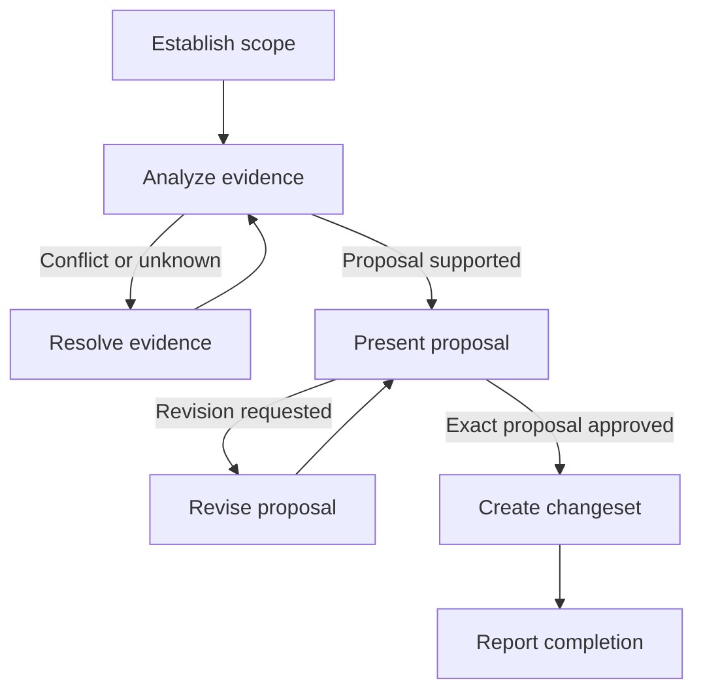

# Author Changeset

## Workflow

Announce `Step <node path> - <label path>` before each node and on returns/loops. After decisions, name the branch.



### A. Establish scope

Read `baseBranch` from `.changeset/config.json`, package names from manifests, working-tree diffs, and branch commits not on base. Use relevant chat when available; say if unavailable.

**Complete when:** Scope, packages, base, evidence, and available chat are clear.

### B. Analyze evidence

Inspect diffs and history, not subjects alone; use chat, docs, and prior changesets for intent and conventions.

Recommend per package: patch for compatible fixes, minor for compatible features, major for breaking changes. State rationale. If package or impact is unclear, evidence conflicts, or no releasable change exists, do not guess; ask or report no changeset.

**Complete when:** Proposals are evidence-based and conflicts resolved.

### C. Resolve evidence

State the conflict or missing fact, ask one focused question, and wait. Then return to B.

**Complete when:** The issue or no-change decision is resolved.

### D. Present proposal

Show each package, bump, rationale, and exact text; separate entries when values differ. Ask approval of the exact proposal and wait. Initial requests, delegated judgment, silence, urgency, others' approval, and CLI flags are not approval. Revisions go to E.

**Complete when:** The proposal is approved or revision requested.

### E. Revise proposal

Apply the revision. Return to B if package or impact changes; otherwise return to D. Do not run the CLI here.

**Complete when:** The revised proposal is presented.

### F. Create changeset

Only after approval, run one `changeset add` command for each approved entry:

```sh
pnpm exec changeset add --<bump> <package> [--<bump> <package> ...] --message '<approved text>'
```

For an entry with different bumps, include one bump option per package. For example:

```sh
pnpm exec changeset add --minor @spindle/core --patch @spindle/cli --message 'Improve parsing and fix CLI output.'
```

Preserve the approved message exactly, including Markdown punctuation. In a POSIX shell, represent an apostrophe inside a single-quoted message as `'\''`. Run separate commands for separate approved entries. An entry does not need to cover every changed package or change. Changesets may commit the entry when configured; do not make a separate commit. If the CLI requires different values, stop before writing and return to D. Do not run versioning or publishing commands.

**Complete when:** The command exits with code 0. If it exits with an error, report the error and stop.

### H. Report completion

Report that the command succeeded and include its output, such as the created file path. Do not inspect or compare the generated entry.

**Complete when:** The successful command and its reported result are delivered.
