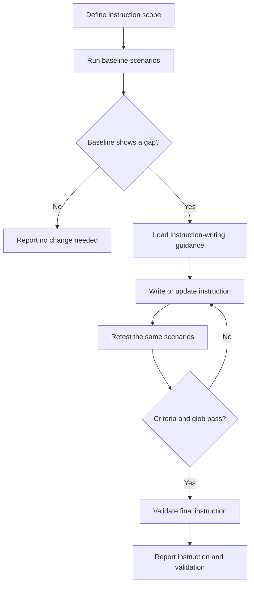

# Author Instruction

Create or update a project instruction in `.github/instructions/**/*.instructions.md`.

## Clarify the request

Before your first question, read and consider only the `private-ref-writing-for-agents` and `public-ref-asd-ste100` skills. Load and follow the `grill` skill to clarify the user's request. Ask one question per turn and wait for the answer. Do not load other skills before the user confirms the shared understanding.

Do not announce workflow steps or load other skills during clarification. Start the workflow only after the user confirms the shared understanding.

## Workflow

After confirmation, your first action is to announce `Step A - Define instruction scope`. Do not read files, load skills, or take another action before this announcement. Before acting on each node, announce `Step <node ID> - <node label>`. Announce resumed steps and loop re-entries. After each decision, state its result and selected branch before entering the next node. Select the mode from the calling context before entering A.

### A. Define instruction scope

Identify the users, purpose, requirements, and workspace files governed by the instruction. Define the intended path and the narrowest `applyTo` glob that covers the intended files without matching out-of-scope files. Ask the user about missing requirements that change scope or behavior.

**Complete when:** The instruction's purpose and intended files are explicit, and the proposed glob can be checked against concrete in-scope files and near misses.

### B. Run baseline scenarios

Load the `private-testing-agent-guidance` skill. Define frozen scenarios and observable criteria for the requested instruction. For an update, test the current instruction. For a new instruction, test the task without the proposed instruction. Run core and expanded baselines. Record observed actions and outputs before drafting.

**Complete when:** Testing guidance is loaded, and every meaningful branch has a frozen scenario, criterion, and observed baseline result.

### C. Baseline shows a gap?

Compare each baseline result with its unchanged criterion. Select No when every criterion passes. Select Yes when at least one criterion fails.

**Complete when:** The evidence and selected branch are explicit.

### D. Load instruction-writing guidance

Load the `private-writing-instruction` skill. Apply the clarity rules from the `public-ref-asd-ste100` skill. Follow the instruction-writing guidance for scope, frontmatter, and concise actionable rules.

**Complete when:** The required writing and testing guidance is available.

### E. Write or update instruction

Write the instruction at the agreed `.github/instructions/**/*.instructions.md` path. Keep it about one coherent topic. Use a narrow `applyTo` pattern tied to the governed files. Change no unrelated files.

**Complete when:** The instruction expresses the confirmed requirements without unresolved placeholders.

### F. Retest the same scenarios

Run the frozen core scenarios and expanded tests against the revised instruction in fresh contexts. Check actual actions and output against the original criteria. Test the `applyTo` glob against concrete intended files and near misses; every intended file must match, and out-of-scope files must not.

**Complete when:** Every scenario has an observed result against its unchanged criterion, and the glob has passed its concrete match checks.

### G. Criteria and glob pass?

Select No if any behavior criterion or glob check fails; return to E and address only the observed failure. Select Yes if all criteria pass.

**Complete when:** The evidence supports the selected branch.

### H. Report no change needed

Leave the instruction unchanged. Report the scenario results and explain why they show no gap.

**Complete when:** The user has the baseline evidence and no-change result.

### I. Validate final instruction

Check the file path, YAML frontmatter, `applyTo` glob, and references. Rerun tests if a validation fix changes behavior-shaping text.

**Complete when:** Final checks pass, or each blocker and unverified requirement is explicit.

### J. Report instruction and validation

Report the instruction file changed, its scope, the checks and observed results, and any blocker or unverified requirement. Include a before/after table only when the user requests one. Do not claim runtime discovery or inclusion checks that did not run.

**Complete when:** The user has the result and validation evidence.
