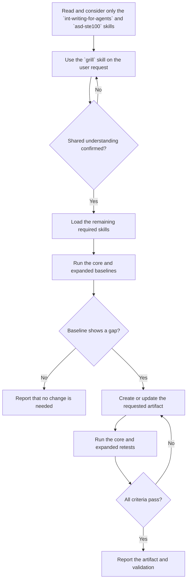

Create or update a project skill in `.github/skills/<skill-name>/SKILL.md` based on the user's requirements.

## Authoring flow

During the grill exchange, ask one question per turn and wait for the answer.
Do not load other skills or announce the current flowchart step until the user confirms shared understanding.

Before grilling, read and consider only the `int-writing-for-agents` and `asd-ste100` skills. Do not follow their workflows or load skills they reference yet.

After the user confirms shared understanding, load and follow:

- **REQUIRED:** `int-writing-skills`
- **REQUIRED:** `int-testing-agent-guidance`

Apply the clarity rules from the `asd-ste100` skill. Include a before/after table only when the user requests one. Run the core and expanded testing workflows in `int-testing-agent-guidance` for every authoring request.

Do not modify unrelated files. Report the skill changed and validation performed, including any blockers or unverified requirements.
