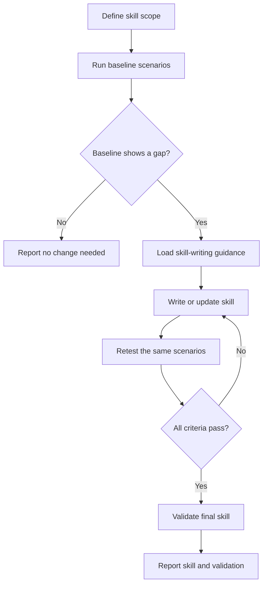

# Author Skill

Create or update a project skill in `.github/skills/<skill-name>/SKILL.md`.

## Clarify the request

Before your first question, read and consider only the `private-ref-writing-for-agents` and `public-ref-asd-ste100` skills. Load and follow the `grill` skill to clarify the user's request. Ask one question per turn and wait for the answer. Do not load other skills before the user confirms the shared understanding.

Do not announce workflow steps or load other skills during clarification. Start the workflow only after the user confirms the shared understanding.

## Workflow

After confirmation, your first action is to announce `Step A - Define skill scope`. Do not read files, load skills, or take another action before this announcement. Before acting on each node, announce `Step <node ID> - <node label>`. Announce resumed steps and loop re-entries. After each decision, state its result and selected branch before entering the next node. Select the mode from the calling context before entering A.

### A. Define skill scope

Decide whether the request is a reusable skill, a project convention, a one-off task, or a tooling rule. For a skill, identify its users, purpose, primary type, invocation needs, required inputs, actions, and completion result. Ask the user about missing requirements that change scope or behavior.

**Complete when:** The capability is reusable, its primary type and invocation needs are explicit, and its behavior requirements are resolved or reported as blocked.

### B. Run baseline scenarios

Load the `private-testing-agent-guidance` skill. Define frozen scenarios and observable criteria for the requested capability. For an update, test the current skill. For a new skill, test the task without the proposed skill. Run core and expanded baselines. Record observed actions and outputs before drafting.

**Complete when:** Testing guidance is loaded, and every meaningful branch has a frozen scenario, criterion, and observed baseline result.

### C. Baseline shows a gap?

Compare each baseline result with its unchanged criterion. Select No when every criterion passes. Select Yes when at least one criterion fails.

**Complete when:** The evidence and selected branch are explicit.

### D. Load skill-writing guidance

Load the `private-writing-skills` skill. Apply the clarity rules from the `public-ref-asd-ste100` skill. Follow the skill-writing guidance for structure, frontmatter, visibility, invocation, and workflow.

**Complete when:** The required writing and testing guidance is available.

### E. Write or update skill

Write `.github/skills/<skill-name>/SKILL.md` for the confirmed capability. Keep common-path steps inline and disclose branch-specific guidance only when its condition occurs. Use references and assets only when they serve a distinct purpose. Change no unrelated files.

**Complete when:** The skill has the required structure, every retained section has a distinct purpose, and no placeholder remains.

### F. Retest the same scenarios

Run the frozen core scenarios and expanded tests against the revised skill in fresh contexts. Check actual actions and output against the original criteria. Do not treat a statement of understanding as evidence.

**Complete when:** Every scenario has an observed result against its unchanged criterion.

### G. All criteria pass?

Select No if any criterion fails; return to E and address only the observed failure. Select Yes if all criteria pass.

**Complete when:** The evidence supports the selected branch.

### H. Report no change needed

Leave the skill unchanged. Report the scenario results and explain why they show no gap.

**Complete when:** The user has the baseline evidence and no-change result.

### I. Validate final skill

Check frontmatter, invocation fields, relative links, references, assets, and the required version. Rerun tests if a validation fix changes behavior-shaping text.

**Complete when:** Final checks pass, or each blocker and unverified requirement is explicit.

### J. Report skill and validation

Report the skill changed, its purpose, the checks and observed results, and any blocker or unverified requirement. Include a before/after table only when the user requests one. Do not claim runtime discovery or invocation checks that did not run.

**Complete when:** The user has the result and validation evidence.
