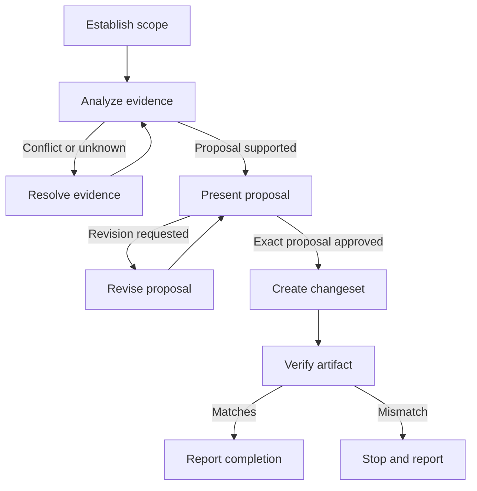

# Changeset Authoring

## Workflow

Announce `Step <node path> - <label path>` before each node and on returns/loops. After decisions, name the branch.

### A. Establish scope

Read `baseBranch` from `.changeset/config.json`, package names from manifests, working-tree diffs, and branch commits not on base. Use relevant chat when available; say if unavailable.

**Complete when:** Scope, packages, base, evidence, and available chat are clear.

### B. Analyze evidence

Inspect diffs and history, not subjects alone; use chat, docs, and prior changesets for intent and conventions. Use `pnpm exec changeset add --help` for syntax.

Recommend per package: patch for compatible fixes, minor for compatible features, major for breaking changes. State rationale. If package or impact is unclear, evidence conflicts, or no releasable change exists, do not guess; ask or report no changeset.

**Complete when:** Proposals are evidence-based and conflicts resolved.

### C. Resolve evidence

State the conflict or missing fact, ask one focused question, and wait. Then return to B.

**Complete when:** The issue or no-change decision is resolved.

### D. Present proposal

Show each package, bump, rationale, and exact text; separate entries when values differ. Ask approval of the exact proposal and wait. Initial requests, delegated judgment, silence, urgency, others' approval, and CLI flags are not approval. Revisions go to E.

**Complete when:** The proposal is approved or revision requested.

### E. Revise proposal

Apply the revision. Return to B if package or impact changes; otherwise return to D. Do not run the CLI here.

**Complete when:** The revised proposal is presented.

### F. Create changeset

Only after approval, use the installed help for `changeset add` syntax. Enter only approved packages, bumps, and text. With flags, pass each package with its bump option. Preserve every message character, including Markdown punctuation, and quote it so the shell passes it unchanged. If the CLI requires different values, stop before writing and return to D. Do not run versioning or publishing commands.

**Complete when:** The approved entry is created.

### G. Verify artifact

Compare the created entry with the approved packages, bumps, and text. If any value differs, do not overwrite it or claim success; go to I.

**Complete when:** The entry matches or a mismatch is identified.

### H. Report completion

Report the verified path and contents.

**Complete when:** The path and verified result are delivered.

### I. Stop and report

Describe the mismatch, ask how to resolve it, and wait before making further changes.

**Complete when:** The mismatch and user decision are explicit.
