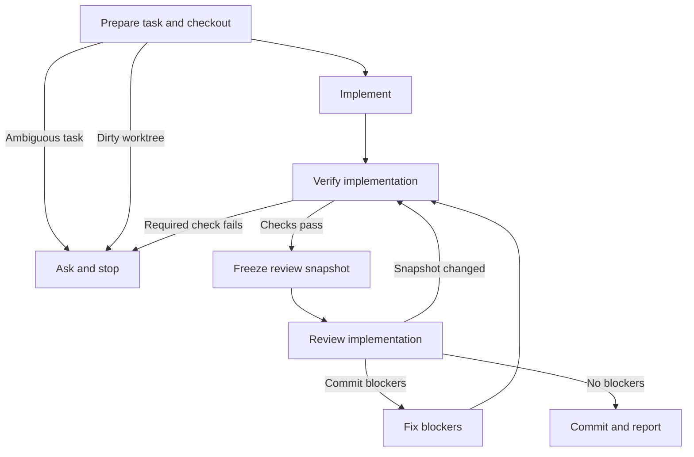

# Implement

Implement the user's task or supplied issue/spec, verify it, and obtain a clean code review before committing.

## Workflow

Announce `Step <node ID> - <node label>` before acting on each node, including resumed steps and loop re-entries. After each decision, state its result and selected branch.

### A. Prepare task and checkout

If the user supplies a ticket reference, read it and state its title; ask if the reference is ambiguous. Preserve the original task description and any supplied issue/spec paths for the review. Before changing files, check `git status --short`. If staged, unstaged, or untracked changes already exist, preserve them, ask the user to clean or separately preserve them, and stop. Once clean, record `git rev-parse HEAD` as the implementation base before making changes.

**Complete when:** the task and requirements context are clear, the worktree is clean, and the starting base revision is recorded; otherwise stop without editing.

### B. Implement

Implement the requested work. Call `int-test-driven-development` at pre-agreed seams where appropriate. Keep changes within the task scope.

**Complete when:** the requested implementation is complete and its changed files are known, selecting C.

### C. Verify implementation

Run applicable project completion checks through the repository's Just recipes. Call `int-verification-before-completion` for evidence-backed claims. If a required check fails or is unavailable, report the blocker and do not proceed to commit.

**Complete when:** required checks pass and their results identify the snapshot they cover, selecting D; otherwise stop with the failing or unavailable checks.

### D. Freeze review snapshot

Stop implementation edits while review runs. Prepare review inputs using the existing [review-input contract](../int-subagent-driven-dev/references/review-inputs.md): absolute workspace, recorded starting base, current head, exact snapshot identity, complete changed-file inventory and diff including staged, unstaged, and untracked changes, original task description and known issue/spec pointers, and verification evidence for the same snapshot. Use `just tool::git-detailed-diff` to capture staged, unstaged, and untracked content. Keep the implementation frozen until review returns.

**Complete when:** the caller can supply a complete, internally consistent review snapshot and matching verification evidence; otherwise stop and identify the gap.

### E. Review implementation

Load and follow `int-code-review`. Supply the frozen review inputs and task requirements context. If the review reports a snapshot mismatch or incomplete evidence, do not commit; refresh the snapshot and required checks before reviewing again.

**Complete when:** review findings identify the current snapshot and explicitly classify each finding as blocking or non-blocking, selecting F for blockers or G when there are none.

### F. Fix blockers

Fix every substantiated requirement defect and confirmed mandatory repository-rule violation marked as a commit blocker. Keep advisory smells and optional recommendations separate; do not treat them as blockers. After changing code, rerun affected required checks, prepare a new frozen snapshot, and rerun `int-code-review`. Do not commit while any blocker remains.

**Complete when:** the updated snapshot has passing required checks and a current review with no commit blockers, selecting G; unresolved or unverified blockers remain here.

### G. Commit and report

Commit only the reviewed task changes after confirming the reviewed snapshot is still current and no commit blockers remain. Report the commit and verification and review outcomes.

**Complete when:** the reviewed changes are committed and the caller receives the commit and evidence summary.

### X. Ask and stop

Request the missing task clarification, clean-worktree action, or verification correction. Preserve existing work and do not commit.

**Complete when:** the blocker and required next action are explicit; stop.
