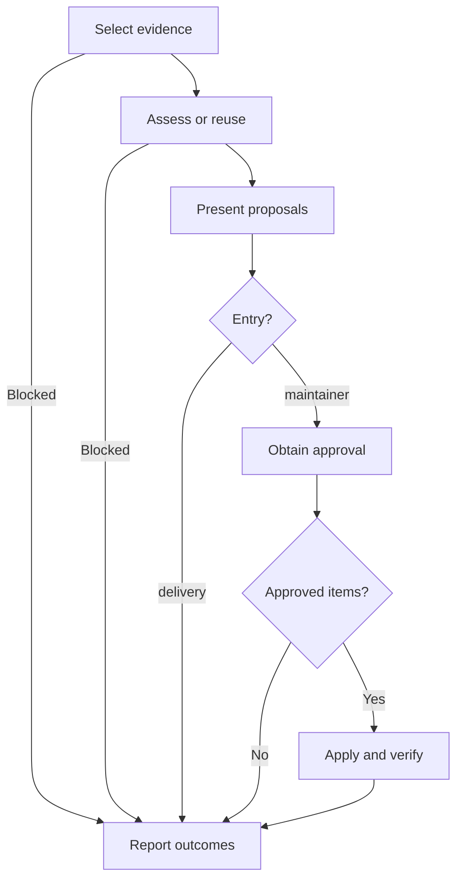

# Retrospective

Capture evidence-backed improvements to the agent environment and domain model. The controller coordinates; a fresh, read-only reader assesses.

## Mode selection

Select the mode from the explicit purpose in the calling context, not from flags or unrelated conversational mentions.

- `delivery`: a delivery caller invokes this after final verification, once for the full spec or for a standalone ticket, and supplies verified delivery evidence pointers. This mode records proposals and applies nothing, even when asked to apply them.
- `maintainer`: the maintainer retrospective caller requests an assessment of the current or selected session and may supply a proposal-report pointer. With no session selection, use the current session. This mode obtains item-level approval before applying changes.

If the calling context does not clearly establish exactly one mode, explain that the retrospective mode is unclear and ask for the purpose or caller context before starting the workflow. Delivery still requires its evidence pointers.

## Workflow

Before acting on each node, announce `Step <node ID> - <node label>`. Announce resumed steps and loop re-entries. After each decision, state its result and selected branch before entering the next node. Select the mode from the calling context before entering A.

### A. Select evidence

For delivery, list the spec or brief, every ticket and its `## Comments` log, starting and final revisions, and final review. For maintainer, locate primary sources for the selected session, including relevant local session logs. Start from a supplied report or the work's existing dated `retrospective.md` when available. Include applicable glossary, ADR and instruction pointers.

**Complete when:** the selected entry and accessible sources are explicit, selecting B; unavailable required sources select H with a blocker. Session sources need not contain delivery artifacts; state genuine evidence gaps.

### B. Assess or reuse

Read the [assessment reference](./references/assessment.md). Reuse an existing report only after checking its cited evidence still covers the selected work and its proposals satisfy that reference's [report contract](./references/assessment.md#report-contract); reuse requires no dispatch. Otherwise fill every slot in the [assignment template](./assets/retrospective-prompt.md) for one fresh read-only subagent that did not participate in the assessed work. Supply the assessment reference's resolved absolute path as a required first read, plus evidence pointers validated against its entry-specific requirements. The reader returns the report; the controller owns persistence and approval.

**Complete when:** an evidence-current, contract-compliant report is available, selecting C; required reader skills were confirmed for fresh assessment. Missing prerequisites select H with a blocker, not a completed assessment.

### C. Present proposals

Rank by impact and show stable IDs with their evidence and verification criteria. Delivery writes `.scratch/YYYY-MM-DD-<feature-slug>/retrospective.md` in the work's existing dated directory. Maintainer presents the report; reuse that destination when one exists, otherwise present in chat.

**Complete when:** proposals (or "None") and assessment limitations are visible, selecting D; delivery's report exists and no environment or domain files have changed.

### D. Entry?

Evaluate the mode selected from the calling context.

**Complete when:** `delivery` selects its branch to H; `maintainer` selects its branch to E. Delivery never enters approval or application.

### E. Obtain approval

Ask for approval by proposal ID, recording approved, declined and pending items. A blanket "just apply it" is a request to review: list proposals for item-level approval and wait in E. On the response, resume E. Resolve approved domain proposals with the maintainer through `int-domain-modeling`; unresolved decisions remain pending.

**Complete when:** the item-level response is recorded and approved IDs, targets and any domain decisions are explicit, selecting F. An empty proposal list proceeds to F without an approval request.

### F. Approved items?

Check for individually approved items whose targets and required domain decisions are settled.

**Complete when:** at least one actionable approved item selects Yes and G; none selects No and H. Unresolved items remain pending.

### G. Apply and verify

Change only approved targets. Load `int-writing-for-agents` for agent-facing writing, `int-writing-instruction` for workspace instructions, `int-writing-skills` for skills, and `int-testing-agent-guidance` for behavior-shaping guidance validation. Instruction briefs are not validated files. Use existing repository tooling for checks and test each proposal against its recorded criterion.

**Complete when:** each actionable approved item has an applied change and passing evidence, or an explicit blocker/unverified result, selecting H.

### H. Report outcomes

Delivery hands the report path and pending proposals to the maintainer and stops without applying changes. Maintainer reports applied, declined and pending IDs, verification evidence and limitations; update an existing proposal report without overwriting its evidence. A blocked assessment reports missing prerequisites instead of claiming completion. Commit or publish only when requested.

**Complete when:** the caller has the report or explicit blocker, proposal statuses and applicable verification results; stop.
