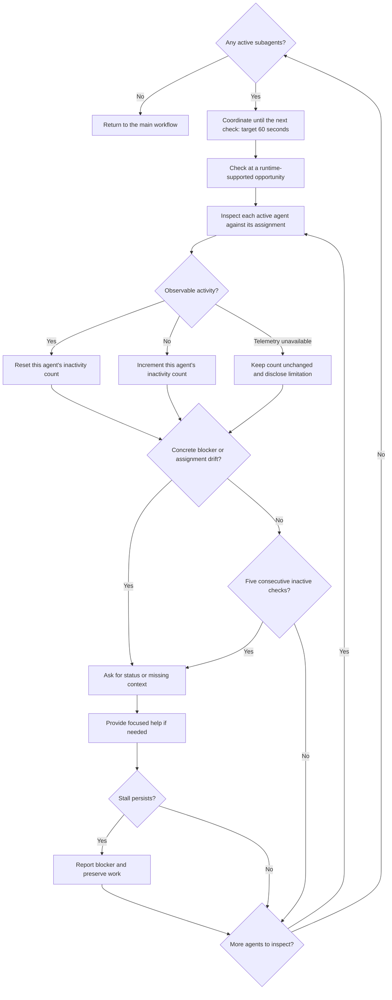

# Active subagent monitoring

The controller follows this policy for all active subagents, particularly
implementers, across all roles and both ticket and aggregate work.

## Monitoring loop

The cadence is best-effort and subject to runtime restrictions, not a busy-wait
loop. Ongoing command progress counts as activity. Reporting a blocker does not
automatically cancel, restart, or reassign an agent.

## Check activity and coordinate

Aim to check all active subagents every 60 seconds on a best-effort basis, not
as a strict wall-clock mandate. Blocking calls may delay a check; check promptly
after they return and prefer nonblocking coordination when supported. Do not
interrupt productive work just to meet the timer.

Use runtime-supported status or activity access to inspect observable activity
and progress against each assignment: tool calls, command progress, file changes,
or progress updates. Do not send routine messages or claim access to private
reasoning or unavailable telemetry. Do not invent tools, busy-loop, or override
host restrictions on polling or waiting. If the runtime prevents periodic
observation, follow its restrictions, inspect at supported opportunities, and
disclose the limitation; do not imply that 60-second checks are guaranteed.

Between checks, dispatch ready tickets within capacity, process completed
reports, resolve dependencies, and prepare reviews. Do not duplicate active
agents' work or review unfinished edits as completed submissions.

## Intervene when needed

Intervene on a reported blocker, repeated failures with no changed approach,
an unanswered request for context, or assignment drift.

Track consecutive checks with no observable activity per agent. Five such
checks (roughly five minutes at the target cadence) warrant a brief status
inquiry for possibly stuck thinking; no visible progress alone is not proof
of a stall. Distinguish ongoing long tests from inactivity. Reset the count
when activity is observed; missing telemetry does not count as observed
inactivity.

First ask for status or missing context, then provide focused help when needed.
Respect reported `NEEDS_CONTEXT` and workflow-recorded assignments. If a stall
persists, report the blocker and preserve work; do not automatically cancel,
restart, or reassign the agent.
