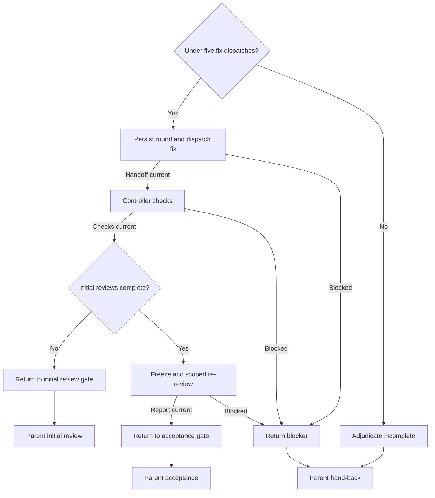

# Ticket corrective rounds

Parent: G - Corrective branch. Enter when reviews leave findings open or controller checks require a non-mechanical fix. Restore the persisted counter, prior findings, attempts, and rulings before acting.

Q, T, and U denote parent return points, not child work: Q returns to parent Q, T to parent E, and U to parent F. Before returning, announce `Step G - Corrective branch` as resumed.

## G.A. Under five fix dispatches?

Cap corrective implementation dispatches at five per ticket across all reviews and check failures. Resume preserves the counter. A sixth dispatch is unavailable.

**Complete when:** persisted count below five selects G.B; exhausted budget selects G.Z.

## G.B. Persist round and dispatch fix

Persist the next round before dispatching `sdd-implementer` with the [implementer template](../assets/implementer-prompt.md), corrective mode, assigned finding IDs, prior attempts, and controller rulings. Read [implementer corrections](implementer-corrections.md) for the branch inputs. Resolve round-specific destinations by adding `--round <R>` to the parent report-destination command. Serialize edits and retain report history.

**Complete when:** the fix report and required passing focused-test evidence identify the fixed snapshot, selecting G.C; missing/failing required evidence selects G.X.

## G.C. Controller checks

Perform the parent D mechanical gate after the fix; rerun invalidated or explicitly required checks.

**Complete when:** required checks pass and cover the fixed snapshot, selecting G.P; otherwise G.X records the blocker without consuming an unrecorded round.

## G.P. Initial reviews complete?

Check the ledger for the complete initial review batch.

**Complete when:** completed initial reviews select G.D; pending initial reviews select G.R. Scoped re-review cannot replace missing initial coverage.

## G.D. Freeze and scoped re-review

Freeze the fixed snapshot. Read [review inputs](review-inputs.md) and populate the [re-review template](../assets/re-review-prompt.md) with the fix-only change, exact previous and fixed identities, assigned findings, prior verdicts, rulings, and current covering-test evidence. Dispatch `sdd-re-review` and wait for its report.

**Complete when:** the report covers every assigned finding and fix-induced regressions, selecting G.E; failed/unavailable review selects G.X. Preserve unaffected review evidence.

## G.E. Return to acceptance gate

Update verdicts and controller rulings from the scoped report.

**Complete when:** current verdicts/rulings are recorded; resume parent G and return to parent F.

## G.R. Return to initial review gate

Record the checked fixed snapshot and missing initial coverage.

**Complete when:** the ledger identifies all pending initial reviewers; resume parent G and return to parent E.

## G.Z. Adjudicate incomplete

Rule on residual findings and persist the exhausted count and incomplete state. Preserve working changes and reports; do not reset the budget.

**Complete when:** every residual blocker and the exhausted count are recorded; resume parent G and return to parent Q.

## G.X. Return blocker

Record the unavailable handoff, check, or review, preserving counters and evidence.

**Complete when:** the blocker and current state are explicit; resume parent G and return to parent Q.
