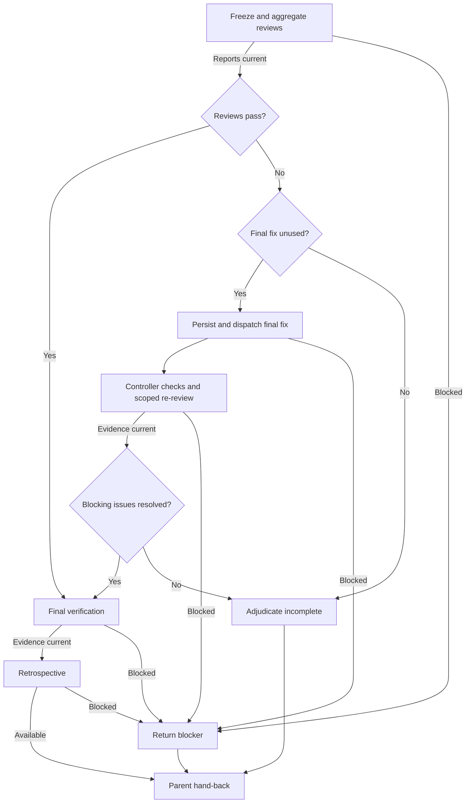

# Standalone full-spec delivery

Parent: M - Full-spec branch. Enter only when all tickets in standalone full-spec scope are integrated and no eligible ticket remains.

Q denotes the parent Q return point, not child work. Before returning, announce `Step M - Full-spec branch` as resumed.

## M.A. Freeze and aggregate reviews

Read [review inputs](review-inputs.md). Freeze the whole delivery, including cross-ticket integration and parked findings. Dispatch aggregate `sdd-code-reviewer` and `sdd-code-slop-reviewer` **in parallel** with matching templates, the same snapshot/evidence, and separate report destinations. Mark unavailable same-batch reports `NONE - parallel review pending`.

Wait for both reports before reconciling findings and rulings. Keep implementation frozen; failed/unavailable reviews block the gate.

**Complete when:** both reports cover the delivery and findings are ruled, selecting M.B. Failed/unavailable reviews select M.X after both dispatched reviewers return.

## M.B. Reviews pass?

Evaluate both required aggregate verdicts and controller rulings.

**Complete when:** passing reviews with no unresolved blocker select M.C; blocking findings select M.D.

## M.D. Final fix unused?

Restore the persisted final-fix usage independently of ticket budgets.

**Complete when:** unused final-fix budget selects M.E; exhausted budget selects M.Z.

## M.E. Persist and dispatch final fix

Persist usage before the one permitted final corrective implementation dispatch. Use `sdd-implementer`, the [implementer template](../assets/implementer-prompt.md), and [corrective inputs](implementer-corrections.md). Wait for the implementation handoff.

**Complete when:** the handoff identifies the fixed snapshot and required passing covering tests, selecting M.F; missing/failing required evidence selects M.X.

## M.F. Controller checks and scoped re-review

Perform parent D controller checks. Once they pass, freeze the fixed snapshot and dispatch `sdd-re-review` with the [re-review template](../assets/re-review-prompt.md). Supply fix-only changes, findings/rulings, prior review state, and fresh covering-test evidence. Preserve unaffected aggregate evidence; request expanded review for broader contract changes.

**Complete when:** required checks and scoped review cover the fixed snapshot, selecting M.G; failed/unavailable evidence selects M.X.

## M.G. Blocking issues resolved?

Evaluate all blocking findings and required Spec/Quality verdicts against the fixed snapshot.

**Complete when:** all blockers resolved with sufficient passing review evidence select M.C; remaining blockers select M.Z. No second final-fix dispatch.

## M.C. Final verification

Confirm all required evidence covers the final delivered snapshot, rerunning only invalidated or explicitly required checks.

**Complete when:** required evidence is current and passing, selecting M.H; failed/unavailable required checks select M.X.

## M.H. Retrospective

Load and follow the `int-retrospective` skill once for the full spec.

**Complete when:** the retrospective and final evidence are available; resume parent M and return to parent Q. Unavailable required retrospective output selects M.X.

## M.Z. Adjudicate incomplete

Persist residual rulings and incomplete status; preserve checkout, reports, and counters.

**Complete when:** all residual blockers and the used budget are explicit; resume parent M and return to parent Q.

## M.X. Return blocker

Record the failed/unavailable handoff, review, or check and current evidence.

**Complete when:** the blocker and preserved state are explicit; resume parent M and return to parent Q.
