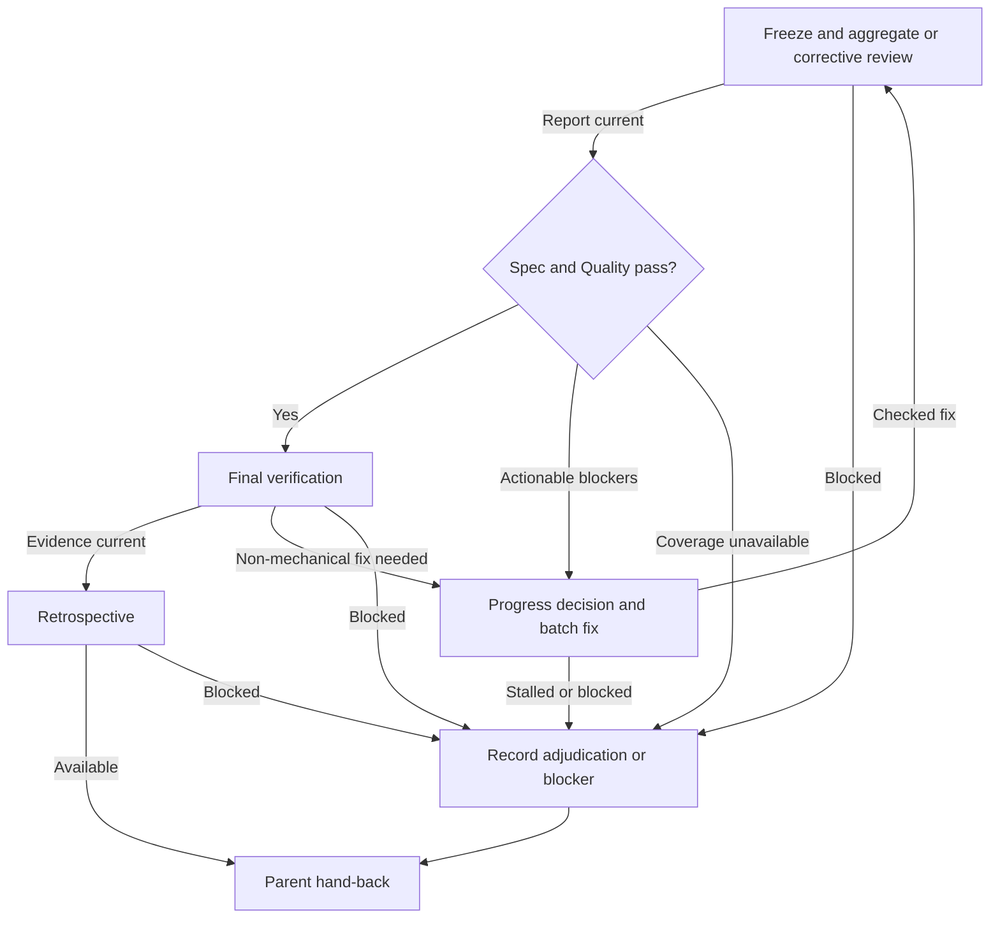

# Standalone full-spec delivery

Parent: M - Full-spec branch. Enter only when all tickets in standalone full-spec scope are integrated and no eligible ticket remains. Restore aggregate findings, review coverage, and delivery correction history independently of ticket attempts.

Child IDs are local to this diagram: announce `Step M.<ID> - Full-spec branch / <label>` before acting. Q denotes parent Q, not child work. Before returning, announce `Step M - Full-spec branch` as resumed and state the exit without restarting child work.

## A. Freeze and aggregate or corrective review

Read [review inputs](review-inputs.md) and [aggregate scope](aggregate-review.md). Freeze the whole delivery, including cross-ticket behavior and parked findings. Assign `final-review.md` for the first aggregate review and `final-round-<R>-review.md` for delivery corrections; preserve earlier evidence.

Dispatch one `sdd-reviewer` with the [reviewer template](../assets/reviewer-prompt.md) in `AGGREGATE` mode for initial whole-spec coverage. After a narrow checked fix, use `CORRECTIVE` mode with delivery scope, fix-only changes, prior/fixed identities, selected findings, prior aggregate verdicts/rulings, and fresh checks. Broader contract changes require expanded affected aggregate coverage. A scoped report cannot replace missing aggregate review.

**Complete when:** the report covers the assigned scope and findings are reconciled, selecting M.B; missing context or unavailable review selects M.X. Keep implementation frozen until the reviewer returns.

## B. Spec and Quality pass?

Evaluate current aggregate verdicts, corrected findings, unaffected coverage, and controller rulings.

**Complete when:** Spec and Quality pass with no unresolved blocker selects M.D; actionable blockers select M.C. Missing required coverage selects M.X, not acceptance or an unfounded fix.

## C. Progress decision and batch fix

Apply the [continuation decision](corrective-rounds.md#continuation-decision) to delivery history. There is no single-final-fix allowance: continue only with recorded progress or an explicit adjudicated revised plan. Persist the next delivery attempt before dispatching `sdd-implementer` with batched findings and [corrective inputs](implementer-corrections.md). Use the [implementer template](../assets/implementer-prompt.md), delivery scope, and append-only final implementation evidence.

Wait for the focused-test handoff, then perform parent D controller checks on the fixed snapshot, reusing unaffected passing checks. Final fixes must be integrated under the established permissions before final hand-back; do not silently alter caller ownership or commit permissions.

**Complete when:** current required checks cover the fix, selecting M.A for one scoped review; stalled progress, requirements disagreement, or failed/unavailable evidence selects M.X. Preserve the attempt and original aggregate coverage.

## D. Final verification

Confirm required evidence covers the final delivered snapshot, rerunning only invalidated or explicitly scheduled checks. Apply the existing [integration permissions](integration.md) to accepted final changes; record committed/delivered identity and confirm coverage survives integration.

**Complete when:** final changes are safely integrated and required evidence is current and passing, selecting M.E; a new non-mechanical failure selects M.C; unsafe integration or unavailable evidence selects M.X.

## E. Retrospective

Load and follow the `int-retrospective` skill once for the full spec after final verification. Identify a `delivery` retrospective and supply verified evidence pointers. Preserve the current required-retrospective convention; do not add creation flags or command policy.

**Complete when:** retrospective and final evidence are available; resume parent M and return to Q. Unavailable required retrospective output selects M.X.

## X. Record adjudication or blocker

Persist residual findings/rulings, progress assessment, and incomplete status while preserving checkout, reports, attempts, and gate. Use current triage for requirements decisions; do not weaken criteria to terminate corrections.

**Complete when:** the decision needed or failed/unavailable evidence is explicit; resume parent M and return to Q.
