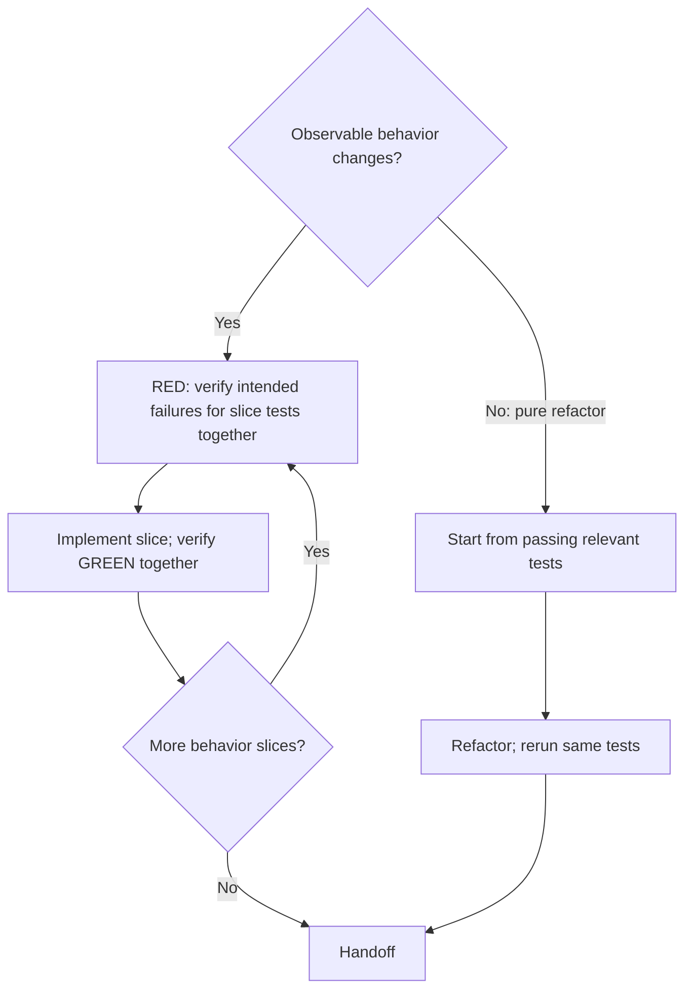

# Test-Driven Development

Use verified RED → GREEN cycles for behavior changes and bug fixes; use existing passing tests for pure refactors.

Read the relevant glossary and ADRs so test vocabulary and boundaries match the domain.

## Agree the seam

A **seam** is the public boundary where a test observes behavior. Reuse user-confirmed seams recorded in the assignment when unchanged. For missing or changed seams, propose the boundary and what it catches and misses; obtain user confirmation before writing tests there. If the expected behavior is unclear, clarify it first.

**Ready when:** the behavior is clear and the seam has applicable confirmation.

## Choose the path

### Behavior change: one slice at a time

A **behavior slice** is one cohesive observable outcome at the agreed seam, including its closely related cases and edge conditions. Group criteria that describe that outcome; acceptance bullets, assertions, and individual test cases do not each require a separate cycle. Keep independent outcomes in separate slices, even when they share files.

1. **Write focused tests for the slice together.** Cover its relevant cases before changing implementation; one test is sufficient when it covers the slice.
2. **Verify RED together.** Run the slice tests in one focused invocation that executes every selected case. Confirm each test requiring changed behavior fails for its intended behavioral reason; existing passing coverage may remain green. Repair setup errors and investigate unexpected passes before proceeding; never delete working code to manufacture failure.
3. **Implement the slice.** Make the coherent set of changes needed to satisfy its tests before running GREEN, rather than testing after each edit.
4. **Verify GREEN together.** Rerun the slice tests together, including relevant existing regression coverage. Correct failures and rerun affected tests before the next slice.

Use one RED and one GREEN invocation per slice when they provide the required evidence; additional runs serve failure diagnosis or changed coverage, not individual assertions or edits. A ticket may use a single cycle when it is one cohesive slice.

**Complete when:** each requested behavior has coverage and relevant tests pass on the final implementation. Work in vertical slices rather than batching independent ticket behaviors into one test-writing and implementation phase.

### Pure refactor: preserve behavior

Start from passing relevant tests, make the structural change, then rerun those same tests. No new test or RED phase is required. Preserve behavioral assertions; fix regressions rather than weakening them. Observable behavior changes take the RED → GREEN path.

Keep small necessary local refactors after GREEN; substantial cleanup requires a review finding or explicit refactoring ticket.

**Complete when:** relevant tests pass again and the diff preserves tested behavior.

## Test quality

- Assert public behavior, not private methods or internal collaborator calls.
- Derive expected values independently from the spec, a known-good literal, or a worked example, not the production algorithm.
- Keep tests meaningful through behavior-preserving structural changes.

See [tests.md](tests.md) for examples and [mocking.md](mocking.md) when choosing mocks.

## Ticket-completion checks

Hand off commands, results, the tested snapshot, and unrun checks. For dispatched tickets, the controller owns the [mechanical gate](../int-subagent-driven-dev/SKILL.md#controller-flow). Without a controller, run applicable project completion checks yourself. Early mechanical checks require a concrete diagnostic need or an explicitly scheduled gate; approved commands alone do not schedule per-edit checks. Required failures or unavailable checks block completion.
