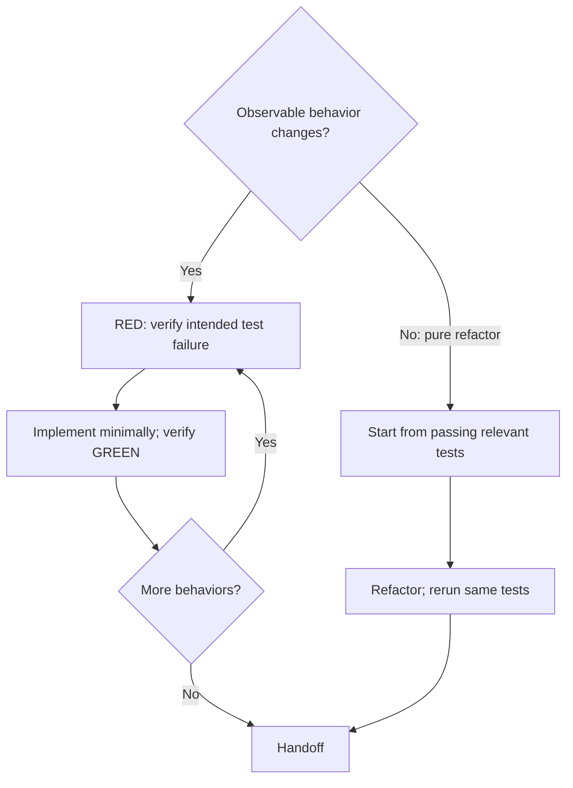

# Test-Driven Development

Use verified RED → GREEN cycles for behavior changes and bug fixes; use existing passing tests for pure refactors.

Read the relevant glossary and ADRs so test vocabulary and boundaries match the domain.

## Agree the seam

A **seam** is the public boundary where a test observes behavior. Reuse user-confirmed seams recorded in the assignment when unchanged. For missing or changed seams, propose the boundary and what it catches and misses; obtain user confirmation before writing tests there. If the expected behavior is unclear, clarify it first.

**Ready when:** the behavior is clear and the seam has applicable confirmation.

## Choose the path

### Behavior change: one slice at a time

1. **Write one focused test** for one behavior at the agreed seam.
2. **Verify RED.** Run it and confirm an intended behavioral failure. Repair setup errors before evaluating RED. If it passes, investigate existing behavior or an insensitive test; never delete working code to manufacture failure.
3. **Implement minimally.** Change only what satisfies that behavior.
4. **Verify GREEN.** Rerun the focused test; correct failures before the next slice.

**Complete when:** each requested behavior has coverage and relevant tests pass on the final implementation. Write tests and implementation in vertical slices, not all ticket tests followed by all code.

### Pure refactor: preserve behavior

Start from passing relevant tests, make the structural change, then rerun those same tests. No new test or RED phase is required. Preserve behavioral assertions; fix regressions rather than weakening them. Observable behavior changes take the RED → GREEN path.

Keep small necessary local refactors after GREEN; substantial cleanup requires a review finding or explicit refactoring ticket.

**Complete when:** relevant tests pass again and the diff preserves tested behavior.

## Test quality

- Assert public behavior, not private methods or internal collaborator calls.
- Derive expected values independently from the spec, a known-good literal, or a worked example, not the production algorithm.
- Keep tests meaningful through behavior-preserving structural changes.

See [tests.md](tests.md) for examples and [mocking.md](mocking.md) when choosing mocks.

## Ticket-completion checks

Hand off commands, results, the tested snapshot, and unrun checks. For dispatched tickets, the controller owns the [mechanical gate](../int-subagent-driven-dev/SKILL.md#controller-flow). Without a controller, run applicable project completion checks yourself. Early mechanical checks require a concrete diagnostic need or an explicitly scheduled gate; approved commands alone do not schedule per-edit checks. Required failures or unavailable checks block completion.
