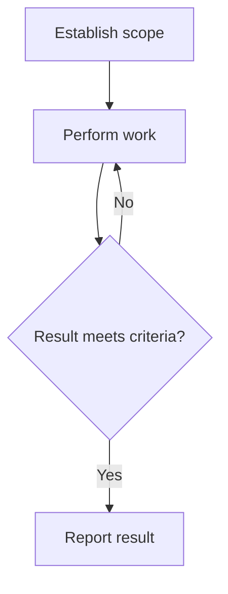
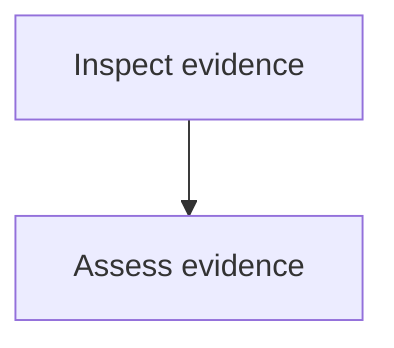

# Interactive skill template

Replace every `[placeholder text]` slot. Apply the common metadata and visibility rules in the primary authoring skill. Keep the optional flowchart only when the workflow has a non-obvious branch or loop; adapt its nodes and matching step headings together.

````markdown
---
name: [skill-name]
description: "[description appropriate to visibility and invocation]"
---

# [Skill title]

[Purpose, scope, and concrete applicability.]

## [Optional argument contract]

[If this skill accepts arguments, add argument-hint to frontmatter and define accepted inputs using the Arguments reference. Specify required and optional inputs, paired long/short flags, defaults, values, parsing boundaries, validation, and workflow effects. Validate before workflow actions. Otherwise omit this section and argument-hint.]

## Workflow

[Required guidance for all paths, if any.]

On entering each node, announce `Step <node path> - <label path>` before acting. Announce resumed steps and loop re-entries; state each decision result and selected branch. For sub-flowcharts, use dot-separated ancestor IDs and labels separated by `/`.



### A. Establish scope

[Actions that establish the required inputs and intended result.]

**Complete when:** [Checkable, exhaustive scope criterion.]

### B. Perform work

[Actions using the established scope. At a branch-specific need, require loading its supporting reference or internal skill and state the trigger.]

**Complete when:** [Checkable, exhaustive work criterion.]

### C. Result meets criteria?

[Evaluate the result against the criterion; state the result and selected branch.]

**Complete when:** [Evidence supports either returning to B or proceeding to D.]

### D. Report result

[Required output, evidence, and unresolved limitations.]

**Complete when:** [The delivered result and validation evidence meet the requested contract.]

## [Optional sub-flowchart title]

Parent: [Full parent node path and label path]. Enter when [observable condition]. Local node IDs below extend the parent path in announcements.



### [Parent path].A. Inspect evidence

[Child action.]

**Complete when:** [Checkable child criterion.]

### [Parent path].B. Assess evidence

[Child action and exit condition. On exit, announce the parent as resumed and continue at the stated return point without repeating completed child work.]

**Complete when:** [Child exit criterion and exact parent return point.]

## [Optional example]

[One adaptable example. Use pseudocode for language-neutral illustrative code; actual language only for a skill always specific to it. Commands and required formats keep their syntax.]
````

Remove unused optional sections. If the flowchart is omitted, replace node-based headings with ordered steps and omit its announcement instruction. A retained sub-flowchart requires a real parent call site and matching return point. Add repository-required version and invocation metadata before delivery.
