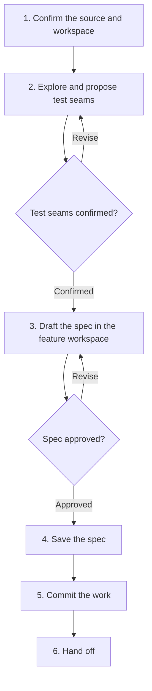

# To Spec

Write a spec that reflects the agreed requirements and the repository. Save it in an SDD feature workspace. Do not create tickets or start implementation.

Accept one optional design file path. If omitted, use the feature workspace's `design.md` when it contains a filled-in design. An unfilled design template does not count as a design. Otherwise, use the requirements already agreed in the conversation.

## Workflow

1. **Confirm the source and workspace.**
   - Reuse the existing feature workspace for this feature, if there is one. Identify its original checkout. If the feature or checkout is ambiguous, ask the user.
   - Read the selected design in full. If a supplied path is missing or unreadable, ask for a corrected path. If the design is incomplete or unapproved, ask the user to resolve it before drafting.
   - Use the approved design as the requirements source. Apply explicit user changes, but do not let older conversation override the design. If no design applies, use the agreed requirements. Do not author a design here.
   - If no feature workspace exists, derive a lowercase kebab-case slug. Run `pnpm spindle sdd create --slug "<slug>"` from the original checkout to create the workspace and its spec and design templates before drafting. Use the returned workspace path for all subsequent steps. If creation fails, report the error and check for a partially created workspace before retrying. Reuse this workspace on revisions.
   - For a new workspace, save the approved design in its `design.md` when one applies. Otherwise, leave the design template unfilled. Preserve any existing approved design.

   **Complete when:** the requirements source is clear, any selected design is approved, and the feature workspace exists in the original checkout.

2. **Explore and confirm the test seams.**
   - Explore the repo to understand the current state if it has not already been explored. Use the relevant domain glossary and ADRs.
   - Sketch the highest useful seams at which the feature should be tested. Prefer existing seams. If new seams are needed, propose them at the highest practical boundary.
   - Ask the user to confirm the proposed seams before drafting. If the user corrects them, update the seam proposal and confirm the revision.

   **Complete when:** the codebase context and user-confirmed test seams are recorded.

3. **Draft the spec.**
   - Read the feature workspace's `spec.md` and draft directly in that file, using its template as the outline. Preserve existing content outside the intended changes. Give the spec a feature title. Use these sections: Problem Statement, Solution, User Stories, Implementation Decisions, Testing Decisions, Out of Scope, and Further Notes.
   - Follow the `private-ref-ears` skill when writing observable behavior requirements and acceptance outcomes.
   - Give each important user story a concise, observable acceptance outcome or example scenario focused on user-visible behavior. Leave implementation-slice completion criteria to tickets; no fixed scenario format is required.
   - Use domain glossary terms. Do not include file paths or code snippets unless a prototype captures a decision more clearly than prose.
   - Record unresolved decisions in Further Notes. Resolve questions that block ticket planning before asking the user to approve the spec.

   **Complete when:** the draft is saved in the feature workspace's `spec.md`, the user approves it, and no open question blocks ticket planning.

4. **Save the spec.**
   - Ensure the approved spec is saved in the same workspace's `spec.md`. Read and preserve existing content outside the approved changes. Leave `design.md` unchanged. Do not create a second workspace or edit the ledger.

   **Complete when:** the approved spec is saved in the feature workspace.

5. **Commit the work.**
   - Follow the `public-ref-commit-format` skill for the commit message.
   - Review the working tree and index in the original checkout. Stage only the files created or changed by this workflow, including new feature workspace scaffolding. If unrelated changes are already staged, ask the user how to proceed without including or unstaging them.
   - Commit the work and verify that the saved spec and any new scaffolding are committed. If they are already committed, do not create an empty commit. If the commit fails, report the error and stop before handoff.

   **Complete when:** the approved spec and any new workspace scaffolding are committed, with no unrelated changes included.

6. **Hand off.**
   - Report the saved spec path. Ask the user to invoke `/sdd-to-tickets` with that path. Do not invoke it automatically.

   **Complete when:** the user has the committed spec's path for ticket planning.
