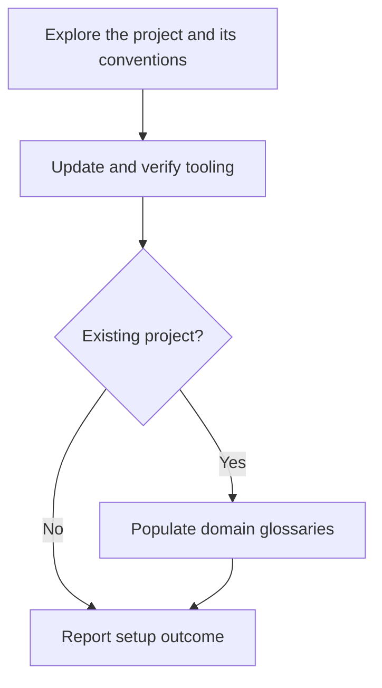

# Setup Project

Curate the commands agents should use and establish project domain documentation. Project tooling varies by repository; register only commands that have been inspected and verified. The tooling registry in `.github/spindle.json` is authoritative, and Spindle regenerates `docs/agents/tooling.md` from it. These entries document commands; Spindle does not execute them.

## Prerequisite

The user must have completed `spindle init` before running this skill. This skill
does not initialize the project. If the required project guidance or tooling
registry is missing, report the prerequisite and stop.

## Workflow

Announce `Step <node ID> - <node label>` before acting on each node, including resumed steps and loop re-entries. After each decision, state its result and selected branch before entering the target node.

### B. Explore the project and its conventions

Read `docs/agents/domain.md`, the relevant glossary and ADRs, and existing project guidance. Inspect the repository's package manifests, task runner configuration, and test/build configuration to identify candidate commands. Do not treat discovery as registration: decide which commands are useful to agents and verify their names and argument forms against their configuration.

Also inspect the source to determine whether this is an existing project: it contains substantive application or library code, not merely scaffold files or manifests. Ask the user if the evidence is ambiguous.

**Complete when:** each candidate command selected for the guide has a verified invocation and a clear documentation section, and the existing-project classification is established, selecting C.

### C. Update and verify tooling

Load and follow the `update-tooling` skill. Supply the verified candidate commands and relevant configuration paths found in B as explicit context, and request a full registry comparison for initial setup. That skill owns the proposal, explicit approval, revision loop, `spindle tool` registry mutations, and generated-guide verification; do not duplicate or bypass its approval gate.

**Complete when:** the delegated workflow has returned with the registry and guide verified, selecting G. If approval is pending, wait; if it reports failures or discrepancies, report the blocker and stop rather than claiming setup is complete.

### G. Existing project?

Use the classification established in B. Only an existing project with substantive application or library code proceeds to domain modeling. A new project containing only scaffold files or manifests skips it; do not create empty glossary files or invent a domain model.

**Complete when:** an existing project selects H or a new project selects I.

### H. Populate domain glossaries

Load and follow the `int-domain-modeling` skill. Use the existing code and user input to establish domain terms and context boundaries. Resolve ambiguities and conflicts with the user rather than treating implementation names as authoritative terminology. Preserve existing definitions unless a change is agreed, and capture resolved terms as they become clear.

For a single context, populate or refine the root `GLOSSARY.md`. For multiple contexts, populate or refine the context glossaries and `GLOSSARY-MAP.md`, including links to the glossaries and the relationships between contexts. Create the map only when multiple contexts are established. Keep glossaries free of implementation details and create files only when there are resolved terms to record.

**Complete when:** resolved domain terms are recorded in the appropriate glossaries, multiple established contexts are mapped with valid links, and any unresolved questions are explicitly identified, selecting I.

### I. Report setup outcome

Summarize tooling changes applied or declined, guide verification, and domain documentation populated or skipped with the reason. Identify unresolved questions or blockers without claiming they are complete.

**Complete when:** the user has an accurate setup outcome and any remaining actions.
