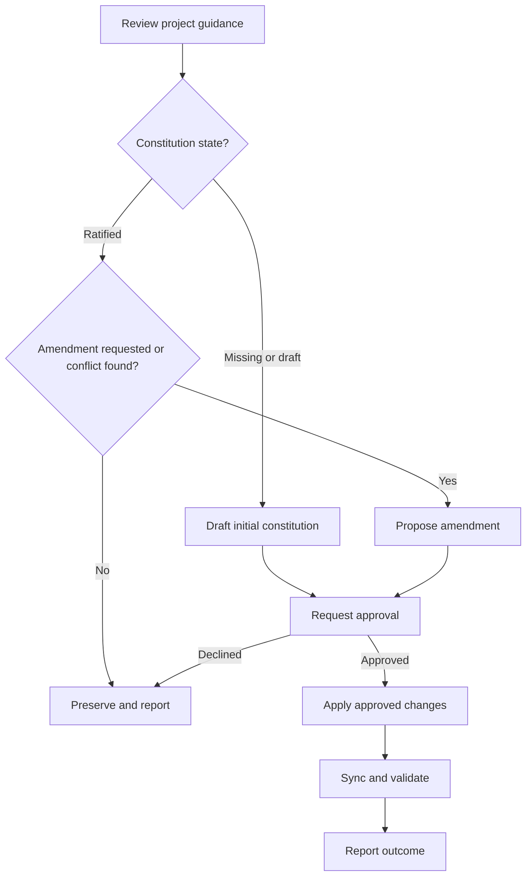

# Spindle Constitution

Use this skill to create or amend `docs/agents/constitution.md`. A ratified constitution records durable, project-specific principles and constraints. It does not replace repository-wide instructions or architectural decisions.

## Workflow

On entering each node, announce `Step <node path> - <label path>` before acting. Announce resumed steps and loop re-entries. After each decision, state its result and selected branch.

### A. Review project guidance

Inspect the constitution if it exists, relevant repository-wide instructions, project guidance, and architectural decisions before discussing candidate principles. Cite the files and clauses that inform your findings; do not respond with only a plan to review them. Use this evidence to identify existing rules, durable project-specific gaps, and conflicts. Do not duplicate rules that already have a clear authoritative home. If a proposed rule conflicts with a higher-level instruction or decision, surface the conflict and ask the user to resolve it before drafting. If you cannot access relevant files, ask the user to provide them and stop.

**Complete when:** The constitution is classified as missing, draft/unratified, or ratified, and relevant existing rules and conflicts are recorded.

### B. Constitution state?

Treat a file with the template's draft marker, comments, or unfinished placeholders as unratified. Treat a complete constitution with a ratification date as ratified. If its state is unclear, ask the user; do not overwrite it.

**Complete when:** The initial-draft or ratified-document branch is selected from observable file state.

### C. Draft initial constitution

Ask for project-specific choices that cannot be established from existing guidance. DRY, SOLID, DDD, and similar approaches are options to discuss, not defaults. For every adopted principle, record what it means in this project and an observable implication. Include only relevant optional sections. If the user adopts no additional principles, state that explicitly instead of copying repository-wide rules.

**Complete when:** Every proposed principle and constraint is grounded in project context or user input, and unresolved conflicts are absent.

### D. Amendment requested or conflict found?

For a ratified constitution, preserve it during ordinary setup. Continue only when the user requests an amendment or the review finds a conflict that needs the user's attention. Otherwise, report that the file is preserved.

**Complete when:** The file is preserved, or a specific amendment is needed and the amendment branch is selected.

### E. Propose amendment

Show the exact proposed text and the relevant existing text. Explain conflicts and list only project-owned guidance that needs synchronization. Do not change application code or copy the constitution's principles into unrelated documents. Do not proceed while a conflict with higher-level guidance remains unresolved.

**Complete when:** The proposed text, conflict resolution, version impact, date impact, and synchronization scope are explicit.

### F. Request approval

Show the complete initial draft or amendment, including its synchronization scope. Ask the user to approve it. Do not write or synchronize before explicit approval. If the user declines, preserve the current file and report that no changes were made.

**Complete when:** The user approves the complete proposal, or the existing file is preserved after a decline.

### G. Apply approved changes

On first ratification, set status to `Ratified`, version to `1.0.0`, the ratification date to the approval date, and last amended to `Not yet amended`. For amendments, keep the ratification date fixed and set last amended to the approval date. Use semantic versioning: major for breaking principle changes, minor for added or removed principles, and patch for clarifications. Update only the approved, relevant, project-owned guidance; leave application code unchanged.

**Complete when:** The approved constitution and only approved, relevant project-owned guidance are updated with consistent metadata.

### H. Sync and validate

Remove all template comments and placeholders. Verify the status, version, dates, and approved content. Keep `docs/agents/constitution.md` project-owned after creation; do not replace it from the template during later `spindle init` or `spindle update` runs.

**Complete when:** The ratified file contains no draft marker, template comment, or unfinished placeholder, and metadata matches the approved change.

### I. Report outcome

Report the constitution version and dates, files changed or preserved, conflicts raised, and any synchronization work that remains. Do not claim a sync is complete if a managed file requires a source-template change.

**Complete when:** The user can distinguish completed changes, preserved files, and unresolved follow-up.
