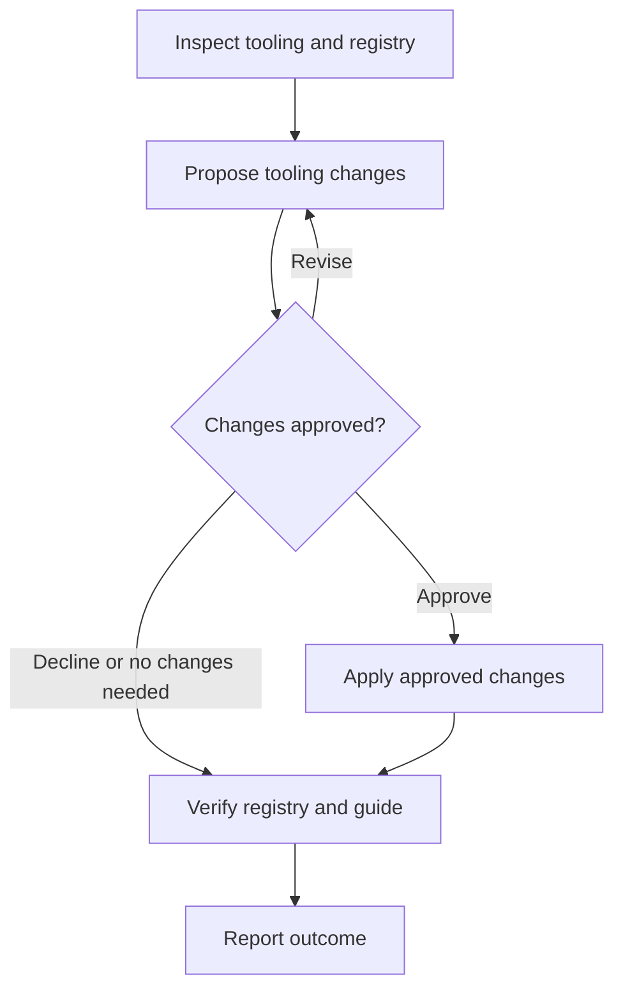

# Update Tooling

Keep the tooling registry in `.github/spindle.json` and generated `docs/agents/tooling.md` aligned with verified project commands. These entries document commands; Spindle does not execute them. Do not install tools, change tooling configuration, initialize project guidance, or update glossaries.

## Input

Optional free-form text identifies the tooling changes or configuration paths to inspect. Treat all supplied text as context, not flags. A calling skill supplies this context explicitly. With no supplied target, compare the full registry against the project's tooling configuration; do not infer a target from unrelated conversation.

## Workflow

Announce `Step <node ID> - <node label>` before acting on each node, including resumed steps and loop re-entries. After each decision, state its result and selected branch before entering the target node.



### A. Inspect tooling and registry

Read project guidance and run `spindle tool list` from the target Git working tree. Inspect package manifests, task runner configuration, and test/build configuration for the supplied target, or the whole project when no target is supplied. Verify command names, argument forms, and working-directory requirements against configuration. Preserve unrelated registry entries; absence from a targeted inspection is not evidence that an entry is obsolete.

Do not execute project commands merely to document them if execution could install dependencies, mutate data, or have side effects without authorization. If the registry is missing or invalid, report the prerequisite and stop; do not run initialization or silently repair it.

**Complete when:** the inspection scope, current entries, and verified candidate changes are known, selecting B; otherwise stop with the blocker.

### B. Propose tooling changes

Present the complete proposed additions, updates, and removals, including each entry's stable kebab-case key, section, exact command text, and optional description. Show current and proposed values for updates and identify entries being removed. Include relevant working-directory or usage limitations. Do not register every discovered command or propose speculative invocations.

If the user requests revisions, inspect any additional relevant configuration before presenting the revised change set.

**Complete when:** the exact change set is available for user review, or no changes are needed, selecting C.

### C. Changes approved?

Ask for explicit approval of the complete change set and wait. Approval applies only to the presented changes; revisions require a new proposal and approval. Declining leaves the registry unchanged. If no changes are needed, state that result and skip mutation without requesting approval.

**Complete when:** approval selects D, revisions select B, or declining or having no changes selects E. Without a response to a pending approval request, wait here.

### D. Apply approved changes

Apply only approved changes through Spindle, not by directly editing the registry or generated Markdown. Add one entry per approved command:

```sh
spindle tool add \
  --key test-unit \
  --section Testing \
  --command "pnpm test -- --run" \
  --description "Run the focused unit tests."
```

Use `spindle tool update <key>` with the approved `--section`, `--command`, or `--description` fields; `--clear-description` explicitly removes a description. Use `spindle tool remove <key>` for approved removals. Each successful mutation regenerates the guide, grouped by section with empty sections omitted.

If the inspected registry or relevant configuration has changed since approval, stop and return to A, then obtain approval for a refreshed proposal. If a command fails, stop and report the failure and any already-applied changes; do not claim atomicity or completion.

**Complete when:** all approved changes succeed with no unapproved changes, selecting E; otherwise report the blocker.

### E. Verify registry and guide

Run `spindle tool list` again and inspect `docs/agents/tooling.md`. Confirm entries, sections, commands, descriptions, and limitations agree, approved changes are reflected, and unrelated entries remain unchanged. After a decline or no-op, verify the existing state without mutating it. Report mismatches; any corrective changes require a new proposal and approval rather than direct Markdown edits.

**Complete when:** verification results and any discrepancies are known, selecting F.

### F. Report outcome

Summarize the inspected scope, changes applied or declined, and registry/guide verification. Explicitly identify failures, partial application, mismatches, and remaining actions; do not describe an unverified or inconsistent state as complete.

**Complete when:** the user or calling skill receives the outcome and any blockers.
