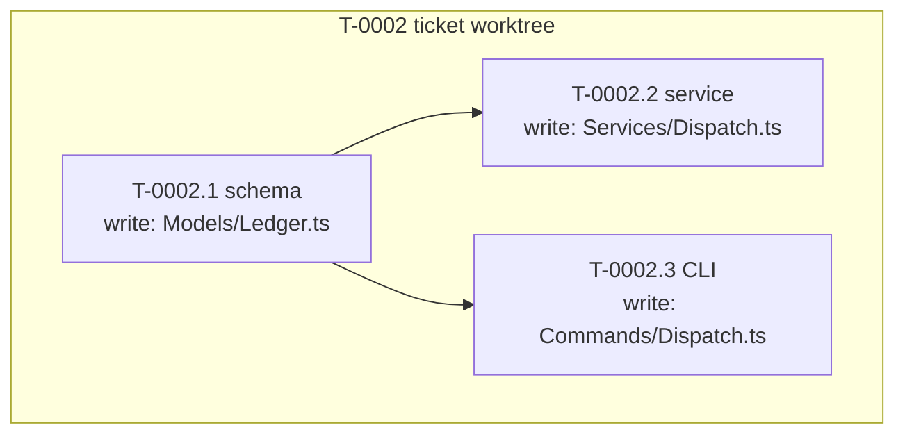
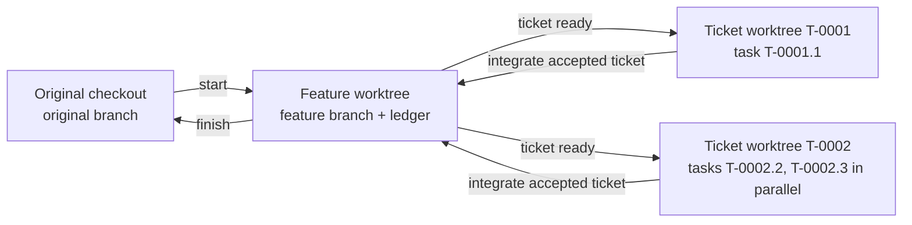
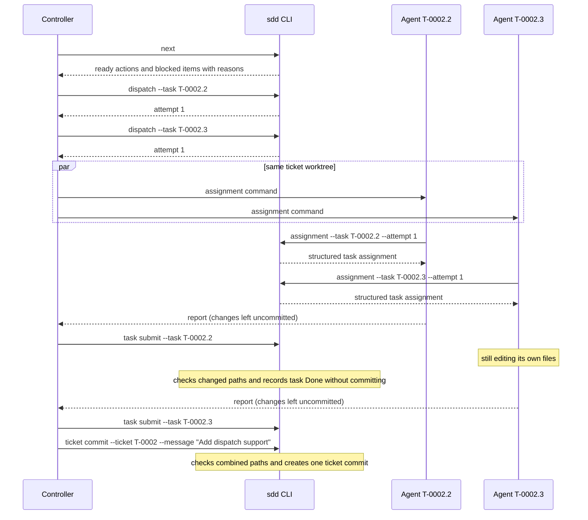
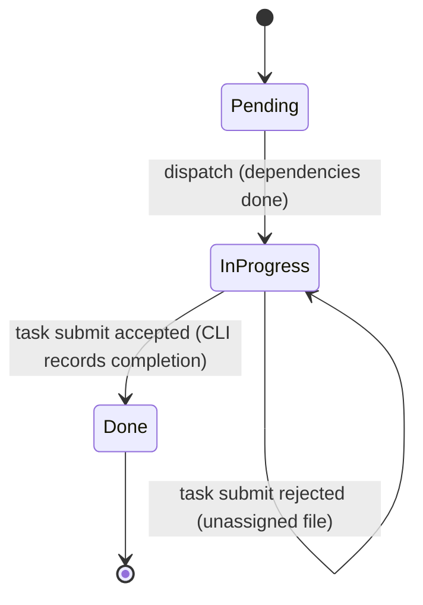
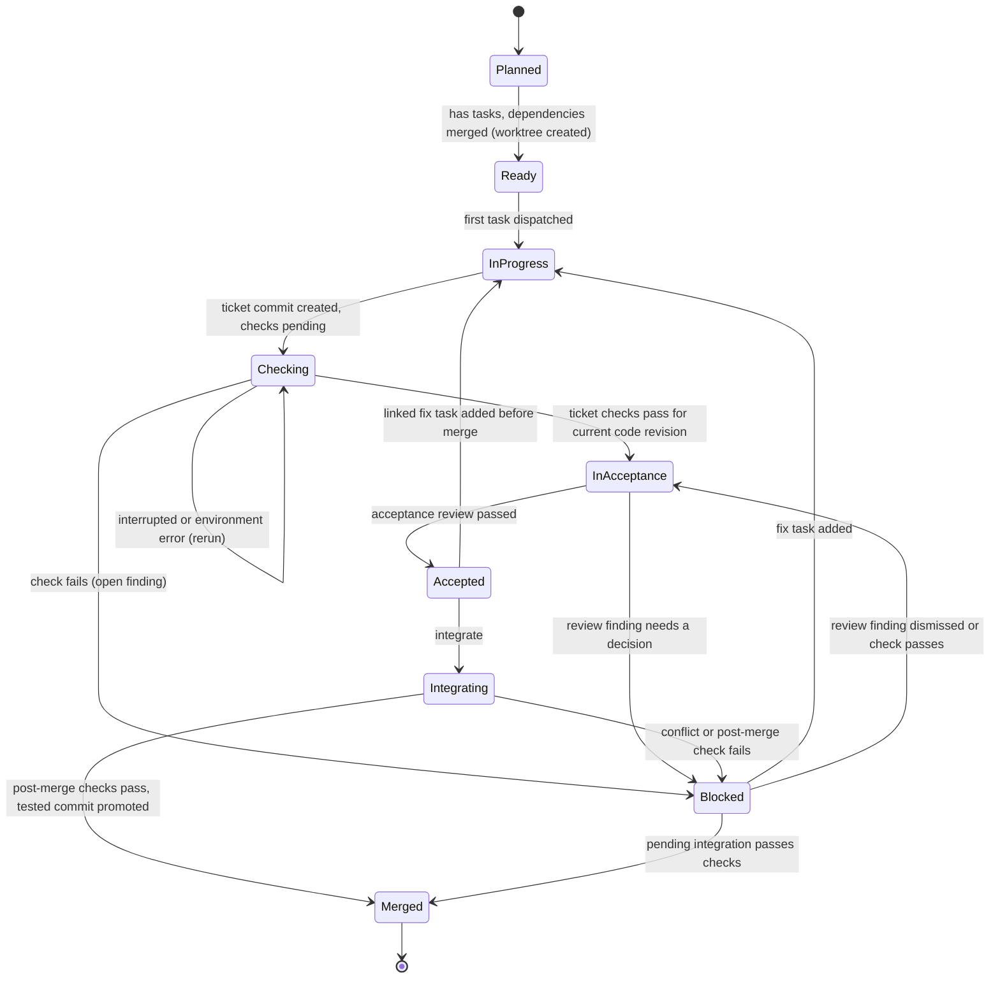
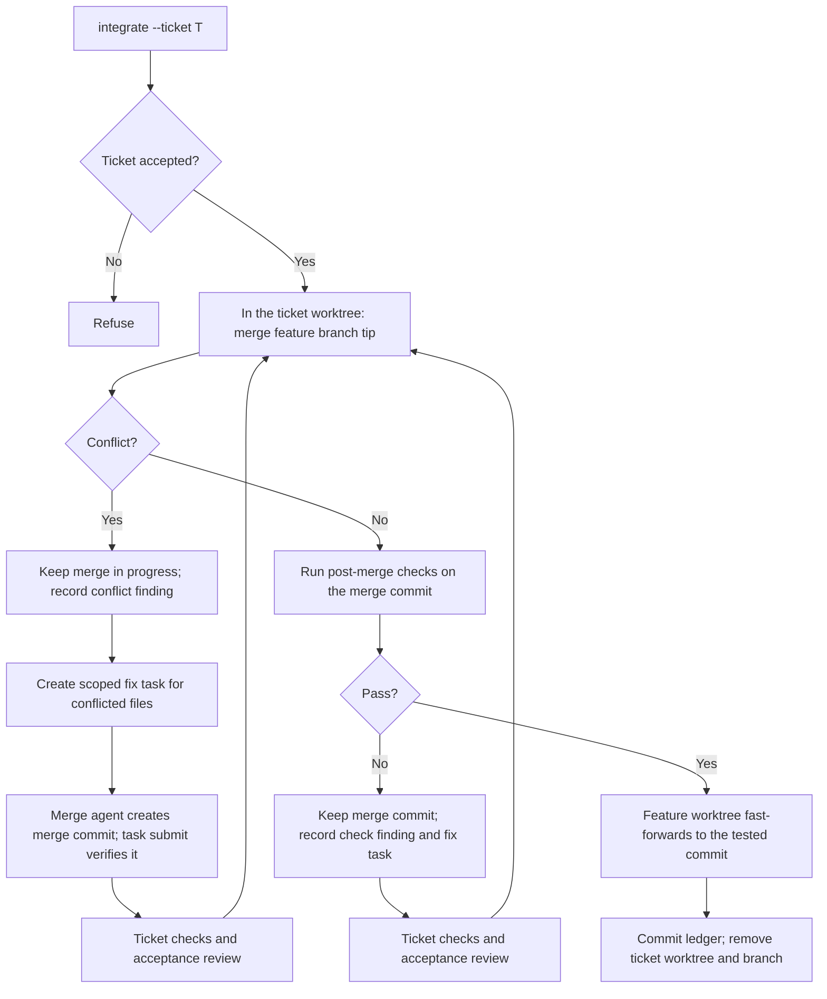
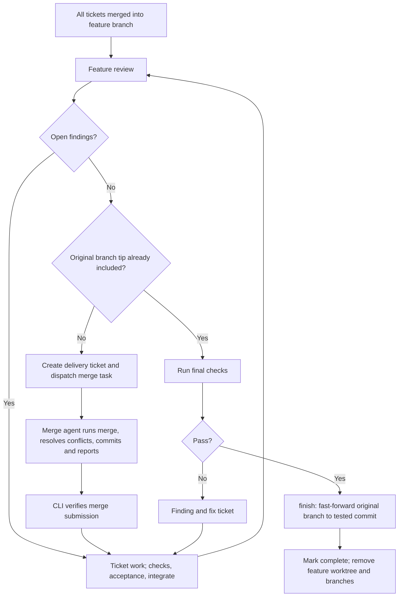

# SDD target workflow

This document defines the target design for subagent-driven development (SDD).
It is the starting point for rebuilding
[`src/SubagentDrivenDevelopment/`](src/SubagentDrivenDevelopment/). Where the
current implementation differs, this document wins. The final section lists
what the rebuild removes.

## Concepts

| Term       | Meaning                                                                                                                                        |
| ---------- | ---------------------------------------------------------------------------------------------------------------------------------------------- |
| Feature    | The complete unit of work, with a spec, a feature branch and one or more tickets.                                                              |
| Ticket     | A coherent deliverable within a feature. It owns acceptance criteria, a branch and worktree, ticket checks, acceptance review and integration. |
| Task       | A dispatchable unit of implementation within a ticket. It declares its instructions, file scope and task dependencies.                         |
| Finding    | A recorded issue from a review, check or integration. Review findings may be dismissed; gate failures require resolution.                      |
| Controller | The single operator coordinating the feature through the SDD CLI.                                                                              |
| Worker     | An agent implementing one dispatched task.                                                                                                     |
| Reviewer   | An agent reviewing a ticket or the completed feature against its acceptance criteria.                                                          |

## Design principles

1. **Tasks are the only dispatched work.** Every ticket needs at least one task.
   Agents implement tasks; tickets hold requirements, acceptance criteria and
   the acceptance review.
2. **One worktree per ticket.** All tasks of a ticket run in its ticket
   worktree. Several agents can work in the same ticket worktree at once.
3. **Tasks declare their write scope.** Every task lists the exact files it may
   create, edit or delete. The CLI uses these scopes to reject unordered
   write conflicts and unassigned changed paths. It does not store per-task
   file hashes or snapshots.
4. **Dependencies order the work.** Tickets depend on tickets, and tasks depend
   on tasks in the same ticket. Work cannot start until its dependencies are
   done. Findings and failed checks link to the fix tasks or tickets they
   create.
5. **Tasks submit; the controller commits ticket work.** Workers leave
   ordinary task changes uncommitted. The controller records task completion
   through the CLI, then creates a ticket commit after all tasks are Done and
   workers have stopped. Each completed round of ticket work has one commit;
   fixes create follow-up commits. A final-delivery merge agent creates its own
   merge commit, which the CLI verifies instead of replacing. Reviewers assess
   the ticket's combined diff against its acceptance criteria.
6. **Only feature merges are serial.** Accepted tickets merge into the feature
   branch one at a time.
7. **Corrections are normal work.** Findings and failed checks become fix tasks
   or fix tickets. There is no separate correction workflow.
8. **The CLI runs checks.** Declared check commands are executed by the CLI,
   so recorded results are real.
9. **`next` is the only guide.** It lists all currently available actions with
   exact commands and explains why other work is blocked.

## Work graph

Tickets and tasks form one hierarchical work graph. A ticket is the parent of
its tasks; task IDs use the ticket ID as a prefix (for example,
`T-0002.1`). A ticket groups the work that shares a branch, worktree, checks
and acceptance review. Tasks are the only nodes dispatched to workers.

`ticket create` creates a ticket with no tasks. Add at least one task with
`task create` before the ticket can become ready. Add more tasks when parts of
the ticket can be done independently. A task may depend on other tasks in the
same ticket; a ticket may depend on other tickets in the feature.

Each task has:

| Field        | Meaning                                                                                                                 |
| ------------ | ----------------------------------------------------------------------------------------------------------------------- |
| Instructions | What to do and the task's completion criteria.                                                                          |
| Write scope  | Exact repository-relative files the task may create, edit or delete. Paths may exist or not exist when the task starts. |
| Context      | Optional files or links that may help the worker. This list is not exhaustive; workers may read other repository files. |
| Dependencies | Tasks in the same ticket that must be Done before this task starts.                                                     |

A task must list at least one path in its write scope. Paths are repository-
relative file paths, not directories or patterns.

### Write conflicts

Two tasks in the same ticket **conflict** when their write scopes contain the
same path.

Conflicting tasks must be ordered by a dependency, in either direction.
`task create` and `task update` refuse a change that leaves two conflicting
tasks unordered, and print the dependency to add. Tasks with disjoint write
scopes can run at the same time. If a task needs another task's changes, it
must depend on that task; context paths are informational and do not establish
dependencies.



T-0002.2 and T-0002.3 depend on T-0002.1 because they need its schema contract.
Their write scopes are disjoint, so they run in parallel after T-0002.1 is
Done. They use its uncommitted changes in the shared ticket worktree.

### Readiness and dependencies

- A ticket is **ready** when it has at least one task and every ticket it
  depends on has merged into the feature branch.
- A task is **ready** when its ticket is ready, it has a write scope, and every
  task it depends on is Done.
- A task created to fix a finding or failed check has a `discovered-from` link
  to that finding or check. This records why the task exists; it does not
  replace task or ticket dependencies.
- The feature spec is fixed when `start` creates the feature branch. Ticket
  requirements and acceptance criteria are fixed when the first task is
  dispatched. Before dispatch, `ticket update` can edit them; after dispatch,
  it can edit other ticket fields, such as dependencies, but not requirements
  or acceptance criteria.
- Tasks can be added to a ticket before it is accepted. After acceptance and
  before merge, the controller can add only fix tasks linked to findings.
  Adding a fix task pauses integration and returns the ticket to InProgress.
  The ticket must pass checks and acceptance review again after the fix. No
  tasks can be added after merge. A task can be removed only before it is
  dispatched. A task's write scope can change only before it is dispatched,
  or when the controller accepts an out-of-scope file at submission. A scope
  change must not create an unordered write conflict with another unfinished
  task.

## Records

Each feature has a workspace under `.spindle/features/<feature>/`:

```text
spec.md     Feature requirements
design.md   Optional feature design
sdd.json    Ledger: tickets, tasks, dependencies, links, write scopes, findings, checks
tickets/    Ticket requirements, acceptance criteria and comments
reports/    Worker and check-output reports
```

The ledger stores workflow facts: task states, dependencies, findings and
their links, ticket commits, check runs, review recommendations and controller
decisions, and operation journals. Ticket state is derived from these facts;
it is not stored separately. Only the controller changes the ledger, through
the CLI. A workspace lock serializes
ledger writes, and each write replaces the file atomically. Tasks never change
files under `.spindle/`, except that a final-delivery merge may import committed
records from the original branch. The merge must preserve the active feature's
records. A conflict in workflow records, or an incoming change to the active
feature's records, requires a controller decision; the merge agent reports it
as a blocker rather than editing those records.

## Worktrees



- **Feature worktree.** `start` creates the feature branch and worktree from
  the original branch. The original branch tip used by `start` is the initial
  feature review base. The worktree holds the ledger and reports. `start` does
  not commit to the original branch.
- **Ticket worktree.** When a ticket becomes ready, the CLI creates its branch
  and worktree from the feature branch tip. That tip is the ticket review base.
  The CLI then runs the project's setup command (for example `pnpm install`)
  once. The ticket worktree is removed after the ticket merges into the feature
  branch.
- Worktrees live under a configured parent directory outside the original
  checkout.

## Dispatch and `next`

Each feature sets a limit on agents working at once. `next` lists one
`dispatch` command for every ready task, across all tickets, up to that limit.
It also lists blocked tickets and tasks with the dependencies or state that
prevents each from becoming ready. Human-readable and JSON output report the
same actions and blockers.

`dispatch` rechecks readiness and marks the task in progress in one
workspace-locked ledger write. It returns the attempt number and exact
`assignment` command, and refuses a second active assignment. If a worker
stops without submitting, the controller can confirm the worker has stopped
and dispatch the in-progress task again; the new attempt number makes an
earlier assignment stale.



The controller gives the worker the command printed by `dispatch`, not a
rewritten task prompt. It includes the absolute feature-workspace path, task
ID and attempt number:

```text
spindle sdd assignment --feature <absolute-feature-directory> --task T-0002.2 --attempt 1 --json
```

`assignment` is read-only. Use exactly one mode: `--task <id> --attempt <n>`
for a worker, or `--review <id>` for a reviewer. Both modes require the
absolute `--feature` path. Task mode returns the assignment only when the task
is in progress and the attempt matches the current dispatch. Its structured
output includes the role, feature/ticket/task IDs, attempt, ticket worktree
path, task instructions and completion criteria, write scope, optional
context, ticket requirements, acceptance criteria, originating finding and
evidence, worker rules and response/report instructions. Review mode returns
the role, review ID, target diff and revision, review criteria, current check
results and response template. It reads a complete ledger snapshot and does
not acquire the workspace write lock or change workflow state. Without
`--json`, it renders the same content for a person to read.

Workers:

- change only files in their write scope, and write their report only to the
  separately assigned report path;
- do not commit, stage or run SDD commands other than the read-only
  `assignment` command, except that a final-delivery merge agent may run Git
  merge, stage conflict resolutions and create the assigned merge commit;
- may read other repository files and run focused tests, knowing that other
  agents may be editing files outside their write scope in the same worktree.

## Task lifecycle



- **`task submit`** runs after the submitting worker stops. It checks changed
  paths against the scopes of in-progress and Done tasks in the ticket.
  Changes within another such task's scope do not block submission. Changes
  from completed tasks remain in the worktree until the ticket commit. A
  changed path outside these scopes is unassigned; it is reported and leaves
  the submitting task in progress. The controller can assign that path to a
  task by updating its scope, if doing so creates no unordered conflict, then
  submit again.
- For ordinary tasks, **Done** means the CLI accepted the submission and
  recorded completion. It does not create an individual task commit.
  Dependent tasks can use the completed work in the shared worktree.
  Done does not mean the ticket passed checks or acceptance review.
- The CLI does not keep per-task file hashes, snapshots or change baselines.
  Scope checks identify unassigned paths, not which worker changed a scoped
  file. Workers must obey their own scopes; ticket review assesses the combined
  result against the acceptance criteria.
- For a final-delivery merge task, the agent creates the merge commit instead.
  `task submit` verifies and records that existing merge commit. The controller
  does not run `ticket commit` unless later task work adds changes. The merge
  task has exclusive use of its ticket worktree until the agent stops and the
  CLI verifies the submission.
- An agent that stops without submitting leaves its files in place. The task
  can be dispatched again.

## Ticket lifecycle



- Ticket state is a CLI-derived view, not a separately edited ledger field.
  The CLI derives it from task states, ticket dependencies, open findings,
  the ticket commit, check results for the current code revision, the acceptance
  verdict and operation journals.
- Derive the state in this order:
  1. **Merged** when the ticket has been integrated and its worktree has been
     cleaned up.
  2. **Blocked** when an open finding has no linked fix work, or an integration
     conflict has no resolution task yet.
  3. **Integrating** while an integration operation is active and is not
     paused for a fix task.
  4. **Planned** when the ticket has no tasks or its ticket dependencies have
     not merged.
  5. **Ready** when the ticket's prerequisites are met and none of its tasks
     has started.
  6. **InProgress** when task work has started and at least one task remains
     unfinished, or all tasks are Done but the controller has not created the
     ticket commit. Adding a fix task to a ticket with completed tasks
     naturally returns it to InProgress; there is no separate reopen operation.
  7. **Checking** when the ticket commit exists but checks have not passed for
     the current code revision.
  8. **InAcceptance** when checks pass for the current code revision but
     acceptance has not passed for it.
  9. **Accepted** when checks and acceptance pass for the current code
     revision.
- A finding blocks the ticket only while it has no linked fix work and has not
  been dismissed or resolved by its gate. A check finding is resolved when
  that check passes for the current code revision. A review finding is resolved
  by dismissal or by a passing review of the fix.
- `next` reports the derived state and its blockers. For a blocked ticket, it
  offers the permitted action, such as rerunning a failed gate, creating fix
  work or dismissing a review finding. Adding the task changes the derived
  state; there is no separate reopen command.
- **Ticket commits.** After all tasks for a work round are Done and no workers
  are running, the controller runs
  `ticket commit --ticket <id> --message <message>`. The CLI checks the
  combined changed paths against the Done tasks' scopes, then
  creates one commit for that round under the workspace lock. Every
  `ticket commit` requires a message. The commit records that round's work;
  task submissions do not create commits.
- Additional work or fixes create a new ticket commit after the new tasks are
  Done. They do not amend an earlier commit. If integration has created a
  pending merge commit, later fixes create a follow-up commit after it. No
  existing commit is amended.
- A final-delivery merge task is different: its agent creates the merge commit,
  and `task submit` verifies and records it. If later tasks change files, the
  controller uses `ticket commit` to commit those changes with a required
  message.
- **Ticket checks** run after the work round's ticket commit exists and no task
  workers are running. A missing ticket commit prevents checks and acceptance
  review from proceeding. The ticket remains InProgress while the controller
  prepares the commit, then moves to Checking. No task can be dispatched during
  Checking or InAcceptance.
- If a check fails, the controller records a finding linked to the check run
  and creates fix work. Until then, the ticket is Blocked on that finding.
  The CLI does not infer a task's instructions or write scope from check
  output.
- An interrupted check or environment error is incomplete, not a code failure.
  It does not create a finding or fix task; resolve the interruption or
  environment problem and rerun the check.
- Adding a fix task moves the derived state to InProgress. Earlier check runs
  stay recorded against the revision they tested, but cannot satisfy the gate
  after a code change. Once all fix tasks are Done, the controller creates a
  follow-up ticket commit with a required message. Ticket checks and acceptance
  then run again on the updated revision.
- **Acceptance review** reads the ticket branch diff from the feature branch,
  against the ticket's acceptance criteria.
- Ticket acceptance is the required review gate whether the ticket has one
  task or many.
- Review findings block the ticket until the controller creates linked fix
  work or dismisses the finding with a reason. Check failures and integration
  conflicts cannot be dismissed; their gate must pass.
- After acceptance and before merge, the controller can create only fix tasks
  linked to findings. Creating one pauses integration and returns the ticket
  to InProgress. After the fix is submitted, the ticket must pass checks and
  acceptance review again before integration resumes. A merged ticket cannot
  receive more tasks.

## Integration



- The feature branch moves only by a fast-forward to the exact commit that was
  tested. A failed post-merge check leaves the merge commit on the ticket
  branch and does not change the feature branch. The controller records a
  finding linked to that check run and creates a fix task. Once all fix tasks
  are Done and workers have stopped, the controller creates a follow-up ticket
  commit with a required message. The failed merge commit remains unchanged.
- If the merge has conflicts, `integrate` leaves it in progress on the ticket
  branch and records a finding with the conflicted paths. The controller
  creates a fix task whose write scope covers those paths. No other task in
  that ticket is dispatched while the merge is unresolved. The merge agent's
  conflict resolutions are part of the merge commit; `task submit` verifies
  that commit. Later fixes create follow-up ticket commits. The ticket then
  runs checks and acceptance again before integration continues.
- After either kind of fix, the ticket goes through checks and acceptance
  again before integration resumes. A linked fix task added after acceptance
  pauses integration and returns the ticket to InProgress. Integrations are
  serial, but a failed or paused integration does not move the feature branch
  or prevent other tickets from integrating.
- Ledger changes are uncommitted in the feature worktree, and tickets never
  touch `.spindle/`, so they do not conflict with the fast-forward.

## Reviews and findings

| Level             | Target                                                     | Checks against             |
| ----------------- | ---------------------------------------------------------- | -------------------------- |
| Ticket acceptance | Full diff and commit history from the ticket review base   | Ticket acceptance criteria |
| Feature review    | Full feature diff from the applicable feature review base  | Feature spec               |

The controller runs `review`, which creates a review ID and returns an
assignment command for the reviewer:

```text
spindle sdd assignment --feature <absolute-feature-directory> --review <review-id> --json
```

The review assignment includes the target diff and commit history from the
applicable review base, relevant spec or ticket acceptance criteria, the code
revision, current check results and the response template below. It has no
report-file path. Reviewers do not write files or run SDD commands other than
the read-only `assignment` command; their final response is the review.

```text
Recommendation: pass | changes-required

Findings:
- Title:
  Severity:
  Location:
  Criterion:
  Evidence:
  Suggested fix:
```

`pass` requires no findings. `changes-required` requires at least one finding.
For `pass`, write `Findings: none`; for `changes-required`, list each finding
with all fields shown above.
Each finding must identify the criterion or spec requirement it breaks and
include evidence and a suggested fix.

The recommendation is advisory. The controller records it and creates a
ledger finding with `finding create` for **every** finding the reviewer
proposes, not only the ones the controller agrees with. The controller then
decides each finding:

- **`finding fix`** creates ordinary fix work with its own write scope and a
  `discovered-from` link to the finding. Every finding records its title,
  severity, location, criterion, evidence and suggested fix. If the finding
  belongs to an active ticket, the fix is a task in that ticket. If it is
  feature-level, the CLI creates a new fix ticket from the feature branch tip;
  it does not reopen an already merged ticket. The new ticket goes through the
  normal checks, acceptance and integration lifecycle.
- **`finding dismiss --reason`** closes it with a recorded reason.

The controller records the final review decision after all proposed findings
are fixed or dismissed. A reviewer's recommendation does not accept or reject a
ticket by itself, and a ticket cannot be accepted while any finding is open.
Review findings may be dismissed with a reason. Check failures and integration
conflicts cannot be dismissed; their gate must pass. If a check failure or
conflict needs correction, the controller creates a finding and then a fix
task or fix ticket with a write scope. The CLI does not infer the scope from
diagnostic output.

After review findings are fixed, the same review level runs again. Each ticket
acceptance review includes the full cumulative ticket diff and commit history
from the ticket review base, plus the findings to verify. Each feature review
includes the full cumulative feature diff and commit history from its review
base, not only changes since the prior review. Before delivery, the feature
review base is the original branch tip used by `start`. After a delivery ticket
merges a newer original-branch tip, that merged tip becomes the feature review
base. The delivery ticket's acceptance review covers incoming original-branch
changes; feature review assesses the cumulative feature changes against the
feature spec. The reviewer returns its response to the controller; no review
report file is created or stored verbatim. The ledger keeps the
recommendation, proposed findings and controller decisions. After check-related
fix work is integrated, the affected check set runs again on the updated code
revision.

## Delivery



- Final checks run on the feature branch after it includes the original
  branch tip. The commit that is tested is the commit that lands.
- If the feature branch does not include the original branch tip, the
  controller creates a delivery ticket from the feature branch tip. Its merge
  task goes to a specialized merge agent, which performs the merge itself.
  The CLI does not start the Git merge or create its merge commit.
- The delivery ticket follows the normal ticket checks, acceptance review
  and integration process. Feature review runs again after integration,
  before final checks. If the original branch advances again, repeat the
  delivery merge with its new tip.
- A failed final check creates a feature-level finding and a fix ticket from
  the feature branch tip. The ticket goes through checks, acceptance and
  integration; final checks then run again on the resulting feature revision.
- `finish` refuses if the original branch has moved since the final checks
  ran. Repeat the update and the checks.
- An optional retrospective report can be required by the feature settings.
  `finish` requires it when set.
- `finish` never pushes, publishes or force-deletes. It removes a worktree or
  branch only after confirming that its work is merged.

### Final-delivery merge agent

The merge agent receives a normal task assignment with explicit merge
permissions. The assignment records the starting ticket commit, the original
branch commit to merge, the file scope and the report path. The file scope
must cover incoming file changes as well as conflict resolutions. No other
task or Git operation may run in that ticket worktree while the agent works.

The merge agent:

- runs `git merge --no-ff` against the assigned original-branch commit in the
  ticket worktree;
- resolves conflicts within the assigned scope, stages those resolutions and
  creates the merge commit;
- runs focused tests and writes a report with both input commits, the result
  commit, conflict resolutions, test results and any unresolved problems;
- does not edit workflow records, move the feature or original branch, or
  push.

If the agent cannot complete the merge within its assignment, it reports the
blocker and leaves its work in place. The task remains InProgress. The
controller must confirm that the agent has stopped before another agent or
recovery operation uses the worktree.

At submission, the CLI verifies the actual Git state, not just the report.
The result must be the ticket branch tip, with the two assigned commits as
its ordered parents. The worktree must have no unresolved conflicts or
uncommitted changes. Changes from the starting ticket commit must stay within
the assigned scope. Verification failures leave the task InProgress and
report the reason. A verified merge still needs the normal checks and
independent acceptance review; the agent's report does not approve it.

## Checks

Check commands are declared once per feature, with project defaults:

- **ticket** checks run in a ticket worktree after the current work round's
  ticket commit exists.
- **post-merge** checks run during every `integrate`.
- **final** checks run before `finish`.

The CLI runs each command against the committed code revision in the relevant
worktree and records the tested commit, the code revision, the commands
actually run, the result and the report paths. Results are `passed`, `failed`,
`interrupted` or `environment-error`. Every run remains in the history; a
retry does not erase an earlier failure.

The code revision is computed from the checked commit's tree, excluding
`.spindle/`. Ledger and report updates therefore do not invalidate code checks.
A run is current only when both its code revision and the declared commands
match the current check set. Changes to tracked content outside `.spindle/`
make the code revision different; a change to declared commands invalidates
the corresponding check results even though the configuration is in the
ledger. Earlier results remain in history but cannot satisfy a gate for a
different revision or command set.

| Change after a check passes                                     | Effect                                                                                        |
| --------------------------------------------------------------- | --------------------------------------------------------------------------------------------- |
| Tracked content outside `.spindle/` changes                     | Change the code revision; rerun checks before the gate can pass.                              |
| Declared check commands change                                  | Invalidate results for that check set; rerun before the gate can pass.                        |
| Ledger, report or review-comment changes under `.spindle/`      | Do not invalidate code checks.                                                                |
| Another ticket merges into the feature branch                   | Keep this ticket's result; run post-merge checks on the combined revision during integration. |
| Command fails                                                   | Record a failed run and create a linked finding with fix work.                                |
| Command is interrupted or cannot run because of the environment | Leave the gate incomplete; resolve the issue and rerun without creating a code-fix task.      |

During Checking and InAcceptance, no worker may change the ticket branch. A
check result is valid only for its recorded code revision. `check --scope
<scope>` runs a set on demand and records the result without changing ticket
state.

## Commands

All commands run as `spindle sdd <command> --feature <directory>`, except
`create`. `--json` returns a success envelope on stdout and errors on stderr.

| Command                          | Purpose                                                                                                                                                   |
| -------------------------------- | --------------------------------------------------------------------------------------------------------------------------------------------------------- |
| `create`                         | Create a numbered feature workspace with `spec.md` and optional `design.md`.                                                                              |
| `start`                          | Create the feature branch and worktree; commit workspace records on the feature branch.                                                                   |
| `ticket create`, `ticket update` | Create or edit tickets, dependencies and blockers. Requirements and acceptance criteria can be edited only before the first task is dispatched. A new ticket has no tasks. |
| `task create`, `task update`     | Add or edit tasks: instructions, write scopes and dependencies. Refuses unordered write conflicts.                                                        |
| `next`                           | List ready actions and blocked items with reasons. `--verbose` adds the full graph and state.                                                             |
| `dispatch`                       | Atomically mark a ready task in progress and return the attempt number and `assignment` command.                                                          |
| `task submit`                    | Record a worker's task completion, or verify and record a final-delivery merge commit.                                                                    |
| `ticket commit`                  | Commit the combined ticket work for a completed task round; requires `--message`.                                                                         |
| `review submit`                  | Record the review recommendation and controller decision.                                                                                                 |
| `review`                         | Create a ticket-acceptance or feature review assignment and return its ID and `assignment` command.                                                       |
| `assignment`                     | Read-only: print the structured task assignment for `--task` and `--attempt`, or review assignment for `--review`. Requires an absolute `--feature` path. |
| `finding`                        | `create`, `fix` (creates linked fix work) or `dismiss --reason` for review findings.                                                                      |
| `integrate`                      | Merge an accepted ticket into the feature branch and run post-merge checks.                                                                               |
| `check`                          | Run a declared check set on demand.                                                                                                                       |
| `finish`                         | Run final checks, merge into the original branch and clean up.                                                                                            |

## Recovery and safety

- Ledger writes are atomic file replacements under the workspace lock.
- The feature branch moves only by fast-forward to a tested commit, so an
  interrupted `integrate` leaves it either unchanged or fully updated.
- `start`, `integrate`, `finish` and `ticket commit` operations
  write a small journal before they change branches. If a command is
  interrupted, the next SDD command completes or rolls back the operation,
  or stops and prints what it found. It never discards uncommitted work.
- Ticket commit creation uses the journal to recover an interrupted command.
  If Git succeeds before the ledger update, recovery verifies the journal
  against the branch and records the existing commit. It does not create a
  duplicate commit or infer success from a clean worktree.
- One controller runs a feature at a time. The workspace lock prevents two
  controllers from writing at once; there is no per-command actor identity.
