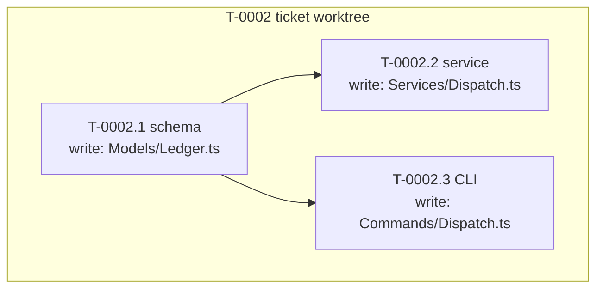
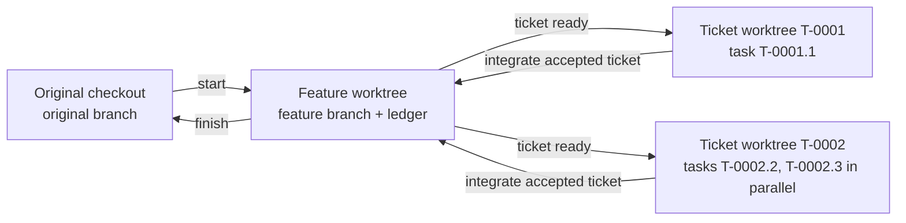
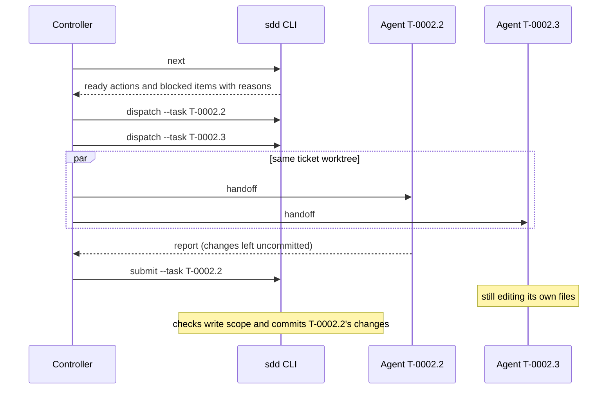
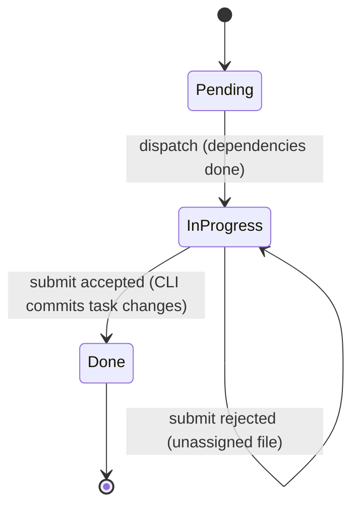
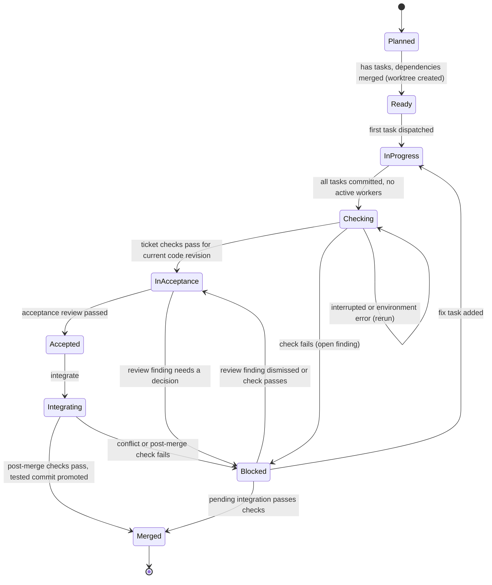
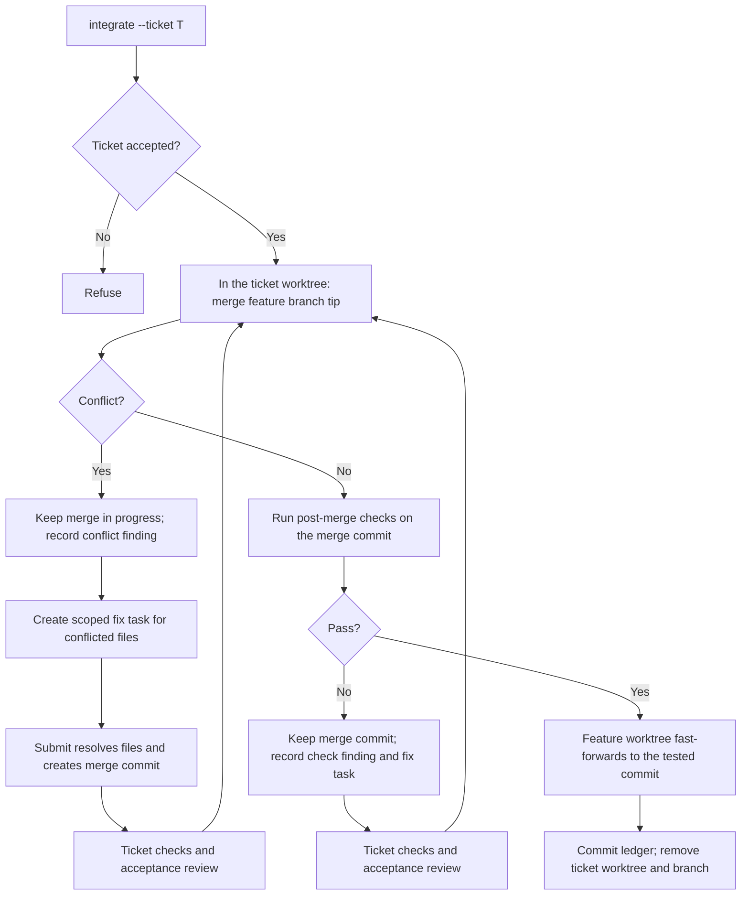
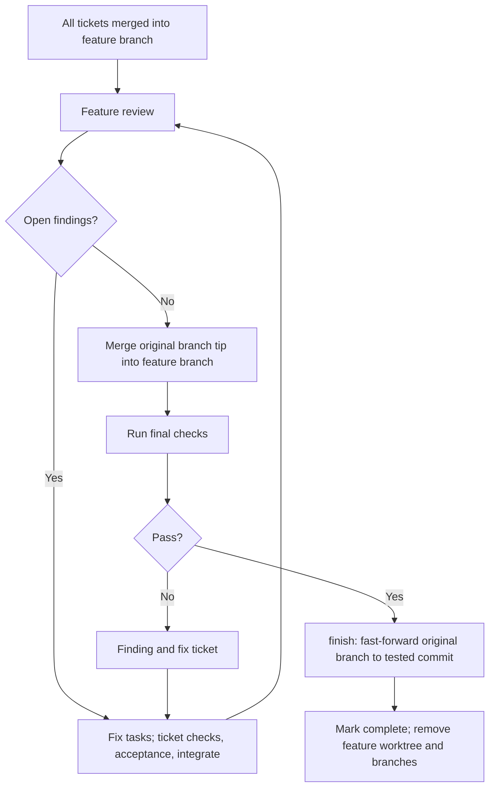

# SDD target workflow

This document defines the target design for subagent-driven development (SDD).
It is the starting point for rebuilding
[`src/SubagentDrivenDevelopment/`](src/SubagentDrivenDevelopment/). Where the
current implementation differs, this document wins. The final section lists
what the rebuild removes.

## Concepts

| Term | Meaning |
| ---- | ------- |
| Feature | The complete unit of work, with a spec, a feature branch and one or more tickets. |
| Ticket | A coherent deliverable within a feature. It owns acceptance criteria, a branch and worktree, ticket checks, acceptance review and integration. |
| Task | A dispatchable unit of implementation within a ticket. It declares its instructions, file scope and task dependencies. |
| Finding | A recorded issue from a review, check or integration. Review findings may be dismissed; gate failures require resolution. |
| Controller | The single operator coordinating the feature through the SDD CLI. |
| Worker | An agent implementing one dispatched task. |
| Reviewer | An agent reviewing a ticket or the completed feature against its acceptance criteria. |

## Design principles

1. **Tasks are the only dispatched work.** Every ticket needs at least one task.
   Agents implement tasks; tickets hold requirements, acceptance criteria and
   the acceptance review.
2. **One worktree per ticket.** All tasks of a ticket run in its ticket
   worktree. Several agents can work in the same ticket worktree at once.
3. **Tasks declare their write scope.** Every task lists the exact files it may
   create, edit or delete. The CLI uses these scopes to prevent overlapping
   writes and to commit only the submitting task's changes.
4. **Dependencies order the work.** Tickets depend on tickets, and tasks depend
   on tasks in the same ticket. Work cannot start until its dependencies are
   done. Findings and failed checks link to the fix tasks or tickets they
   create.
5. **Tasks submit; tickets are reviewed.** A worker implements and submits a
   task. The CLI checks its write scope and commits it. Reviewers assess the
   ticket's combined diff against its acceptance criteria.
6. **Only feature merges are serial.** Accepted tickets merge into the feature
   branch one at a time.
7. **Corrections are normal work.** Findings and failed checks become fix tasks
   or fix tickets. There is no separate correction workflow.
8. **The CLI runs checks.** Declared check commands are executed by the CLI,
   so recorded results are real.
9. **`next` is the only guide.** It lists all currently available actions with
   exact commands and explains why other work is blocked.

## Work graph

Tickets and tasks form one hierarchical work graph. A ticket is the parent of
its tasks; task IDs use the ticket ID as a prefix (for example,
`T-0002.1`). A ticket groups the work that shares a branch, worktree, checks
and acceptance review. Tasks are the only nodes dispatched to workers.

`ticket create` creates a ticket with no tasks. Add at least one task with
`task create` before the ticket can become ready. Add more tasks when parts of
the ticket can be done independently. A task may depend on other tasks in the
same ticket; a ticket may depend on other tickets in the feature.

Each task has:

| Field | Meaning |
| ----- | ------- |
| Instructions | What to do and the task's completion criteria. |
| Write scope | Exact repository-relative files the task may create, edit or delete. Paths may exist or not exist when the task starts. |
| Context | Optional files or links that may help the worker. This list is not exhaustive; workers may read other repository files. |
| Dependencies | Tasks in the same ticket that must be committed before this task starts. |

A task must list at least one path in its write scope. Paths are repository-
relative file paths, not directories or patterns.

### Write conflicts

Two tasks in the same ticket **conflict** when their write scopes contain the
same path.

Conflicting tasks must be ordered by a dependency, in either direction.
`task create` and `task update` refuse a change that leaves two conflicting
tasks unordered, and print the dependency to add. Tasks with disjoint write
scopes can run at the same time. If a task needs another task's changes, it
must depend on that task; context paths are informational and do not establish
dependencies.



T-0002.2 and T-0002.3 depend on T-0002.1 because they need its schema contract.
Their write scopes are disjoint, so they run in parallel after T-0002.1 is
committed.

### Readiness and dependencies

- A ticket is **ready** when it has at least one task and every ticket it
  depends on has merged into the feature branch.
- A task is **ready** when its ticket is ready, it has a write scope, and every
  task it depends on has been committed in the ticket worktree.
- A task created to fix a finding or failed check has a `discovered-from` link
  to that finding or check. This records why the task exists; it does not
  replace task or ticket dependencies.
- Tasks can be added to a ticket at any time before the ticket is accepted. A
  task can be removed only before it is dispatched. A task's write scope can
  change only before it is dispatched, or when the controller accepts an
  out-of-scope file at submission. A scope change must not create an unordered
  write conflict with another unfinished task.

## Records

Each feature has a workspace under `.spindle/features/<feature>/`:

```text
spec.md     Feature requirements
design.md   Optional feature design
sdd.json    Ledger: tickets, tasks, dependencies, links, write scopes, findings, checks
tickets/    Ticket requirements, acceptance criteria and comments
reports/    Worker and check-output reports
```

The ledger stores workflow facts: task states, dependencies, findings and
their links, check runs, review recommendations and controller decisions, and
integration journals. Ticket
state is derived from these facts; it is not stored separately. Only the
controller changes the ledger, through the CLI. A workspace lock serializes
ledger writes, and each write replaces the file atomically. Tasks never change
files under `.spindle/`.

## Worktrees



- **Feature worktree.** `start` creates the feature branch and worktree from
  the original branch. It holds the ledger and reports. `start` does not
  commit to the original branch.
- **Ticket worktree.** When a ticket becomes ready, the CLI creates its branch
  and worktree from the feature branch tip, then runs the project's setup
  command (for example `pnpm install`) once. The ticket worktree is removed
  after the ticket merges into the feature branch.
- Worktrees live under a configured parent directory outside the original
  checkout.

## Dispatch and `next`

Each feature sets a limit on agents working at once. `next` lists one
`dispatch` command for every ready task, across all tickets, up to that limit.
It also lists blocked tickets and tasks with the dependencies or state that
prevents each from becoming ready. Human-readable and JSON output report the
same actions and blockers.

`dispatch` rechecks readiness and marks the task in progress in one
workspace-locked ledger write. It refuses a second active assignment. If a
worker stops without submitting, the controller can confirm the worker has
stopped and dispatch the in-progress task again.



A handoff contains the ticket worktree path, the task's instructions and
completion criteria, its write scope, optional context paths, links to the
ticket and spec, and the absolute report path.

Workers:

- change only files in their write scope;
- do not commit, stage or run SDD commands;
- may read other repository files and run focused tests, knowing that other
  agents may be editing files outside their write scope in the same worktree;
- write their report to the assigned path.

## Task lifecycle



- **Submit** checks changed paths against the submitting task's write scope
  and the scopes of other in-progress tasks. Changes within another active
  task's scope are treated as concurrent work: they do not block this submit
  and are not included in its commit. A changed path outside every active
  task's scope is unassigned; it is reported and leaves the submitting task in
  progress. The controller can assign that path to a task by updating its
  scope, if doing so creates no unordered conflict, then submit again.
- **Done** means the CLI verified the task's write scope and committed exactly
  its changed files to the ticket branch, leaving other tasks' changes
  untouched. Commits in one ticket worktree are serialized by the workspace
  lock. It does not mean the ticket has passed checks or acceptance review.
- An agent that stops without submitting leaves its files in place. The task
  can be dispatched again.

## Ticket lifecycle



- Ticket state is a CLI-derived view, not a separately edited ledger field.
  The CLI derives it from task states, ticket dependencies, open findings,
  check results for the current code revision, the acceptance verdict and the
  integration journal.
- Derive the state in this order:
  1. **Merged** when the ticket has been integrated and its worktree has been
     cleaned up.
  2. **Blocked** when an open finding has no linked fix work, or an integration
     conflict has no resolution task yet.
  3. **Integrating** while an integration operation is active and has no
     unresolved conflict.
  4. **Planned** when the ticket has no tasks or its ticket dependencies have
     not merged.
  5. **Ready** when the ticket's prerequisites are met and none of its tasks
     has started.
  6. **InProgress** when task work has started and at least one task remains
     unfinished. Adding a fix task to a ticket with completed tasks naturally
     returns it to InProgress; there is no separate reopen operation.
  7. **Checking** when all tasks are committed but checks have not passed for
     the current code revision.
  8. **InAcceptance** when checks pass for the current code revision but
     acceptance has not passed for it.
  9. **Accepted** when checks and acceptance pass for the current code
     revision.
- A finding blocks the ticket only while it has no linked fix work and has not
  been dismissed or resolved by its gate. A check finding is resolved when
  that check passes for the current code revision. A review finding is resolved
  by dismissal or by a passing review of the fix.
- `next` reports the derived state and its blockers. For a blocked ticket, it
  offers the permitted action, such as rerunning a failed gate, creating fix
  work or dismissing a review finding. Adding the task changes the derived
  state; there is no separate reopen command.
- **Ticket checks** run in the ticket worktree after all ticket tasks are
  committed and no task workers are running. The ticket stays in Checking or
  InAcceptance until the gate completes; no task can be dispatched during
  either state.
- If a check fails, the controller records a finding linked to the check run
  and creates fix work. Until then, the ticket is Blocked on that finding.
  The CLI does not infer a task's instructions or write scope from check
  output.
- An interrupted check or environment error is incomplete, not a code failure.
  It does not create a finding or fix task; resolve the interruption or
  environment problem and rerun the check.
- Adding a fix task moves the derived state to InProgress. Earlier check runs
  stay recorded against the revision they tested, but cannot satisfy the gate
  after a code change. After the fix is submitted, ticket checks and
  acceptance run again.
- **Acceptance review** reads the ticket branch diff from the feature branch,
  against the ticket's acceptance criteria.
- Ticket acceptance is the required review gate whether the ticket has one
  task or many.
- Review findings block the ticket until the controller creates linked fix
  work or dismisses the finding with a reason. Check failures and integration
  conflicts cannot be dismissed; their gate must pass.

## Integration



- The feature branch moves only by a fast-forward to the exact commit that was
  tested. A failed post-merge check leaves the merge commit on the ticket
  branch and does not change the feature branch. The controller records a
  finding linked to that check run and creates a fix task on top of the merge
  commit.
- If the merge has conflicts, `integrate` leaves it in progress on the ticket
  branch and records a finding with the conflicted paths. The controller
  creates a fix task whose write scope covers those paths. No other task in
  that ticket is dispatched while the merge is unresolved. Submitting the
  conflict-resolution task creates the merge commit; its changes are part of
  that merge commit rather than a separate task commit. The ticket then runs
  checks and acceptance again before integration continues.
- After either kind of fix, the ticket goes through checks and acceptance
  again. Integrations are serial, but a failed or paused integration does not
  move the feature branch or prevent other tickets from integrating.
- Ledger changes are uncommitted in the feature worktree, and tickets never
  touch `.spindle/`, so they do not conflict with the fast-forward.

## Reviews and findings

| Level | Target | Checks against |
| ----- | ------ | ------------- |
| Ticket acceptance | Ticket branch diff from the feature branch | Ticket acceptance criteria |
| Feature review | Feature branch diff from the original branch | Feature spec |

The `review` handoff includes the target diff, relevant spec or ticket
acceptance criteria, the code revision, current check results and the response
template below. It has no report-file path. Reviewers do not run SDD commands
or write files; their final response is the review.

```text
Recommendation: pass | changes-required

Findings:
- Title:
  Severity:
  Location:
  Criterion:
  Evidence:
  Suggested fix:
```

`pass` requires no findings. `changes-required` requires at least one finding.
For `pass`, write `Findings: none`; for `changes-required`, list each finding
with all fields shown above.
Each finding must identify the criterion or spec requirement it breaks and
include evidence and a suggested fix.

The recommendation is advisory. The controller records it and creates a
ledger finding with `finding create` for **every** finding the reviewer
proposes, not only the ones the controller agrees with. The controller then
decides each finding:

- **`finding fix`** creates ordinary fix work with its own write scope and a
  `discovered-from` link to the finding. Every finding records its title,
  severity, location, criterion, evidence and suggested fix. If the finding
  belongs to an active ticket, the fix is a task in that ticket. If it is
  feature-level, the CLI creates a new fix ticket from the feature branch tip;
  it does not reopen an already merged ticket. The new ticket goes through the
  normal checks, acceptance and integration lifecycle.
- **`finding dismiss --reason`** closes it with a recorded reason.

The controller records the final review decision after all proposed findings
are fixed or dismissed. A reviewer's recommendation does not accept or reject a
ticket by itself, and a ticket cannot be accepted while any finding is open.
Review findings may be dismissed with a reason. Check failures and integration
conflicts cannot be dismissed; their gate must pass. If a check failure or
conflict needs correction, the controller creates a finding and then a fix
task or fix ticket with a write scope. The CLI does not infer the scope from
diagnostic output.

After review findings are fixed, the same review level runs again. The reviewer
gets the diff since the last reviewed revision and the findings to verify. The
reviewer returns its response to the controller; no review report file is
created or stored verbatim. The ledger keeps the recommendation, proposed
findings and controller decisions. After check-related fix work is integrated,
the affected check set runs again on the updated code revision.

## Delivery



- Final checks run on the feature branch after it includes the original
  branch tip. The commit that is tested is the commit that lands.
- A failed final check creates a feature-level finding and a fix ticket from
  the feature branch tip. The ticket goes through checks, acceptance and
  integration; final checks then run again on the resulting feature revision.
- `finish` refuses if the original branch has moved since the final checks
  ran. Repeat the update and the checks.
- An optional retrospective report can be required by the feature settings.
  `finish` requires it when set.
- `finish` never pushes, publishes or force-deletes. It removes a worktree or
  branch only after confirming that its work is merged.

## Checks

Check commands are declared once per feature, with project defaults:

- **ticket** checks run in a ticket worktree after all its tasks are
  committed.
- **post-merge** checks run during every `integrate`.
- **final** checks run before `finish`.

The CLI runs each command against the committed code revision in the relevant
worktree and records the tested commit, the code revision, the commands
actually run, the result and the report paths. Results are `passed`, `failed`,
`interrupted` or `environment-error`. Every run remains in the history; a
retry does not erase an earlier failure.

The code revision is computed from the checked commit's tree, excluding
`.spindle/`. Ledger and report updates therefore do not invalidate code checks.
A run is current only when both its code revision and the declared commands
match the current check set. Changes to tracked content outside `.spindle/`
make the code revision different; a change to declared commands invalidates
the corresponding check results even though the configuration is in the
ledger. Earlier results remain in history but cannot satisfy a gate for a
different revision or command set.

| Change after a check passes | Effect |
| --------------------------- | ------ |
| Tracked content outside `.spindle/` changes | Change the code revision; rerun checks before the gate can pass. |
| Declared check commands change | Invalidate results for that check set; rerun before the gate can pass. |
| Ledger, report or review-comment changes under `.spindle/` | Do not invalidate code checks. |
| Another ticket merges into the feature branch | Keep this ticket's result; run post-merge checks on the combined revision during integration. |
| Command fails | Record a failed run and create a linked finding with fix work. |
| Command is interrupted or cannot run because of the environment | Leave the gate incomplete; resolve the issue and rerun without creating a code-fix task. |

During Checking and InAcceptance, no worker may change the ticket branch. A
check result is valid only for its recorded code revision. `check --scope
<scope>` runs a set on demand and records the result without changing ticket
state.

## Commands

All commands run as `pnpm spindle sdd <command> --feature <directory>`, except
`create`. `--json` returns a success envelope on stdout and errors on stderr.

| Command | Purpose |
| ------- | ------- |
| `create` | Create a numbered feature workspace with `spec.md` and optional `design.md`. |
| `start` | Create the feature branch and worktree; commit workspace records on the feature branch. |
| `ticket create`, `ticket update` | Create or edit tickets, their dependencies and blockers. A new ticket has no tasks. |
| `task create`, `task update` | Add or edit tasks: instructions, write scopes and dependencies. Refuses unordered write conflicts. |
| `next` | List ready actions and blocked items with reasons. `--verbose` adds the full graph and state. |
| `dispatch` | Atomically mark a ready task in progress and return its handoff. |
| `submit` | Record a worker's submission, or the review recommendation and controller decision with `--review`. |
| `review` | Create a ticket-acceptance or feature review assignment and return its handoff. |
| `finding` | `create`, `fix` (creates linked fix work) or `dismiss --reason` for review findings. |
| `integrate` | Merge an accepted ticket into the feature branch and run post-merge checks. |
| `check` | Run a declared check set on demand. |
| `finish` | Run final checks, merge into the original branch and clean up. |

## Recovery and safety

- Ledger writes are atomic file replacements under the workspace lock.
- The feature branch moves only by fast-forward to a tested commit, so an
  interrupted `integrate` leaves it either unchanged or fully updated.
- `start`, `integrate` and `finish` write a small journal before they change
  branches. If a command is interrupted, the next SDD command completes or
  rolls back the operation, or stops and prints what it found. It never
  discards uncommitted work.
- One controller runs a feature at a time. The workspace lock prevents two
  controllers from writing at once; there is no per-command actor identity.

## Removed from the current implementation

| Removed | Replaced by |
| ------- | ----------- |
| Path reservations held while a task is assigned | File conflicts checked when tasks are planned, ordered by dependencies |
| Optional task plans, frozen plans and `correct --approved-exception` | Every ticket has tasks; tasks can be added until the ticket is accepted |
| Task-specific assign, submit, accept and request-changes commands | `dispatch`, `submit` and `review` |
| A controller commit of combined ticket work after all tasks | The CLI commits each task's files at `submit` |
| `--actor`, `claim` and `resume --confirm-handoff` | One controller per feature, enforced by the workspace lock |
| A records commit after every ledger write | Ledger commits at `start`, each `integrate` and `finish` |
| `checks require`, `checks record` and `checks revalidate` | Declared checks that the CLI runs |
| Global block on merges after a failed post-merge check, and `sync` | The feature branch moves only after checks pass |
| `correct` and the correction assignment types | Fix tasks |
| `requirements decide` and the `deferred`/`confirmed` outcomes | Two finding outcomes: fix or dismiss |
| Review pinning, frozen changed-path inventories and report hashes | Reviews of a stated diff; reports committed with the ledger |
| Hash-based check revalidation | Check results tied to a code revision, excluding `.spindle/` metadata |
| Final checks after merging into the original branch | Final checks on the feature branch before `finish` |
| `ready` and `status` | `next --verbose` |
