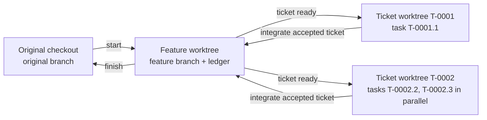
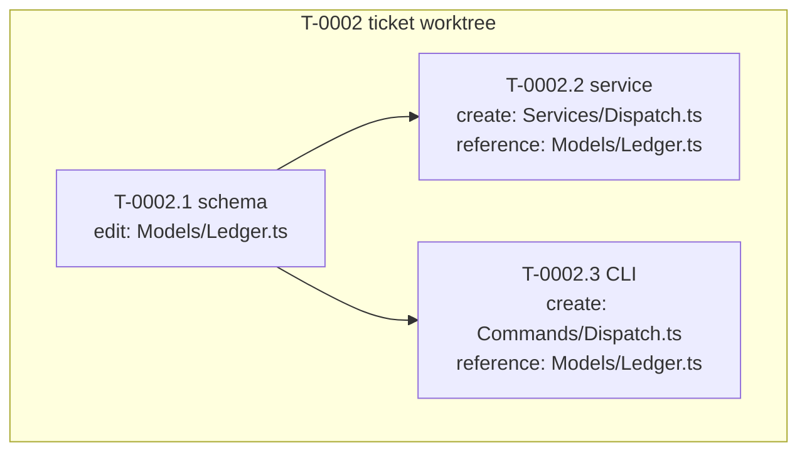
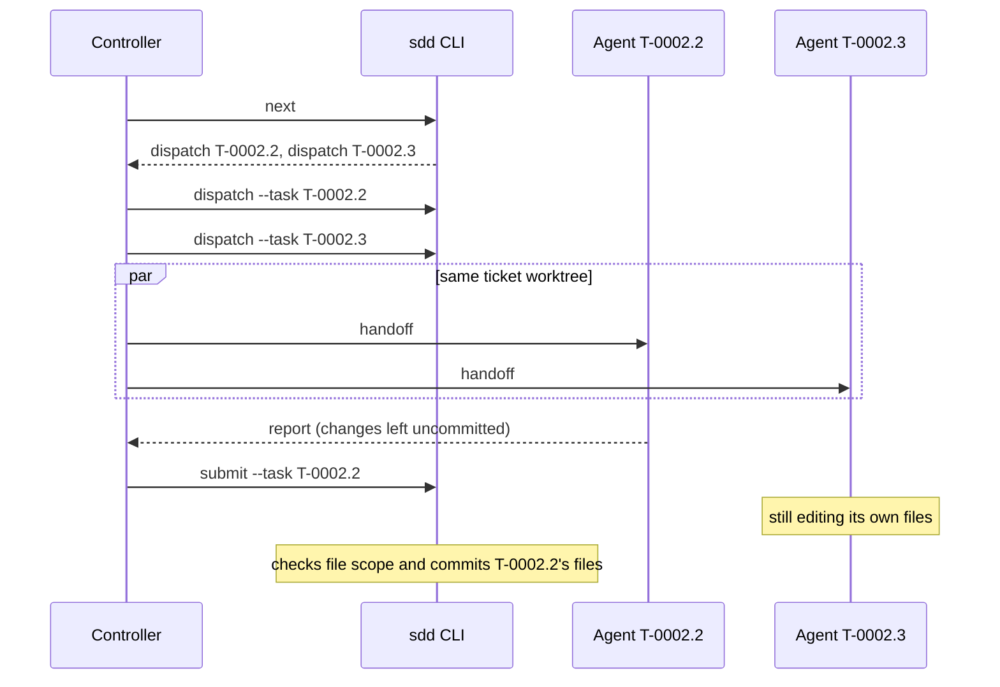
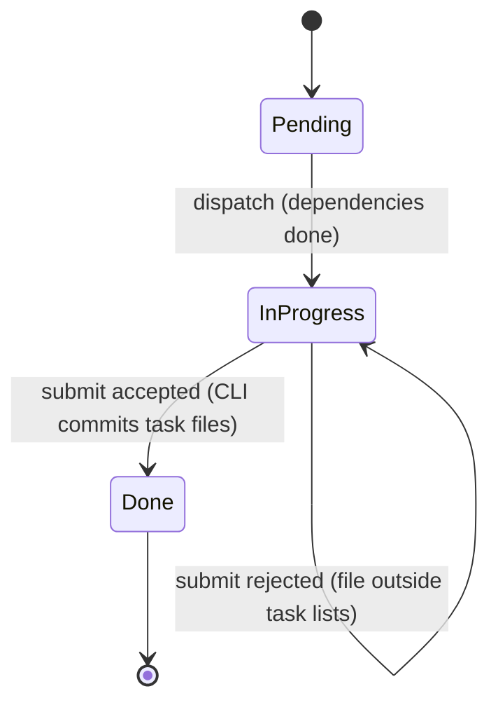
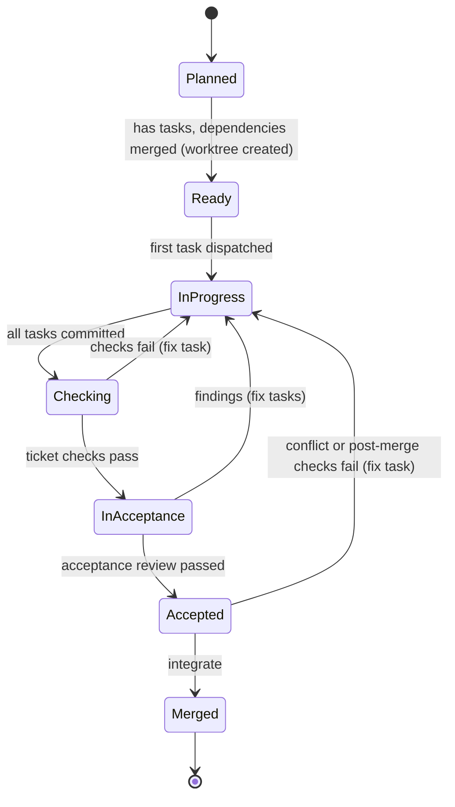
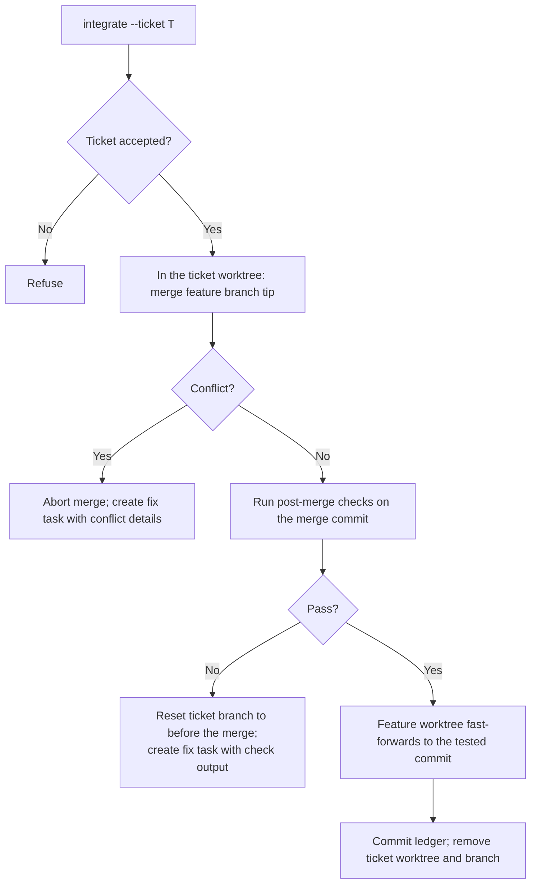
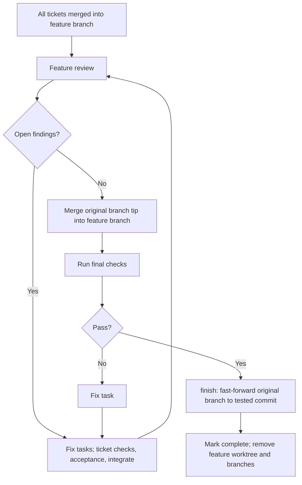

# SDD target workflow

This document defines the target design for subagent-driven development (SDD).
It is the starting point for rebuilding
[`src/SubagentDrivenDevelopment/`](src/SubagentDrivenDevelopment/). Where the
current implementation differs, this document wins. The final section lists
what the rebuild removes.

## Design principles

1. **Tasks are the only dispatched work.** Every ticket needs at least one task.
   Agents implement tasks; tickets hold requirements, acceptance criteria and
   the acceptance review.
2. **One worktree per ticket.** All tasks of a ticket run in its ticket
   worktree. Several agents can work in the same ticket worktree at once.
3. **Tasks declare their files.** Every task lists the files it edits, creates
   and references. The CLI uses these lists to decide which tasks can run at
   the same time.
4. **Dependencies order the work.** Tickets depend on tickets, and tasks depend
   on tasks in the same ticket. Work cannot start until its dependencies are
   done.
5. **Parallel across tasks, sequential within a task.** One task is always
   implemented, then reviewed. Different tasks and tickets can be in
   implementation and review at the same time.
6. **Only feature merges are serial.** Accepted tickets merge into the feature
   branch one at a time.
7. **Corrections are new tasks.** Findings and failed checks become fix tasks.
   There is no separate correction workflow.
8. **The CLI runs checks.** Declared check commands are executed by the CLI,
   so recorded results are real.
9. **`next` is the only guide.** It prints every action that is currently
   possible, including all parallel dispatches, with exact commands.

## Records

Each feature has a workspace under `.spindle/features/<feature>/`:

```text
spec.md     Feature requirements
design.md   Optional feature design
sdd.json    Ledger: tickets, tasks, dependencies, file lists, findings, checks
tickets/    Ticket requirements, acceptance criteria and comments
reports/    Worker, reviewer and check-output reports
```

The ledger is the source of truth for workflow state. Only the controller
changes it, through the CLI. A workspace lock serializes ledger writes, and
each write replaces the file atomically. Tasks never change files under
`.spindle/`.

## Worktrees



- **Feature worktree.** `start` creates the feature branch and worktree from
  the original branch. It holds the ledger and reports. `start` does not
  commit to the original branch.
- **Ticket worktree.** When a ticket becomes ready, the CLI creates its branch
  and worktree from the feature branch tip, then runs the project's setup
  command (for example `pnpm install`) once. The ticket worktree is removed
  after the ticket merges into the feature branch.
- Worktrees live under a configured parent directory outside the original
  checkout.

## Tickets and tasks

`ticket create` creates a ticket with no tasks. Add at least one task with
`task create` before the ticket can become ready. Add more tasks when parts of
the ticket can be done independently.

Each task has:

| Field              | Meaning                                                                  |
| ------------------ | ------------------------------------------------------------------------ |
| Instructions       | What to do, and the task's acceptance criteria.                          |
| Files to edit      | Existing files the task may change or delete.                            |
| Files to create    | New files the task may add. They must not exist when the task starts.    |
| Files to reference | Files the task may read for context but must not change.                 |
| Dependencies       | Tasks in the same ticket that must be committed before this task starts. |

A task must list at least one file to edit or create. Paths are
repository-relative file paths, not directories or patterns.

### File rules

Two tasks in the same ticket **conflict** when:

- they both list the same file to edit or create, or
- one lists a file to reference that the other edits or creates.

Conflicting tasks must be ordered by a dependency, in either direction.
`task create` and `task update` refuse a change that leaves two conflicting
tasks unordered, and print the dependency to add. Tasks that do not conflict
can run at the same time.



T-0002.2 and T-0002.3 reference the file that T-0002.1 edits, so both depend
on it. They do not conflict with each other, so they run in parallel after
T-0002.1 is committed.

### Dependency rules

- A ticket is **ready** when it has at least one task and every ticket it
  depends on has merged into the feature branch.
- A task is **ready** when its ticket is ready, it has files listed, and every
  task it depends on has been committed in the ticket worktree.
- Tasks can be added to a ticket at any time before the ticket is accepted. A
  task can be removed only before it is dispatched. A task's file lists can
  change only before it is dispatched, or when the controller accepts an
  out-of-scope file at submission.

## Parallel dispatch

Each feature sets a limit on agents working at once. `next` lists one
`dispatch` command for every ready task, across all tickets, up to that limit.
The controller launches those agents together.



A handoff contains the ticket worktree path, the task's instructions and
acceptance criteria, its three file lists, links to the ticket and spec, and the
absolute report path.

Workers:

- change only their files to edit and create;
- do not commit, stage or run SDD commands;
- may run focused tests, knowing that other agents may be editing other files
  in the same worktree;
- write their report to the assigned path.

## Task lifecycle



- **Submit** checks which files changed. A changed file outside the task's
  lists is reported and leaves the task in progress. The controller can update
  the file lists if doing so creates no conflict with another unfinished task,
  then submit again.
- **Done** means the CLI verified the task's file scope and committed exactly
  those files to the ticket branch. Commits in one ticket worktree are
  serialized by the workspace lock. It does not mean the ticket has passed
  checks or acceptance review.
- An agent that stops without submitting leaves its files in place. The task
  can be dispatched again.

## Ticket lifecycle



- **Ticket checks** run in the ticket worktree after every task is committed,
  so no agent is still editing. A failure creates a fix task with the check
  output.
- **Acceptance review** reads the ticket branch diff from the feature branch,
  against the ticket's acceptance criteria.
- Ticket acceptance is the required review gate whether the ticket has one
  task or many.

## Integration



- The feature branch moves only by a fast-forward to the exact commit that was
  tested. A failure never changes the feature branch and never blocks other
  tickets.
- Ticket integrations are serial. Ledger changes are uncommitted in the
  feature worktree, and tickets never touch `.spindle/`, so they do not
  conflict with the fast-forward.
- A fix task from a failed integration returns the ticket to InProgress. It
  goes through checks and acceptance again, focused on the fix.

## Reviews and findings

| Level             | Target                                       | Checks against             |
| ----------------- | -------------------------------------------- | -------------------------- |
| Ticket acceptance | Ticket branch diff from the feature branch   | Ticket acceptance criteria |
| Feature review    | Feature branch diff from the original branch | Feature spec               |

For ticket acceptance and feature review, a reviewer writes a report with a
verdict and findings. The controller records the verdict and each accepted
finding. Each finding ends in one of two ways:

- **`finding fix`** creates a fix task with its own file lists. For ticket
  acceptance, it belongs to that ticket. For feature review, it belongs to the
  ticket the finding names, which reopens with a new ticket worktree; if it
  names none, the CLI creates a new ticket for it.
- **`finding dismiss --reason`** closes it with a recorded reason.

When every fix task from a review is committed, the same review level runs
again, focused on the fixes.

## Delivery



- Final checks run on the feature branch after it includes the original
  branch tip. The commit that is tested is the commit that lands.
- `finish` refuses if the original branch has moved since the final checks
  ran. Repeat the update and the checks.
- An optional retrospective report can be required by the feature settings.
  `finish` requires it when set.
- `finish` never pushes, publishes or force-deletes. It removes a worktree or
  branch only after confirming that its work is merged.

## Checks

Check commands are declared once per feature, with project defaults:

- **ticket** checks run in a ticket worktree after all its tasks are
  committed.
- **post-merge** checks run during every `integrate`.
- **final** checks run before `finish`.

The CLI runs each command in the relevant worktree, writes its output to
`reports/`, and records pass or fail. `check --scope <scope>` runs a set on
demand without changing workflow state.

## Commands

All commands run as `pnpm spindle sdd <command> --feature <directory>`, except
`create`. `--json` returns a success envelope on stdout and errors on stderr.

| Command                          | Purpose                                                                                     |
| -------------------------------- | ------------------------------------------------------------------------------------------- |
| `create`                         | Create a numbered feature workspace with `spec.md` and optional `design.md`.                |
| `start`                          | Create the feature branch and worktree; commit workspace records on the feature branch.     |
| `ticket create`, `ticket update` | Create or edit tickets, their dependencies and blockers. A new ticket has no tasks.         |
| `task create`, `task update`     | Add or edit tasks: instructions, file lists and dependencies. Refuses unordered conflicts.  |
| `next`                           | List every available action with exact commands. `--verbose` adds the full graph and state. |
| `dispatch`                       | Mark a ready task in progress and return its handoff.                                       |
| `submit`                         | Record a worker's submission, or a reviewer's verdict with `--review`.                      |
| `review`                         | Create a ticket-acceptance or feature review assignment and return its handoff.             |
| `finding`                        | `create`, `fix` (creates a fix task) or `dismiss --reason`.                                 |
| `integrate`                      | Merge an accepted ticket into the feature branch and run post-merge checks.                 |
| `check`                          | Run a declared check set on demand.                                                         |
| `finish`                         | Run final checks, merge into the original branch and clean up.                              |

## Recovery and safety

- Ledger writes are atomic file replacements under the workspace lock.
- The feature branch moves only by fast-forward to a tested commit, so an
  interrupted `integrate` leaves it either unchanged or fully updated.
- `start`, `integrate` and `finish` write a small journal before they change
  branches. If a command is interrupted, the next SDD command completes or
  rolls back the operation, or stops and prints what it found. It never
  discards uncommitted work.
- One controller runs a feature at a time. The workspace lock prevents two
  controllers from writing at once; there is no per-command actor identity.

## Removed from the current implementation

| Removed                                                              | Replaced by                                                             |
| -------------------------------------------------------------------- | ----------------------------------------------------------------------- |
| Path reservations held while a task is assigned                      | File conflicts checked when tasks are planned, ordered by dependencies  |
| Optional task plans, frozen plans and `correct --approved-exception` | Every ticket has tasks; tasks can be added until the ticket is accepted |
| Task-specific assign, submit, accept and request-changes commands    | `dispatch`, `submit` and `review`                                       |
| A controller commit of combined ticket work after all tasks          | The CLI commits each task's files when its review passes                |
| `--actor`, `claim` and `resume --confirm-handoff`                    | One controller per feature, enforced by the workspace lock              |
| A records commit after every ledger write                            | Ledger commits at `start`, each `integrate` and `finish`                |
| `checks require`, `checks record` and `checks revalidate`            | Declared checks that the CLI runs                                       |
| Global block on merges after a failed post-merge check, and `sync`   | The feature branch moves only after checks pass                         |
| `correct` and the correction assignment types                        | Fix tasks                                                               |
| `requirements decide` and the `deferred`/`confirmed` outcomes        | Two finding outcomes: fix or dismiss                                    |
| Review pinning, frozen changed-path inventories and report hashes    | Reviews of a stated diff; reports committed with the ledger             |
| Final checks after merging into the original branch                  | Final checks on the feature branch before `finish`                      |
| `ready` and `status`                                                 | `next --verbose`                                                        |
