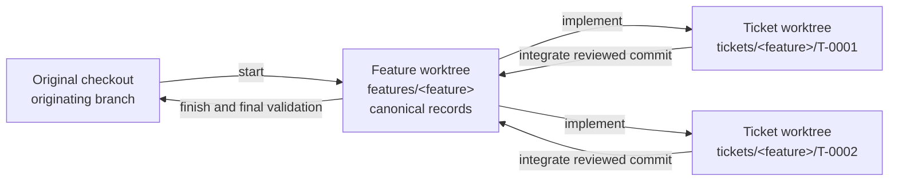
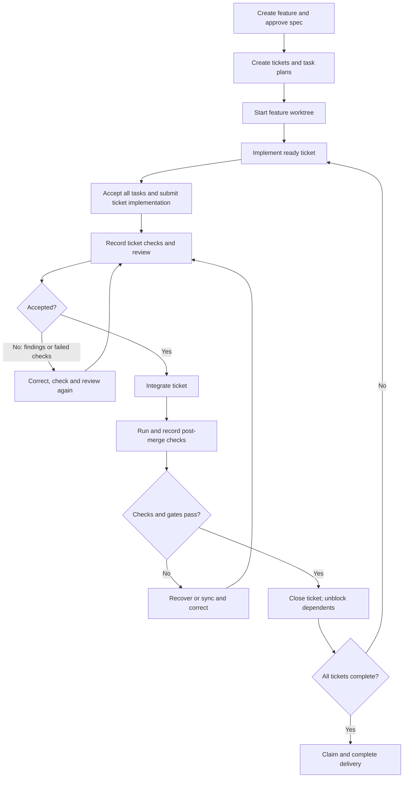
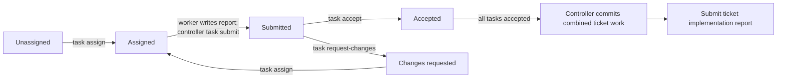
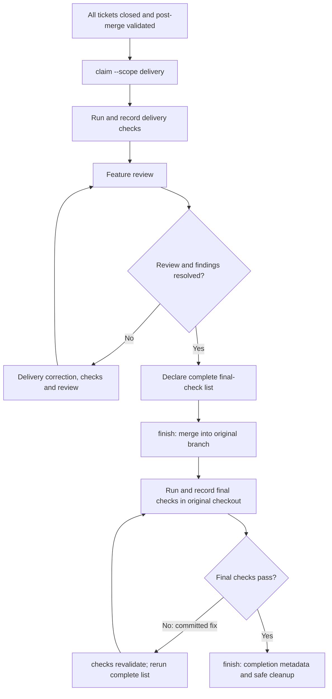

# Current SDD commands and workflows

This document is the starting point for future SDD work. It describes the
current implementation in
[`src/SubagentDrivenDevelopment/`](src/SubagentDrivenDevelopment/). It is a
snapshot of existing behavior, not a specification for unimplemented behavior. The
[batch-workflow-record spec](.spindle/features/0002-batch-workflow-record-commits/spec.md)
is not implemented in the current checkout.

The [SDD glossary](src/SubagentDrivenDevelopment/GLOSSARY.md) defines the domain
terms. The [ticket tracker guide](docs/agents/ticket-tracker.md) describes the
project's operating conventions.

## Records and worktrees

Each feature has a workspace under `.spindle/features/<feature>/`:

```text
spec.md          Feature requirements
design.md        Optional feature design
sdd.json         Structured ledger: tickets, tasks, assignments and evidence
tickets/         Ticket requirements, acceptance criteria and comments
reports/         Assigned task, implementation, review and delivery reports
```

Ticket status is `open` or `closed`; execution state separately tracks progress.
The ledger is authoritative for structured workflow state. A ticket dependency
is ready only after its prerequisite is closed, integrated and post-merge
validated. A task dependency must be accepted.



`start` and `implement` use an existing, absolute parent directory outside the
original checkout for their worktrees. Before `start`, inspect feature records
for sensitive content and explicitly confirm they may be committed. Starting
can commit those records on the original branch before creating the feature
worktree. The feature worktree owns canonical records; ticket worktrees contain
Git copies, not the canonical ledger. Do not assume commands run from a ticket
worktree automatically locate the feature worktree.

## CLI conventions

Run commands as `pnpm spindle sdd <command>`. Use `--help` on a command for its
complete options. Except for `create`, commands take `--feature <directory>`,
the feature workspace directory. Mutating commands generally take
`--actor <acting-agent>`: identify the agent executing the command, not the
model, session, or intended recipient. Ownership rules apply to the operations
that require a ticket or delivery controller.

`--json` produces a success envelope with `data` on stdout; errors and notices
are written to stderr. Task handoffs should be read in JSON mode because the
human-readable output is abbreviated. Assignment commands record assignments;
they do not launch agents. Checks are run by the caller: `checks record`
records a result rather than executing the command.

Use `sdd next` at the start, after a handoff, and after each workflow transition.
It reports actions, assignments and blockers; it does not select a correction,
run a check, or dispatch a worker. It does not enumerate task-level actions or
guarantee that an `implement` suggestion has a task plan. Command-specific gates
still apply, including the global post-merge integration gate. `ready` and
`status` provide additional inspection.

### Command inventory

All commands below are prefixed with `pnpm spindle sdd`.

| Command                               | Purpose and important inputs                                                                                                                                         |
| ------------------------------------- | -------------------------------------------------------------------------------------------------------------------------------------------------------------------- |
| `create`                              | Create a numbered workspace. Supply `--title` and `--actor`; `--with-design` and `--require-retrospective` are optional.                                             |
| `start`                               | Commit initial records and create the feature worktree. Supply `--workspace` and `--confirm-records`.                                                                |
| `ready`, `status`, `next`             | Inspect ticket readiness, detailed state, or next workflow actions.                                                                                                  |
| `resume`                              | Restore a ticket or delivery gate and assignment. `--confirm-handoff` explicitly transfers ownership after the prior controller stops editing.                       |
| `ticket create`                       | Create a ticket with `--title`, `--reporter` and `--category bug\|enhancement`. Fill its Markdown requirements and acceptance criteria.                              |
| `ticket update`                       | Update ticket metadata, blockers or `--blocked-by` dependencies; clear options remove blockers or dependencies.                                                      |
| `ticket comment`                      | Append attributed `--details` to a ticket.                                                                                                                           |
| `task create`, `task update`          | Define or revise a task's instructions, acceptance criteria, explicit edit/create/reference paths and task dependencies.                                             |
| `task assign`                         | Assign a ready task to `--worker` and return its assignment and handoff.                                                                                             |
| `task instructions`                   | Read the current task handoff without changing workflow state.                                                                                                       |
| `task submit`                         | Register the report for the exact task `--assignment`.                                                                                                               |
| `task accept`, `task request-changes` | Record the controller's decision on a submitted task report; a change request requires `--details`.                                                                  |
| `implement`                           | Start or resume the controller's shared ticket worktree, using `--ticket` and `--workspace`.                                                                         |
| `submit`                              | Submit a ticket or delivery implementation, correction or review report for the exact `--assignment`. A review also supplies `--result passed\|failed\|unavailable`. |
| `checks require`                      | Declare or remove an exact external check command. Post-merge and final scopes use a complete list of repeated `--command` options.                                  |
| `checks record`                       | Record `passed`, `failed` or `unavailable` for an exact required command. Failed and unavailable results require details.                                            |
| `checks revalidate`                   | Revalidate a final-check target after a committed fix; rerun the complete final-check list.                                                                          |
| `review`                              | Dispatch the required ticket or feature review assignments.                                                                                                          |
| `review require`                      | Pin a justified specialist with `--type` and `--details` before review assignments freeze. `require` is a positional action.                                         |
| `finding create`                      | Register a finding from a review assignment, with summary, details and blocking or non-blocking classification.                                                      |
| `finding update`                      | Record an explicit disposition: `open`, `confirmed`, `fixed`, `dismissed` or `deferred`. Applicable rulings require rationale, follow-up or a requirements decision. |
| `requirements decide`                 | Approve or reject a requirements change associated with `--finding`; previous review is invalidated.                                                                 |
| `correct`                             | Record a ticket or delivery correction using selected findings and/or an exact failed check. Later attempts require a continuation assessment or a pause decision.   |
| `integrate`                           | Merge the reviewed ticket commit into the feature worktree. Post-merge validation remains pending.                                                                   |
| `sync`                                | Update a ticket baseline for review or synchronize it to a failed post-merge commit before correction.                                                               |
| `claim`                               | Claim `--scope delivery` after all tickets are complete.                                                                                                             |
| `finish`                              | Begin or complete feature finalization; an optional or policy-required `--report` supplies retrospective evidence.                                                   |

Most review, finding, correction, submission and resume operations select
either `--ticket <id>` or `--scope delivery`. Checks additionally support
`--ticket <id> --scope post-merge` and `--scope final`. Consult individual
help output for exact combinations and required options.

## Feature and ticket lifecycle



Create tickets from the approved spec and fill their requirements before
implementation. Plan at least one task per ticket, unless a documented,
approved exception applies. Define task dependencies and explicit
repository-relative paths before `implement`: the plan is frozen after the
ticket implementation assignment. The existing `correct --approved-exception`
is a narrowly scoped, one-use exception for the `0001-ticket-task-dispatch`
feature's T-0004 correction; it is not a general task-plan recovery command.

### Task implementation



The controller assigns workers to the shared ticket worktree. Tasks with unmet
dependencies cannot be assigned. Edit and create paths are reserved while a
task is assigned, submitted or changes-requested; accepted tasks release their
reservations. Reference paths are shared. The current implementation compares
reserved paths by exact string, not directory ancestry. Follow the tracker
convention to avoid overlapping scopes, including nested paths.

Workers edit their assigned scope, write their assigned reports, and do not
commit or change ledger state. The controller submits and reviews each report,
then commits the combined ticket changes after all tasks are accepted.
Submission verifies task state, report hashes, a clean ticket worktree and a
new descendant commit. It does not verify who made the commit or enforce each
worker's actual file edits.

### Checks, review and correction

Declare required ticket checks, run them against the relevant committed inputs,
and record their actual results. Review requires current passing check evidence.
Review dispatch freezes the target commit, changed-path inventory, reviewer
roles and report destinations. Feature and ticket requirements must be
committed and match the reviewed inputs.

The controller reads each review report, registers accepted findings before
submitting the review result, and supplies the verdict explicitly. The CLI
does not infer a verdict from report text. Blocking findings prevent acceptance
until fixed, dismissed with rationale, or deferred under the required approved
requirements decision and fresh review. Corrections require fresh evidence,
checks and review. An unavailable review remains an explicit result, not a
passing review.

### Integration and post-merge validation

`integrate` verifies the reviewed target, task and report evidence, current
requirements, and merge contents before merging the ticket into the feature
branch. It records the actual merge commit and leaves post-merge validation
pending; integration alone does not close the ticket.

Declare the complete nonempty post-merge check list, run the checks on the
feature worktree and record their results. Passing checks and the remaining
gates close the ticket. Pending or failed post-merge validation normally
prevents another ticket integration and blocks dependents. For failed
post-merge recovery, `sync` first fast-forwards a clean, non-divergent ticket
worktree to the recorded failed merge before correction. A later passing result
can also be recorded against the same target; `next` guides a current failure
toward sync and correction.

## Delivery and finalization



Delivery requires all tickets to be closed, integrated and post-merge
validated. The controller claims delivery, records required feature-level
checks and obtains the required feature review. A delivery finding may
reference a ticket, but a delivery correction creates a delivery assignment;
it does not automatically reopen that ticket.

Before `finish`, declare the complete final-check list and satisfy review,
finding, check and retrospective gates. The first `finish` merges the feature
into the originating branch and can return with final validation still pending.
Run and record every final check in the original checkout. If a failed check
needs a committed fix, `checks revalidate` selects the new target and clears
previous final-check results; run the whole list again. A later result may
also be recorded for the same target.

After passing validation, finish from the original checkout records completion
in a ledger-only metadata commit and removes owned worktrees and branches when
safe. The final checks cover the validation target, not the subsequent
metadata-only commit.

## Persistence, safety and recovery

- [`WorkspaceTransaction`](src/SubagentDrivenDevelopment/Persistence/WorkspaceTransaction.ts)
  locks the feature workspace, recovers pending journal writes, and atomically
  updates ledger and ticket records. Conflicting external contents are
  preserved and cause an error.
- In a started feature worktree,
  [`WorkflowRecordsCommitter`](src/SubagentDrivenDevelopment/Services/WorkflowRecordsCommitter.ts)
  currently commits canonical workflow-record changes after writes. Pending
  records are not generally batched until delivery.
- Reports live at assigned paths directly inside `reports/`. Submission records
  a SHA-256 digest; later gates recheck it. A digest establishes content
  identity, not the quality of the report.
- Feature start, ticket start, record commits, integration and finalization use
  journals in the common Git directory. On interruption, preserve the worktree,
  index, reports and journal; inspect the reported state and follow the
  applicable recovery action. Unsafe or ambiguous recovery stops rather than
  silently discarding work.
- The project convention is to integrate tickets serially and validate each
  merge before treating it as complete. A changed review baseline or correction
  requires fresh checks and review.

## Implementation map

| Area                                                         | Responsibility                                                                  |
| ------------------------------------------------------------ | ------------------------------------------------------------------------------- |
| [`Commands/`](src/SubagentDrivenDevelopment/Commands/)       | CLI schemas, option handling and service delegation.                            |
| [`Services/`](src/SubagentDrivenDevelopment/Services/)       | Feature, ticket, task, assignment, review, integration and delivery operations. |
| [`Persistence/`](src/SubagentDrivenDevelopment/Persistence/) | Ledger validation, ticket records, transactions, locks and path safety.         |
| [`Evidence/`](src/SubagentDrivenDevelopment/Evidence/)       | Git and report evidence, commit identity and report integrity.                  |
| [`Policies/`](src/SubagentDrivenDevelopment/Policies/)       | Readiness, ownership, task-plan, check, review and finding gates.               |
| [`Models/`](src/SubagentDrivenDevelopment/Models/)           | Ledger, assignment, evidence and workflow types.                                |
| [`Support/`](src/SubagentDrivenDevelopment/Support/)         | SDD-specific parsing and status formatting.                                     |
