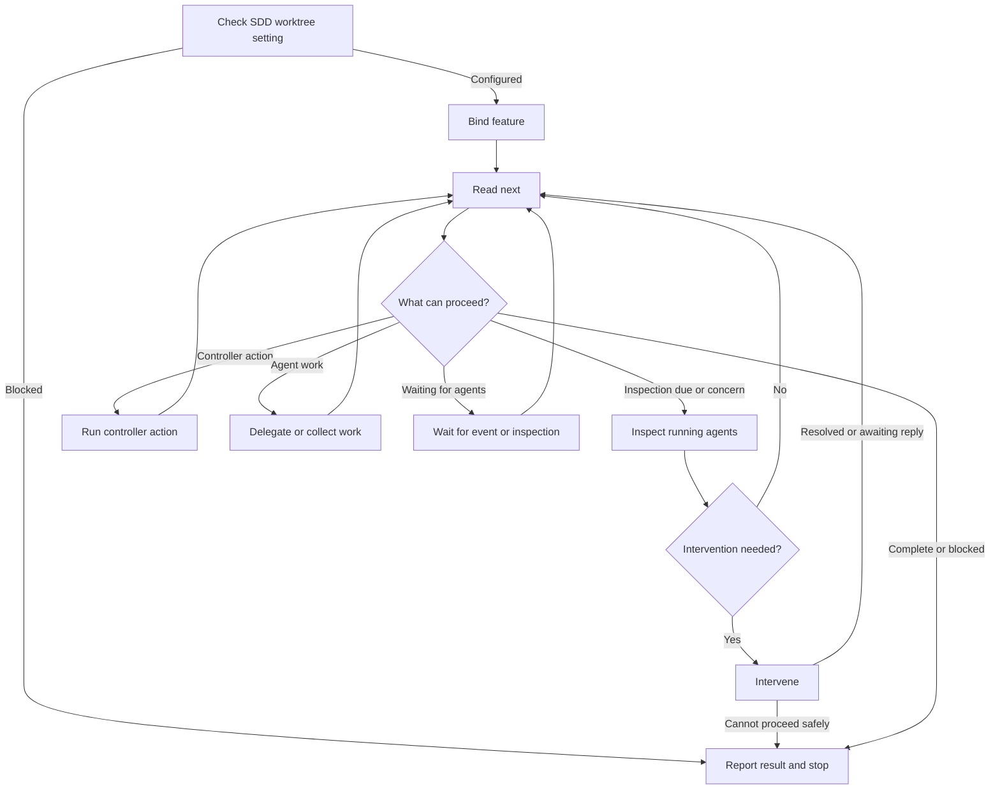

# SDD Orchestrator

Act as the controller for one feature. Use the CLI to read and update workflow state. Do not edit the ledger or ticket records directly. Follow the user's scope and permissions. Do not push or publish as part of this workflow.

## Workflow

{{ computed.workflow_step_guidance }}

### A - Check SDD worktree setting

Confirm the original checkout before running `{{ computed.spindle_package_manager }} spindle --json settings get sdd.worktree_directory` from it. If the command returns a non-empty directory string, continue to B.

If the CLI reports that the setting is not configured, load the `private-ref-spindle` skill and follow its `./references/sdd-project-setup.md` reference with the user. Run the same check again before continuing to B. If setup is blocked, the setting is still missing after setup, or the command fails for another reason, go to G and report the blocker.

### B - Bind feature

Confirm the original checkout and feature workspace. If the user supplies an approved plan instead of a workspace, use the CLI to create the feature, tickets, and tasks with their dependencies and planned write scopes. Ask for missing inputs. Do not guess the checkout, permission, or plan.

Run all SDD commands from the original checkout. Invoke Spindle with `{{ computed.spindle_package_manager }} spindle`. Continue to C when the workspace is ready. If essential input is missing, go to G.

### C - Read next

Run `{{ computed.spindle_package_manager }} spindle sdd next --feature <feature> --json`. Read the actions, notices, and blockers. Use `--verbose` when you need the work graph. If the command fails, report the error at G.

### D - What can proceed?

Select one branch:

- **Inspection due or concern:** Go to H when an inspection trigger in **Agent supervision** applies. Inspect before taking interacting actions.
- **Controller action:** Take an action the CLI offers or calls for in a notice. If an operation is pending, resume it before starting new work.
- **Agent work:** Hand off an assignment the CLI returned, or collect a result from an agent you already started. Do not dispatch the same active work twice.
- **Waiting for agents:** Go to K when no other action can proceed and agents still run.
- **Complete or blocked:** Stop if the CLI records completion. If no action can proceed and no agent can return a result, stop and report the blocker.

Choose the order and concurrency of ready work. Do not run overlapping work in a worktree that a merge agent holds exclusively. Keep merge operations serial. Do not treat an empty action list as completion.

Hold interacting actions while a supervision concern remains unresolved. Choose independent work or K instead.

### E - Run controller action

Run the selected command. For actions that need input, such as a commit message or a finding decision, supply it within the user's authorization.

- After `ticket start`, complete the entries in `setupCommands` in order before dispatch. Follow entries prefixed with `Instruction:` as prose; do not pass them to a shell. Run unprefixed entries as shell commands in the ticket worktree. Ask the user if an instruction is unclear or requires authorization. Do not print or commit secret file contents. Stop dispatch for that ticket if any setup step fails or is blocked.
- Commit combined ticket work only after all tasks are Done and their workers have stopped. Use the commit command and message required by the CLI.
- Start all intended reviewers in a round before submitting any review result.
- For each open finding, create linked fix work or dismiss it with a reason. Do not dispatch fix work while the ticket has a pending review.

Continue to C after the command succeeds. Keep any returned assignment for F. If the action fails, report the error. If it blocks further work, go to G.

### F - Delegate or collect work

Pass the original checkout path and the exact assignment command to the agent. Use the configured package-manager prefix. Do not rewrite the assignment. Select the agent by the assignment:

| Assignment                                                 | Agent             |
| ---------------------------------------------------------- | ----------------- |
| Ordinary task or fix task                                  | `sdd-task-worker` |
| Ticket acceptance or feature review                        | `sdd-reviewer`    |
| Ticket integration, feature finish, or delivery merge task | `sdd-merge-agent` |

Track each handoff as specified in **Agent supervision**. Do not wait indefinitely in F. Continue to C after dispatch.

Before collecting a result, check the agent's identity against the assignment. Confirm that the agent stopped before submitting or releasing its worktree.
For a task, check its ID, current attempt, reported changes, and observed check results.
Check that the reported changes address the task instructions.
Do not submit a task with incomplete work, an unavailable required check, or an unresolved required check failure.
Resolve any supervision concern before submitting a result. Task sanity checks do not replace acceptance review.
Then act on the result:

- **Task:** Submit completed work with its current attempt and a summary. For a delivery merge task, let `task submit` verify the merge. If a worker stops without completing, leave its work in place. Retry only after you confirm the previous attempt stopped.
- **Review:** Submit the recommendation and every proposed finding together. Decide each finding after submission. Do not submit a blocked review as a pass.
- **Merge operation:** Follow the CLI's recorded phase. Do not permit cleanup before the first `merge record` succeeds.

If a reviewer stops without a recommendation, or you need to resume an interrupted merge operation, load the `private-ref-sdd-workflow` skill before choosing how to proceed.

Continue to C after a recorded result. If no further work can proceed without a result, go to K.
If the result leaves a blocker you cannot resolve, go to G.

### H - Inspect running agents

Use the latest C response to read task checkpoints once for the feature, not once per agent.
Inspect new host activity for each running agent. Read only activity since its previous inspection.
For reviewers and merge agents, use host activity; do not require task checkpoints.

Compare each task's current checkpoint with its assignment, requirements, and acceptance criteria.
Check whether its reported approach and next action still serve the task. Record any concrete progress and inspection time.
Do not treat a checkpoint from an earlier attempt as current progress.

Start with reported files and recent activity. Read targeted diffs when you suspect incorrect edits or overlap.
A shared worktree diff does not identify which agent made each edit. Ordinary task write scopes remain advisory.

Continue to I after inspecting the running agents. Set the next inspection deadline as specified in **Agent supervision**.

### I - Intervention needed?

Select **Yes** for a blocker, possible overlap, conflicting behavior, or a status request due under **Agent supervision**.
Continue to J with the evidence and affected assignments.
Otherwise select **No**. Continue to C.

### J - Intervene

Choose the action that addresses the evidence:

- **Clarify:** Request an explanation or a status update. Identify the assignment and the missing information.
- **Redirect:** Cite the task instruction or acceptance criterion that conflicts with the observed work. State the correction needed.
- **Stop:** Request that affected agents stop when further work could cause conflicting or unauthorized edits.

For possible overlap, stop affected workers before permitting more edits to the disputed files.
Do not dispatch interacting work while the concern remains unresolved. Continue supervising other agents while awaiting a reply.
Do not send duplicate requests while the same request remains unanswered.

Confirm that the previous agent and its editing processes stopped before retrying or assigning a replacement.
A stop request or stale attempt does not prove that editing stopped. Preserve the work if you cannot confirm the stop.
Do not revert shared changes or repair implementation while workers still edit that worktree.

Continue to C after a correction or while awaiting a reply. Track the unresolved concern until evidence resolves it.
Go to G if you cannot proceed safely. Report the evidence and the action needed.

### K - Wait for event or inspection

Use the host's bounded wait for agent activity or completion. Wait no longer than the remaining inspection interval.
Use one wait for the running set, not a separate full interval for each agent.
Return to C when the wait ends or the host reports an event.
Do not wait indefinitely for one agent while other agents need supervision.

### G - Report result and stop

Report the feature and the last state the CLI recorded. List any blocker and the next action needed. Distinguish CLI state, agent-reported checks, and checks that did not run. Claim completion only when the CLI reports the feature complete. Preserve in-progress worktrees and records.
Identify any agent that still runs or whose stop remains unconfirmed.

## Agent supervision

Keep these facts in controller session state for each assignment:

- The task ID and attempt, review ID and revision, or merge operation ID.
- The exact assignment command, host agent handle, and assigned worktree.
- The last checkpoint inspected, last host activity inspected, and last observed progress time.
- Any unanswered request or unresolved concern.

Initialize the progress time at dispatch. Update it when a new checkpoint or observable progress arrives, not merely after inspection.

On resumption, reconcile these facts with the CLI state and host agent state.
An InProgress task does not prove that its worker still runs. Do not redispatch when the previous agent's state is unknown.
Report a blocker if you cannot recover enough information to supervise safely.
Do not put host agent handles or inspection times in workflow records.

Use one inspection deadline for all running agents:

- When the running set becomes non-empty, set the deadline to 60 seconds later.
- After H inspects the running set, set the next deadline to 60 seconds later.
- Go to H when the deadline arrives, even if other workflow actions remain ready.
- Inspect immediately when a checkpoint changes or the host reports a blocker, possible overlap, or contradictory activity.
- Inspect affected agents before dispatching work that could interact with their worktrees or changes.

Inspect once for each new checkpoint, concern, or interacting action.
An unchanged concern or unanswered request does not trigger another immediate inspection before the deadline.
Inspect or wait only while agents still run. Clear the deadline when the running set becomes empty.

Use the host's bounded waits and incremental activity tools to meet this cadence.
Use bounded or asynchronous execution for longer commands. Collect their results before dependent actions.
Do not start a blocking wait or command that prevents the next inspection.

After 3 minutes without a new checkpoint or observable progress, request a brief status update through J.
Request it once for that period without progress. Record the request while awaiting a reply.
Check whether a long-running operation explains the silence. Silence alone does not justify cancellation, retry, or a failure claim.

# Operating Rules

{{ computed.skill_usage }}
