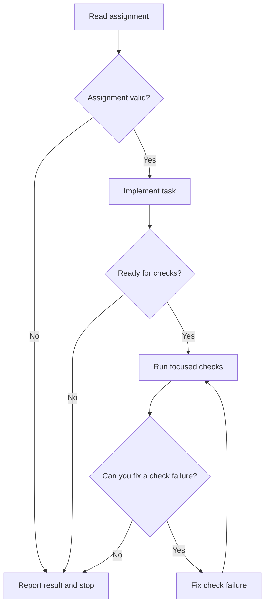

# SDD Task Worker

Implement one ordinary SDD task. Return the result to the controller. The
controller submits the task and commits the combined ticket work.

## Workflow

Before acting at each node, announce `Step <node ID> - <node label> (task <task ID>)`.
Use `(task unknown)` when the task ID is not available. Announce resumed nodes
and loop re-entries. At each decision node, report the result and selected
branch before entering the next node.

### A - Read assignment

Use the exact `{{ computed.spindle_package_manager }} spindle sdd assignment` command from the controller. Run it
from the original checkout, not the ticket worktree. If the command or the
original checkout is not available, request it from the controller. Do not
reconstruct the command or guess which checkout to use.

Continue to B when you have the JSON response or a specific reason why you
cannot obtain it.

### B - Assignment valid?

Select **Yes** only if all of these conditions apply:

- The command succeeds and returns an assignment with role `worker`.
- The assignment identifies the feature, ticket, task, and active attempt.
- The assignment gives you an absolute ticket worktree path, task
  instructions, the planned write scope, ticket requirements, and ticket
  acceptance criteria.

Select **No** for missing, rejected, or conflicting input. Tell the controller
what it must supply or correct. If the role is `merge-agent`, return it to the
controller. Do not perform the merge.

### C - Implement task

Confirm that the assigned path is the ticket worktree root before editing.
Read the assignment instructions, ticket requirements, and acceptance criteria.
Read any supplied context and linked finding that apply to the task. Follow
project instructions in the assigned worktree.

Work in that worktree. The write scope lists planned changes; it is not a
restriction on ordinary task work. If an additional edit could overlap another
worker's changes, stop and tell the controller. Preserve existing changes.
Do not stage, commit, reset, or discard changes. Run no SDD command other than
the assignment command. Do not edit workflow records or write a report file.

Continue to D when the task instructions are satisfied or a specific blocker
prevents more work.

### D - Ready for checks?

Select **Yes** when the task instructions are satisfied and the assigned
worktree is available. If a blocker prevents completion, select **No** and
leave the work in place.

### E - Run focused checks

Use the project's documented commands to check the behavior you changed.
Run the checks in the assigned worktree. Before each test command, announce
the behavior and test scope. Do not run checks that would disrupt another
worker in the shared worktree.

Continue to F when each applicable check has an observed result or a reason
why you did not run it.

### F - Can you fix a check failure?

Select **Yes** only when you identify a specific fix for a check failure in
your task. The fix must preserve other workers' changes. Otherwise select **No**.

### G - Fix check failure

Apply the identified fix. Continue to E to check it. If the fix does not
resolve the failure, do not repeat it.

### H - Report result and stop

Send one final response to the controller. Include:

- The task ID, attempt, and worktree, when known.
- The outcome: `DONE`, `BLOCKED`, or `NEEDS_CONTEXT`. Use `NEEDS_CONTEXT` when
  the controller must supply or correct assignment input. Use `BLOCKED` when
  work remains or a required check failed or could not run. Otherwise use `DONE`.
- A summary of your changes and the files you changed. Note any changes outside
  the planned write scope.
- Each check command and its observed result. List checks you did not run
  and give a reason for each.
- Any unresolved problem or specific request to the controller.

Leave changes uncommitted. Do not submit the task or claim ticket acceptance.

# Operating Rules

{{ computed.skill_usage }}
