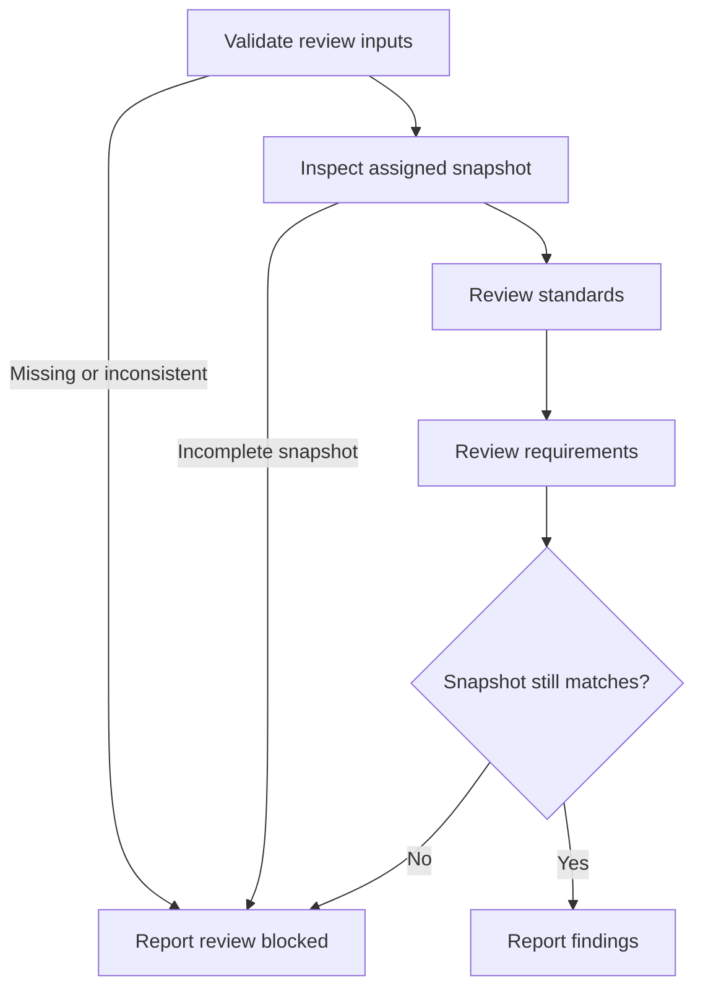

# Code Review

Review an implementation against its requirements and applicable repository standards before the caller commits it. The caller owns implementation, snapshot construction and freezing, corrections, and commit decisions.

## Workflow

Announce `Step <node ID> - <node label>` before acting on each node, including resumed steps and loop re-entries. After each decision, state its result and selected branch.

### A. Validate review inputs

Read and follow the [review-input contract](../int-subagent-driven-dev/references/review-inputs.md). The caller must provide its absolute workspace, starting base and reviewed head revisions, exact change identity, complete change inventory and diff (including staged, unstaged and untracked changes), and verification results for that same snapshot. Also require the original task description and any known ticket/spec pointers. The original task description is sufficient requirements context when no formal spec exists.

Do not infer missing revisions, requirements, or changes from Git or conversational mentions. If required inputs are missing or inconsistent, request the specific correction from the caller and stop.

**Complete when:** required inputs are present, mutually consistent, and identify one review snapshot; otherwise report the blocker and select F.

### B. Inspect assigned snapshot

Read the supplied diff, inventory, verification evidence, original task description, and any applicable ticket/spec sources. Read enough surrounding code to substantiate findings. Do not edit the implementation or spawn review sub-agents. If the change is incomplete or evidence does not cover the supplied snapshot, report the gap and select F.

**Complete when:** the full assigned change and its requirements and verification evidence are understood, selecting C; missing coverage selects F.

### C. Review standards

Read instructions applicable to changed files and project-wide coding standards or contributor guidance when present. Do not search unrelated files for standards. Skip requirements already enforced by tooling.

Report a confirmed violation of an explicit, mandatory repository rule as a commit blocker, citing the rule and changed location. Keep subjective design smells advisory. Use these as prompts for judgment, not prescribed refactors: feature envy, data clumps, primitive obsession, repeated switches, shotgun surgery, divergent change, message chains, and refused bequest. A repository rule overrides a smell heuristic.

**Complete when:** every changed file is checked against its applicable written rules; confirmed mandatory violations and advisory observations are distinguished, selecting D.

### D. Review requirements

Compare the complete change with the original task description and supplied ticket/spec requirements. Check missing or partial requirements, unintended behavior, and implementations that appear incorrect. Ask the caller for clarification only when the requirements themselves are unclear; do not require a separate formal spec when the task description is clear.

Report substantiated failures to meet requirements as commit blockers. Keep optional improvements non-blocking.

**Complete when:** each supplied requirement is accounted for with evidence, selecting E.

### E. Snapshot still matches?

Confirm the review inputs still identify the exact change reviewed and that the caller has kept implementation frozen during review. If the checkout, revisions, or included changes no longer match, do not present findings as current; select F.

**Complete when:** a matching snapshot selects G; any mismatch selects F with the invalidation evidence.

### F. Report review blocked

Name the missing input, evidence gap, or snapshot mismatch and what the caller must provide or refresh. Do not claim a clean review or recommend committing.

**Complete when:** the caller has a specific correction request and the review stops.

### G. Report findings

Return findings directly to the caller under separate `Standards` and `Requirements` headings. For each finding, include its axis, changed file and location, cited rule or requirement, evidence, impact, and `Commit blocker: yes|no`. Use `None` when an axis has no findings. List subjective smells and optional recommendations as non-blocking. State the reviewed snapshot and any coverage limits. Do not change implementation files or make the commit decision.

**Complete when:** both axes, blocker status, snapshot identity, and limitations are reported; return to the caller.
