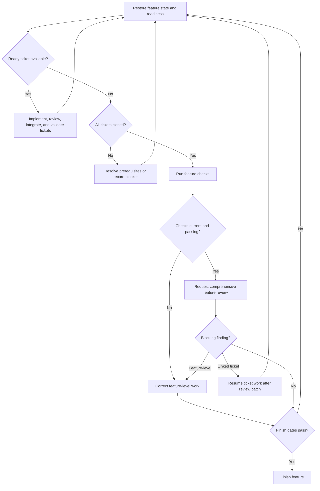

# Subagent-Driven Development

The controller coordinates a feature's tickets, workers, checks, reviews, and completion. The feature workspace and `sdd.json` are the source of truth for structured ticket and delivery state; each ticket Markdown file holds its requirements, acceptance criteria, and discussion.

Add `--json` to Spindle commands when consuming structured results. Read the
success envelope's `data` field; stdout contains one result, while stderr
contains JSON notices or errors. A nonzero exit indicates failure. Human output
is the default, and JSON mode never prompts.

## Workflow map

Before acting on each chart node, announce `Step <node ID> - <node label>`, including initial entries, resumed steps, and loop re-entries. After each decision, state its result and selected branch before entering the target node.

## Ticket workflow

1. Read the feature spec, tickets, applicable instructions, glossary, and ADRs. Inspect `{{ computed.spindle_package_manager }} spindle sdd status --spec <path>` and `{{ computed.spindle_package_manager }} spindle sdd ready --spec <path>` to understand blockers, dependencies, and available work. Inspect feature records for secrets and start the feature worktree with `{{ computed.spindle_package_manager }} spindle sdd start --spec <path> --workspace <external-directory> --confirm-records`. Handle unrelated changes before starting. Run subsequent controller commands in the feature worktree using its returned spec path.
2. Create a ticket for independently actionable work with `{{ computed.spindle_package_manager }} spindle sdd ticket create`. Fill its `[REQUIREMENTS]` and `[ACCEPTANCE CRITERIA]` placeholders. Use `{{ computed.spindle_package_manager }} spindle sdd ticket update` for tracker status, explicit blockers, and dependencies; the supported lifecycle is `open`, `in-progress`, and `closed`. Readiness is derived from status, blockers, and dependencies rather than stored as a separate triage state.
3. Choose a safe concurrency limit. Use `{{ computed.spindle_package_manager }} spindle sdd implement --workspace <external-directory>` for each ready ticket and dispatch the returned assignment until capacity is full. As workers finish, dispatch other ready independent tickets without waiting for unrelated work. Inspect changed canonical records for secrets and pass `--confirm-records` before any automatic record commit. Each worker uses its own worktree. Give workers the canonical source and report paths; submit each implementation report with `{{ computed.spindle_package_manager }} spindle sdd submit --role implementation`.
4. Have each implementer commit its changes. Record relevant checks and submit reviews against that exact ticket commit. Keep its worktree frozen during review; any changed commit requires fresh checks and review.
5. Use `{{ computed.spindle_package_manager }} spindle sdd integrate` to merge reviewed work, inspecting changed canonical records and passing `--confirm-records` before any automatic record commit. Serialize merges and their post-merge checks. Declare the full non-empty check list with `checks require --scope post-merge`, run it in the feature worktree, and record results with `checks record --scope post-merge`. Passing checks close the ticket automatically and unblock eligible dependents.

   If closure is blocked by a ticket blocker or unmet dependency, resolve it and repeat `checks require --scope post-merge` with the same complete list. Passing evidence is retained; rerun checks if their snapshot became stale.

   If a post-merge check fails, keep other merges blocked. Fast-forward the clean ticket worktree to the recorded failed merge commit, then use `sdd correct --check-failure <command>` to dispatch a fix. Commit, check, and review the fix before merging it and rerunning the frozen post-merge check list.

   If integration reports a conflict, rebase the ticket worktree onto the current feature branch, resolve and commit the conflict there, and use `sdd checks require --rebase-baseline` with an existing required command. Run fresh checks and obtain fresh review before retrying integration. Preserve all uncommitted changes and stop if recovery is unsafe.

If work is interrupted, inspect `{{ computed.spindle_package_manager }} spindle sdd status` and use `{{ computed.spindle_package_manager }} spindle sdd resume` to restore the recorded assignment. Preserve existing reports, findings, and evidence. Do not invent missing results or reset progress.

## Feature review and completion

After every ticket is closed, establish current feature-level checks and request the comprehensive review with `{{ computed.spindle_package_manager }} spindle sdd review --scope delivery --inventory <json-array>`. The `sdd-reviewer` is the default reviewer. Add specialists only for justified objectives with `{{ computed.spindle_package_manager }} spindle sdd review require --scope delivery --type <agent-name>`; eligible names must be marked `canReview: true` in the Blueprint Catalog, and actual agent access must be confirmed before dispatch.

Submit every assigned review report against its exact assignment. Register findings from their report and snapshot. A blocking finding can name `--related-ticket`; once the complete review batch is submitted, that ticket is reopened so work can resume. Resolve blocking findings through ticket work and repeat any invalidated checks and reviews.

For detailed review, findings, correction, final merge, checks, and cleanup, read [feature delivery](./references/full-spec.md). For feature-level corrective work, follow [corrective rounds](./references/corrective-rounds.md). Feature completion requires all tickets integrated, current passing required checks and reviews, no unresolved delivery blockers, and passing checks on the final merge. Do not modify the affected checkout concurrently with a Git transition. Never stash, discard, force-delete, push, or publish without authorization.

## Reports and verification

Keep worker reports at their assigned absolute paths inside the feature's `reports/` directory. Preserve earlier reports as history and distinguish inspected evidence from checks actually run. Record failures, unavailable checks, and limitations explicitly. A passing test run is not a substitute for review or for the acceptance criteria.

See [verification evidence](./references/verification-evidence.md) for the worker handoff contract.
