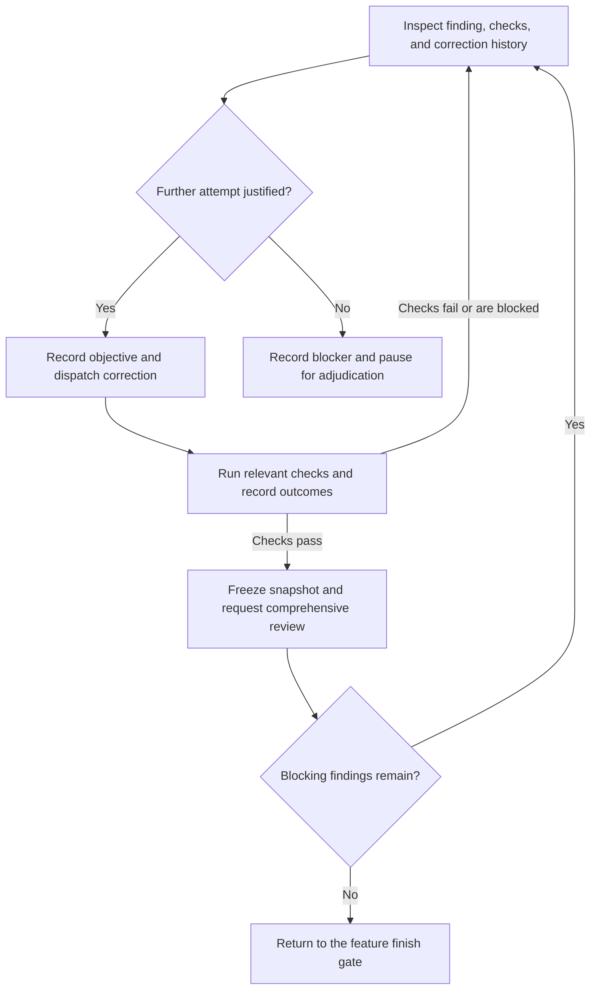

# Feature correction

Parent: K - Correct feature-level work. Enter this workflow for actionable
feature-level review findings or non-mechanical feature-check failures. A
finding linked with `--related-ticket` returns to normal ticket work after the
review batch reopens that ticket.

Before acting on a chart node, announce
`Step K.<node ID> - Correct feature-level work / <node label>`, including
initial entries, resumed steps, and loop re-entries. After each decision, state
its result and selected branch before entering the target node.

## A. Inspect finding, checks, and correction history

Read the finding and its report provenance, current feature state, relevant
checks, and previous correction attempts. Identify a concrete correction
objective and the evidence needed to determine whether it is resolved.

## B. Further attempt justified?

For a first attempt, confirm the finding or check failure is actionable. For
later attempts, cite verified progress from current checks or review. Repeated
failures, stalled progress, or requirements disagreement require controller
adjudication rather than another automatic dispatch.

## C. Record objective and dispatch correction

Use `{{ computed.spindle_package_manager }} spindle sdd correct --scope delivery` to record and dispatch the feature-level
correction. Preserve prior attempts, reports, and report destinations.
Serialize implementation edits and keep the assignment limited to the
recorded objective.

## D. Run relevant checks and record outcomes

Run appropriate tests and checks against the corrected snapshot. Record actual
results and limitations. Do not claim stale evidence covers changed code or
requirements.

## E. Freeze snapshot and request comprehensive review

After checks pass, freeze implementation edits and request a new comprehensive
feature review against the corrected snapshot. Submit each assigned report
against its exact assignment.

## X. Record blocker and pause for adjudication

Preserve working changes, reports, findings, attempts, and evidence. State the
remaining blocker or requirement decision needed; do not dispatch another
correction until it is resolved.

## Y. Return to the feature finish gate

Record the resolved findings and current check/review evidence. Resume the
parent with `Step K - Correct feature-level work`, then continue at
`Step L - Finish gates pass?`. If adjudication was required at X, resume at
`Step K.B - Correct feature-level work / Further attempt justified?` only after
the blocker or decision is resolved. TDD is optional; tests appropriate to the
change remain expected, and verification evidence must be recorded before
completion.
