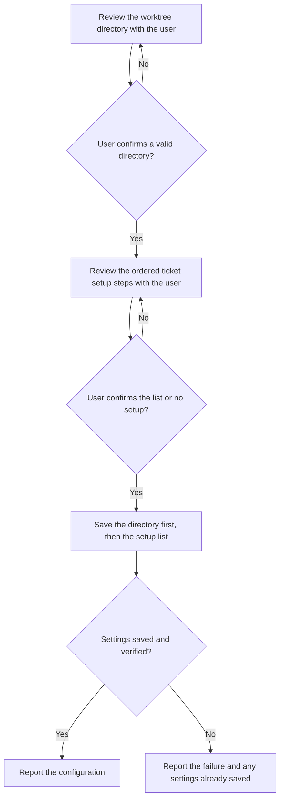

# Set Up a Project for SDD

Run `{{ computed.spindle_package_manager }} spindle settings` commands from the original checkout of an initialized project. Use the `get` and `set` subcommands for targeted changes without the interactive walkthrough.

## Workflow

{{ computed.workflow_step_guidance }}

{{ computed.subworkflow_step_guidance }}



## Choose the worktree directory

Check `{{ computed.spindle_package_manager }} spindle settings get sdd.worktree_directory` and ask the user where to put the feature and ticket worktrees. If a valid directory is already set, offer to keep it. Otherwise, suggest a sibling path such as `../my-project-worktrees`. Confirm the exact path with the user before moving on.

Relative paths resolve from the original checkout root. `~` and `~/` paths resolve from the current user's home directory. Confirm that the resolved directory is outside the original checkout, including after resolving symlinks.

## Agree on ticket setup

Check `{{ computed.spindle_package_manager }} spindle settings get sdd.setup_command`. Use project docs, lockfiles, and the current list to suggest the steps each new ticket worktree needs. Confirm the exact list and order with the user. If no setup is needed, use `[]`.

- Use shell commands such as `pnpm install` only when they fit the project. The SDD orchestrator runs them in the ticket worktree.
- Start prose instructions with `Instruction:`. For an approved `.env` copy, specify the original checkout as the source and the ticket worktree as the destination. Copy only if the destination file is missing. Do not open, print, or commit `.env` contents, and never put secret values in settings.

## Save and verify

Tell the user before saving that each setting change regenerates selected Blueprints and can overwrite their managed paths. Set `sdd.worktree_directory` first because it is required to enable SDD worktrees. Pass the directory as a JSON string and the setup list as a JSON array of strings. Substitute the confirmed values for these examples and skip settings that already match:

```sh
{{ computed.spindle_package_manager }} spindle settings set sdd.worktree_directory '"../my-project-worktrees"'
{{ computed.spindle_package_manager }} spindle settings set sdd.setup_command '["Instruction: Copy .env from the original checkout to the ticket worktree only if it is missing there. Do not inspect, print, or commit its contents.","pnpm install"]'
```

Read both settings back with `{{ computed.spindle_package_manager }} spindle settings get <key>` and compare them with the confirmed values. If a write fails or a value does not match, stop and report the failure and any settings already saved. Do not run the setup steps now: `{{ computed.spindle_package_manager }} spindle sdd ticket start` returns them to the SDD orchestrator, which handles them in order before dispatch.
