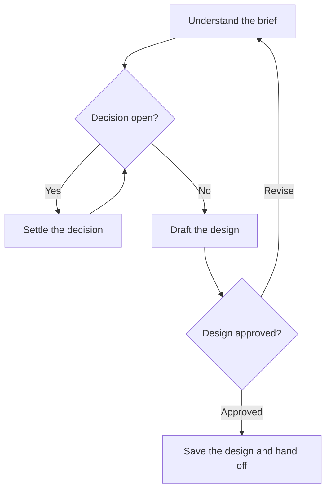

# Author an SDD Design

Settle consequential product or workflow decisions before drafting a spec. Design is optional. If the user wants a spec without a design, stop and point them to `/sdd-to-spec`.

Announce `Step <ID> - <label>` before each node, including resumed steps and loop re-entries. State each decision result and the selected branch before entering the next node.



## A. Understand the brief

Identify the user goal, success outcomes, scope, and constraints. Read relevant project docs and code before asking questions. Identify the original checkout and any existing numbered feature workspace. If that workspace already has a filled-in spec, ask before adding or revising a design for it. An unfilled spec template does not count as a spec.

**Complete when:** the brief and workspace are clear, and any consequential open decision is named.

## B. Decision open?

Go to C if a decision changes the outcome, scope, or workflow. Otherwise go to D. Do not reopen decisions that the user or project evidence already settled.

**Complete when:** the next branch is stated.

## C. Settle the decision

Ask one focused question at a time. Explain what the answer changes. When multiple approaches fit, compare their main trade-offs and recommend one. Record the user's choice or an expressly delegated decision. Return to B.

**Complete when:** the decision is recorded or a focused follow-up is pending.

## D. Draft the design

Follow the `public-ref-asd-ste100` skill for clarity. Use the Spindle installation's `assets/Templates/sdd/design.md` as the outline. Define the terms, rules, and responsibilities needed to understand the selected approach.

Describe how the design works from entry to outcome. Include alternate paths, failure, and recovery where they matter. Use a Mermaid flowchart for branching, a sequence diagram for handoffs, or a state diagram for lifecycle rules. Add a diagram only when it clarifies the design. Keep rules and exceptions explicit in prose. Leave detailed requirements, tickets, and tasks to later steps.

**Complete when:** the draft shows the observable outcomes, selected direction, and open questions without implying decisions the user did not make.

## E. Design approved?

Show the draft and ask for approval. Return to A if the user requests changes. Continue to F only after approval. Stop if the user chooses the spec-only path.

**Complete when:** approval, revisions, or the spec-only choice is explicit.

## F. Save the design and hand off

For an existing workspace, save the approved text as its `design.md`. Read and preserve existing content outside the approved changes. Do not create another workspace or edit the ledger.

For a new feature, use a lowercase kebab-case slug. Run this command from the original checkout to create the workspace and its spec and design templates:

```sh
{{ computed.spindle_package_manager }} spindle sdd create --slug "<slug>"
```

Use the returned workspace path to locate `design.md` and fill it in with the approved design. Leave `spec.md` as an unfilled template for the `sdd-to-spec` skill. If creation fails, report the error and check for a partially created workspace before retrying.

Report the design path and ask the user to invoke `/sdd-to-spec` with it. Do not invoke that skill automatically or fill in the spec.

**Complete when:** the approved design is saved in one feature workspace and the user has its path for spec authoring.
