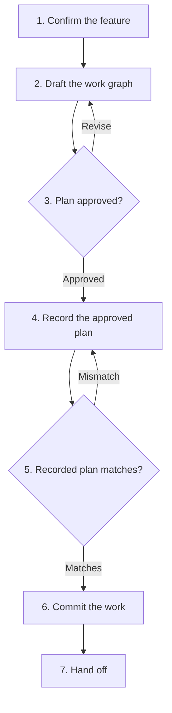

# Plan SDD Tickets and Tasks

Turn an approved spec into a work graph in its existing SDD feature workspace. This skill records the plan. It does not start implementation.

Accept one optional path to the feature workspace's `spec.md`. If omitted, use the approved spec identified in the conversation. If the spec is missing, unapproved, or ambiguous, ask the user before planning.



## 1. Confirm the feature

Read the full spec. Run all SDD commands from the original checkout, not a feature or ticket worktree. Pass the numbered feature name or workspace directory as `--feature`. Do not create another feature workspace.

Inspect the existing work graph with `{{ computed.spindle_package_manager }} spindle sdd next --feature "<feature>" --verbose --json`. If work already exists, read the relevant ticket Markdown and ledger entries. Identify which items to keep, update, or add. Do not duplicate existing items.

**Complete when:** the approved spec, original checkout, and existing work graph are known.

## 2. Draft the work graph

Use the spec and relevant repository context to plan the work. Follow the `private-ref-ears` skill when writing observable behavior requirements and acceptance criteria.

- Give each ticket a title, requirements, and acceptance criteria. Prefer a small, verifiable slice of feature behavior. Add ticket dependencies only when a ticket needs another ticket's result.
- Give each ticket at least one task. Split it only when the parts form distinct work. Give each task self-contained instructions with observable completion criteria. Add files or links as optional context.
- List at least one planned file per task in its write scope. Use repository-relative file paths, not directories or globs. Order tasks that share a write path. Shared read-only context does not require ordering.
- Keep task dependencies within the same ticket. Use ticket dependencies for prerequisites across tickets. Check that neither level contains cycles.

**Complete when:** the plan covers every spec requirement and every task has instructions, completion criteria, and a write scope.

## 3. Get approval

Show the tickets with their requirements, acceptance criteria, and dependencies. Nest each task under its ticket. Show its instructions, write scope, context, and prerequisites. Revise the plan until the user approves both levels. Do not change the ledger before approval.

**Complete when:** the user approves the tickets, tasks, write scopes, and dependencies.

## 4. Record the approved plan

Create prerequisites before their dependents. Use the IDs returned by the CLI. Repeat `--depends-on` for each prerequisite ID. Repeat `--write-scope` and `--context` for each value. Omit optional flags when they do not apply.

```sh
{{ computed.spindle_package_manager }} spindle sdd ticket create --feature "<feature>" \
  --title "<title>" --requirements "<requirements>" --acceptance-criteria "<criteria>"

{{ computed.spindle_package_manager }} spindle sdd task create --feature "<feature>" \
  --ticket "<ticket-id>" --instructions "<work and completion criteria>" \
  --write-scope "<repository-relative-file>"
```

Use `sdd ticket update` or `sdd task update` for approved changes to existing items. Use each command's `--help` for syntax. Do not edit `sdd.json` or duplicate task plans in ticket Markdown. If a command fails, report the error and any IDs already created. Reconcile the current graph before resuming.

**Complete when:** the CLI has recorded every approved ticket, task, and dependency.

## 5. Check the plan

Run the same `sdd next --verbose --json` command again. Compare the recorded graph with the approved plan. Check ticket Markdown and ledger entries for approved text and context that the graph does not show. Report the feature, ticket IDs, task IDs, and any mismatch. Do not execute the actions that `sdd next` suggests. If the plan does not match, return to step 4 to reconcile it through the CLI and check again before committing. Obtain user approval before changing the approved plan.

**Complete when:** the recorded plan matches the approved plan, all IDs have been reported, and implementation has not started.

## 6. Commit the work

Follow the `public-ref-commit-format` skill for the commit message. Review the working tree and index in the original checkout. Stage only the ticket Markdown and feature ledger changes created by this workflow. If unrelated changes are already staged, ask the user how to proceed without including or unstaging them.

Commit the work and verify that all approved tickets, tasks, and dependencies are committed. If they are already committed, do not create an empty commit. If the commit fails, report the error and stop before handoff.

**Complete when:** the verified work graph is committed, with no unrelated changes included.

## 7. Hand off

Tell the user to select `sdd-orchestrator` as the active agent, then invoke `/sdd-implement-spec` with the feature when ready to start implementation. Do not invoke that skill automatically or start implementation.

**Complete when:** the user has the committed feature's reference for implementation.
