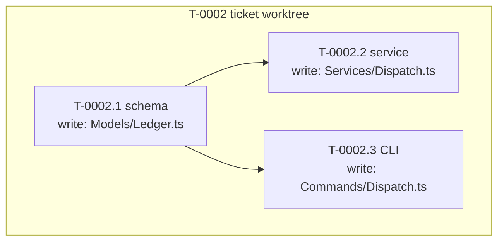
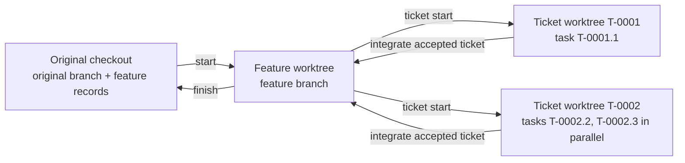
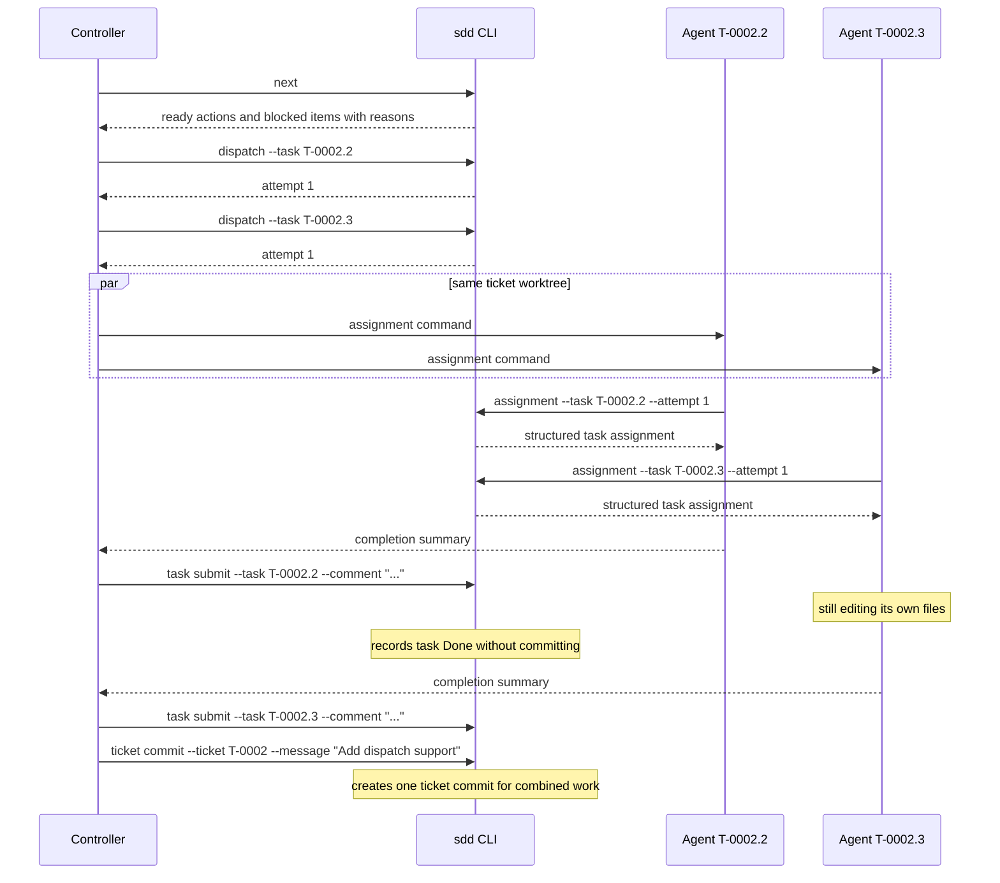
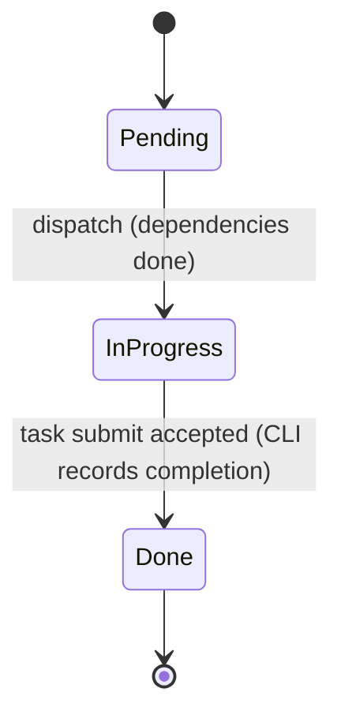
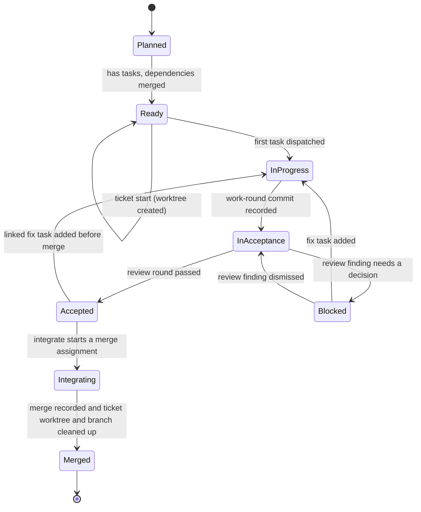
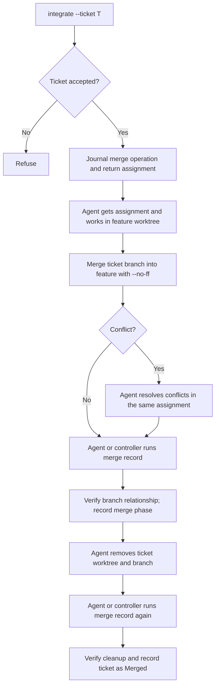
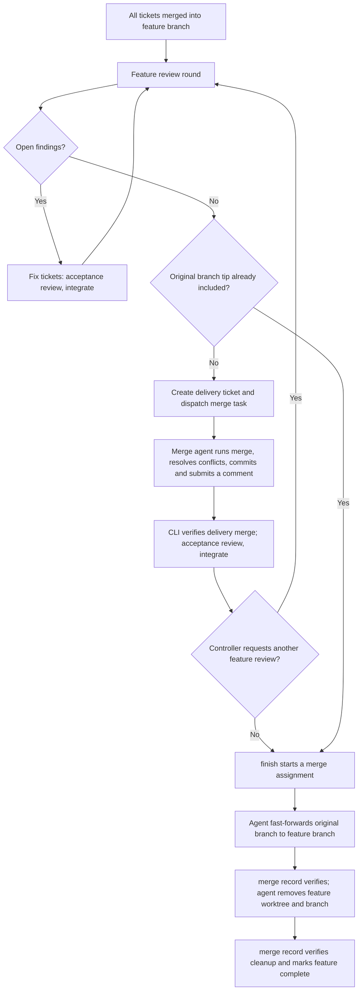

# SDD target workflow

This document defines the target design for subagent-driven development (SDD).
It is the starting point for rebuilding
[`src/SubagentDrivenDevelopment/`](../../../src/SubagentDrivenDevelopment/) from
scratch. The rebuild does not support or migrate feature workspaces, branches
or worktrees created by the current implementation.

## Concepts

| Term         | Meaning                                                                                                                         |
| ------------ | ------------------------------------------------------------------------------------------------------------------------------- |
| Feature      | The complete unit of work, with a spec, a feature branch and one or more tickets.                                               |
| Ticket       | A coherent deliverable within a feature. It owns acceptance criteria, a branch and worktree, acceptance review and integration. |
| Task         | A dispatchable unit of implementation within a ticket. It declares its instructions, file scope and task dependencies.          |
| Finding      | A recorded issue from a review. Review findings may be dismissed with a reason.                                                 |
| Controller   | The single operator coordinating the feature through the SDD CLI.                                                               |
| Worker       | An agent assigned to implement a task or carry out a merge operation.                                                           |
| Reviewer     | An agent reviewing a ticket against its acceptance criteria, or the completed feature against the feature spec.                 |
| Review round | One or more reviews of the same target at the same code revision.                                                               |

## Design principles

1. **Tasks are ticket implementation work.** Every ticket needs at least one
   task. Agents implement tasks; tickets hold requirements, acceptance criteria
   and the acceptance review. Branch integration and feature completion use
   separate merge assignments.
2. **One worktree per ticket.** All tasks of a ticket run in its ticket
   worktree. Several agents can work in the same ticket worktree at once.
3. **Tasks declare a planned write scope.** Each task lists the repository
   paths it is expected to change. The CLI uses declared scopes to identify
   planned write conflicts, but ordinary tasks may change other files.
   Submission and ticket commit do not reject those changes. Merge-task
   submissions still verify that the merge changes only files in scope.
   The CLI does not store per-task file hashes or snapshots.
4. **Dependencies order the work.** Tickets depend on tickets, and tasks depend
   on tasks in the same ticket. Work cannot start until its dependencies are
   done. Findings link to the fix tasks or tickets they create.
5. **Commits record completed ticket work.** Workers leave ordinary task
   changes uncommitted. After all tasks are Done and workers have stopped, the
   controller creates a ticket commit. For a merge task, the assigned agent
   creates the merge commit, and the CLI verifies it instead of replacing it.
   Each completed round has one work-round commit; fixes create follow-up
   commits. Reviewers assess the ticket's combined diff against its acceptance
   criteria.
6. **Feature integrations are serial.** A specialized merge agent integrates
   one accepted ticket branch into the feature branch at a time. The agent
   performs the merge and cleanup; the CLI records completion after checking
   branch relationships.
7. **Corrections are normal work.** Findings become fix tasks or fix tickets.
   There is no separate correction workflow.
8. **Reviews are the quality gate.** One or more review agents review each
   completed ticket and the completed feature. The CLI does not run check
   commands.
9. **`next` is the only guide.** It lists all currently available actions with
   exact commands and explains why other work is blocked.

## Work graph

Tickets and tasks form one hierarchical work graph. A ticket is the parent of
its tasks; task IDs use the ticket ID as a prefix (for example,
`T-0002.1`). A ticket groups the work that shares a branch, worktree and
acceptance review. Tasks are the nodes for ticket implementation work. Merge
assignments handle branch integration and feature completion outside the work
graph.

`ticket create` creates a ticket with no tasks. Add at least one task with
`task create` before the ticket can become ready. Add more tasks when parts of
the ticket can be done independently. A task may depend on other tasks in the
same ticket; a ticket may depend on other tickets in the feature.

Each task has:

| Field        | Meaning                                                                                                                                      |
| ------------ | -------------------------------------------------------------------------------------------------------------------------------------------- |
| Instructions | What to do and the task's completion criteria.                                                                                               |
| Write scope  | Planned repository-relative paths the task is expected to change. Ordinary tasks may change other files; merge tasks must stay within scope. |
| Context      | Optional files or links that may help the worker. This list is not exhaustive; workers may read other repository files.                      |
| Dependencies | Tasks in the same ticket that must be Done before this task starts.                                                                          |

A task must list at least one path in its write scope. Paths are repository-
relative file paths, not directories or patterns.

### Write conflicts

Two tasks in the same ticket **conflict** when their declared write scopes
contain the same path. This identifies planned overlaps; it cannot predict
additional files a worker may change.

Conflicting tasks must be ordered by a dependency, in either direction.
`task create` and `task update` refuse a change that leaves two conflicting
tasks unordered, and print the dependency to add. Tasks with disjoint write
scopes can run at the same time. If a task needs another task's changes, it
must depend on that task; context paths are informational and do not establish
dependencies.



T-0002.2 and T-0002.3 depend on T-0002.1 because they need its schema contract.
Their write scopes are disjoint, so they run in parallel after T-0002.1 is
Done. They use its uncommitted changes in the shared ticket worktree.

### Readiness and dependencies

- A ticket is **ready** when it has at least one task and every ticket it
  depends on has merged into the feature branch.
- A task is **ready** when its ticket has a worktree from `ticket start`, it
  has a write scope, and every task it depends on is Done.
- A task created to fix a finding has a `discovered-from` link to that
  finding. This records why the task exists; it does not replace task or
  ticket dependencies.
- The feature spec is fixed when `start` creates the feature branch. Ticket
  requirements and acceptance criteria are fixed when the first task is
  dispatched. Before dispatch, `ticket update` can edit them; after dispatch,
  it can edit other ticket fields, such as dependencies, but not requirements
  or acceptance criteria.
  Ticket title and dependencies can be updated until the ticket is merged.
- Tasks can be added to a ticket before it is accepted. After acceptance and
  before merge, the controller can add only fix tasks linked to findings.
  Adding a fix task pauses integration and returns the ticket to InProgress.
  The ticket must pass acceptance review again after the fix. No tasks can
  be added after merge. A task can be removed only before it is dispatched.
  A pending task's instructions and dependencies can change only before
  dispatch. Its write scope can change only before dispatch, and a scope
  change must not create an unordered write conflict with another unfinished
  task. For ordinary tasks, the write scope is advisory: workers may change
  other files without approval or a scope update.

## Records

Each feature has a workspace under `.spindle/features/<feature>/` in the
original checkout:

```text
spec.md     Feature requirements template; filled in by the spec-authoring agent
design.md   Design template; optionally filled in by the design-authoring agent
sdd.json    Ledger: worktree paths, tickets, tasks, dependencies, links, write scopes, submission comments, reviews, findings
tickets/    Ticket requirements, acceptance criteria and comments
```

The feature workspace in the original checkout is the only live copy of the
feature's records. The CLI creates and updates these records there but does
not commit them. They stay uncommitted while the feature is in progress.
Feature and ticket worktrees do not hold live records.

`sdd.json` uses a versioned schema and does not duplicate the feature spec,
design, ticket requirements, or acceptance criteria. Ticket Markdown supplies
the requirements and acceptance criteria under those headings. A ledger update
that adds a ticket needs its Markdown record in place before publication.

The ledger stores workflow facts: the original branch, the feature branch and
worktree path, each ticket's branch and worktree path, task states,
dependencies, findings and their links, ticket work-round completion, reviews
with their code revisions and recommendations, finding decisions and operation
journals. Ticket state is derived from these facts; it is not stored
separately. Only the controller changes the ledger, through the CLI. A
workspace lock serializes ledger writes, and each write replaces the file
atomically. Workers do not change workflow records. A task's optional
submission comment is stored with that task in the ledger, not in the ticket's
Markdown Comments section. A final-delivery merge may bring
committed `.spindle/` files from the original branch into the feature branch;
those copies are ordinary repository files, not live records.

## Configuration

SDD settings live under the `sdd` key in
[`.spindle/config.json`](../../../.spindle/config.json) and apply to all features.
Features cannot override them, and `sdd.json` holds no feature settings.

- `worktree_directory` sets the shared parent directory for all feature and
  ticket worktrees. Relative paths resolve from the original checkout's root.
  `~` and `~/` paths expand to the current user's home directory. The resolved
  worktree destination must remain outside the original checkout, including
  after symlink resolution.
- `setup_command` is an ordered array of shell commands and instructions for
  setting up each new ticket worktree. Prefix plain-language instructions with
  `Instruction:`. Unprefixed entries remain shell commands. The CLI returns
  these strings in `setupCommands` without carrying them out. The array can be
  empty.

Example SDD configuration:

```json
{
  "sdd": {
    "worktree_directory": "/home/user/source/spindle_worktrees",
    "setup_command": [
      "Instruction: Copy .env from the original checkout to the ticket worktree if it is missing there. Do not print its contents.",
      "pnpm install"
    ]
  }
}
```

Relative worktree directories resolve from the original checkout root. The
ledger stores each created worktree's resolved path, not a feature-level copy
of the project setting.

Use the [Project Settings CLI](../settings/overview.md) to set or inspect SDD
worktree settings without editing `.spindle/config.json` directly.

## Worktrees



- **Original checkout.** The checkout where the feature starts. It holds the
  feature workspace and its uncommitted records. The controller and all agents
  run SDD commands from this checkout.
- **Feature worktree.** `start` records the original branch, creates the
  feature branch and worktree from it and records both in the ledger. A fresh
  start requires at least one ticket. If none exist, `next` points the user to
  `/sdd-to-tickets` instead of offering `start`. A journaled start can still
  resume without tickets. `start` does not commit.
- **Ticket worktree.** `ticket start` creates a Ready ticket's branch and
  worktree from the current feature branch tip and records both in the
  ledger. The CLI does not run setup. `ticket start` returns the new worktree
  path and `sdd.setup_command` from the original checkout's configuration.
  The controller completes the setup entries in array order before it
  dispatches the ticket's tasks. It follows `Instruction:` entries as prose
  and runs unprefixed commands in the new ticket worktree. An empty array means no
  setup. The merge agent removes the ticket worktree and branch after the
  ticket branch has been merged into the feature branch and recorded.
- Worktrees live under `sdd.worktree_directory`, outside the original
  checkout. The setting applies to all features. The CLI resolves existing
  feature and ticket worktree paths from the ledger, so SDD commands work from
  the original checkout.

Branch and worktree names use fixed patterns, not configurable templates.
`<feature>` is the numbered feature workspace name, such as
`0003-sdd-rebuild`; `<ticket-id>` is the ticket ID, such as `T-0002`.
`<worktree-directory>` is the resolved project-wide worktree directory.

| Item             | Fixed pattern                                |
| ---------------- | -------------------------------------------- |
| Feature branch   | `sdd/<feature>/feature`                      |
| Ticket branch    | `sdd/<feature>/<ticket-id>`                  |
| Feature worktree | `<worktree-directory>/<feature>/feature`     |
| Ticket worktree  | `<worktree-directory>/<feature>/<ticket-id>` |

## Dispatch and `next`

`next` lists one `ticket start` command for every Ready ticket without a
worktree, and one `dispatch` command for every ready task across all tickets.
It also lists blocked tickets and tasks with the dependencies or state that
prevents each from becoming ready. Human-readable and JSON output report the
same actions and blockers.

The CLI does not limit how many agents run at once or choose which ready work
starts first. The controller decides which actions to take, in what order and
how many agents to run. The CLI still refuses unsafe actions, such as
dispatching a task before its dependencies are Done, assigning one task twice
or using a ticket worktree that a merge agent holds exclusively.

`dispatch` rechecks readiness and marks the task in progress in one
workspace-locked ledger write. It refuses a task whose ticket has no worktree.
It returns the attempt number and exact `assignment` command, and refuses a
second active assignment. If a worker stops without submitting, the controller
can confirm the worker has stopped with `dispatch --retry-stopped-attempt <n>`.
The confirmation must match the current attempt, and the new attempt number
makes the previous assignment stale. Each attempt has a separate number, so
submissions from stale assignments are rejected.



The controller gives the worker the command printed by `dispatch`, not a
rewritten task prompt. The worker runs it from the original checkout. It
includes the absolute feature-workspace path, task ID and attempt number:

```text
spindle sdd assignment --feature <absolute-feature-directory> --task T-0002.2 --attempt 1 --json
```

A merge agent uses the operation ID returned by `integrate` or `finish`:

```text
spindle sdd assignment --feature <absolute-feature-directory> --merge <operation-id> --json
```

`assignment` is read-only. Use exactly one mode: `--task <id> --attempt <n>`
for a worker, `--review <id>` for a reviewer, or `--merge <operation-id>` for
a merge agent. All modes require the absolute `--feature` path. Task mode
returns the assignment only when the task is in progress and the attempt
matches the current dispatch. Its structured output includes the role,
feature/ticket/task IDs, attempt, ticket worktree path, task instructions and
completion criteria, write scope, optional context, ticket requirements,
acceptance criteria, originating finding and evidence, and worker rules.
Review mode returns the role, review ID, target worktree, review scope, code
revision, review criteria, optional focus, findings to verify and response
template. Merge mode returns the operation type, source and target branch
names, worktree locations, and assigned merge and cleanup actions. It does not
include commit hashes. Assignment reads a complete ledger snapshot and does
not acquire the workspace write lock or change workflow state. Without
`--json`, it renders the same content for a person to read.

Workers:

- run the `assignment` command from the original checkout and do their task
  work in the ticket worktree that the assignment names;
- use the write scope as a plan for ordinary task work; ordinary tasks may
  change other files when needed. Merge-task agents must stay within their
  assigned scope;
- do not commit, stage or run SDD commands other than the read-only
  `assignment` command, except that an assigned merge agent may run Git merge,
  stage conflict resolutions and create the assigned merge commit;
- a merge-operation agent runs the `assignment --merge` command from the
  original checkout, performs only the branch operations and cleanup in that
  assignment, and may run `merge record` as instructed. It does not edit
  workflow records directly;
- may read other repository files and run focused tests, knowing that other
  agents may be editing files in the same worktree.

## Task lifecycle



- **`task submit --task <id> --attempt <n> [--comment <text>]`** runs after the
  submitting worker stops. The attempt must match the current assignment.
  Ordinary task submission does not compare changed paths with task scopes.
  Files outside the declared scopes are allowed, and all changes remain in the
  shared worktree for the ticket commit. A submission comment is optional,
  accepts text or stdin with `--comment -`, and is stored with the task; it
  does not append to the ticket's Comments section.
- For ordinary tasks, **Done** means the CLI accepted the submission and
  recorded completion. It does not create an individual task commit.
  Dependent tasks can use the completed work in the shared worktree.
  Done does not mean the ticket passed acceptance review.
- The CLI does not keep per-task file hashes, snapshots or change baselines.
  Task submissions do not attribute files to workers. Ticket review assesses
  the combined result against the acceptance criteria.
- For an assigned delivery merge task,
  the agent creates the merge commit instead. `task submit` verifies the merge,
  records task completion and counts the merge commit as the work-round
  commit. The controller does not run `ticket commit` unless later task work
  adds changes. The merge task has exclusive use of its ticket worktree until
  the agent stops and the CLI verifies the submission.
- An agent that stops without submitting leaves its files in place. The task
  can be dispatched again.

## Ticket lifecycle



- Ticket state is a CLI-derived view, not a separately edited ledger field.
  The CLI derives it from task states, ticket dependencies, open findings,
  the work-round commit, review rounds for the current code revision and
  operation journals.
- Derive the state in this order:
  1. **Merged** when the ticket branch has been integrated into the feature
     branch and the ticket worktree and branch have been cleaned up.
  2. **Blocked** when an open finding has no linked fix work.
  3. **Integrating** while a merge assignment or its record-and-cleanup
     operation is still pending.
  4. **Planned** when the ticket has no tasks or its ticket dependencies have
     not merged.
  5. **Ready** when the ticket's prerequisites are met and none of its tasks
     has started.
  6. **InProgress** when task work has started and at least one task remains
     unfinished, or all tasks are Done but no work-round commit is recorded.
     Adding a fix task to a ticket with completed tasks naturally returns it
     to InProgress; there is no separate reopen operation.
  7. **InAcceptance** when a work-round commit is recorded but no review round
     has passed for the current code revision.
  8. **Accepted** when a review round has passed for the current code
     revision.
- A finding blocks the ticket only while it has no linked fix work and has not
  been dismissed or resolved. A review finding is resolved by dismissal, or
  when a review round passes for the fixed code. The merge agent resolves
  integration conflicts within its merge assignment; the feature review
  assesses the resulting feature branch.
- `next` reports the derived state and its blockers. For a blocked ticket, it
  offers the permitted action, such as creating fix work or dismissing a
  review finding. Adding the task changes the derived
  state; there is no separate reopen command.
- **Work-round commits.** Each completed task round has one work-round commit.
  For ordinary tasks, after all tasks are Done and no workers are running, the
  controller runs `ticket commit --ticket <id> --message <message>`. The CLI
  commits the combined ticket work without checking it against task scopes.
  Every `ticket commit` requires a message. For an assigned delivery merge
  task, the agent creates the merge commit, and `task submit` verifies it and
  records it as the work-round commit. Ordinary task submissions do not create
  commits.
- Additional work or fixes create a new ticket commit after the new tasks are
  Done. They do not amend an earlier commit. No existing commit is amended.
- If later tasks change files after a merge commit, the controller uses
  `ticket commit` to commit those changes with a required message.
- **Acceptance review** starts after the work-round commit is recorded and no
  task workers are running. A missing work-round commit prevents review. The
  ticket remains InProgress while the controller prepares or verifies the
  commit, then moves to InAcceptance. The controller starts a review round of
  one or more reviewers against the ticket's acceptance criteria. No task in
  the ticket can be dispatched while a review of it is active.
- Adding a fix task moves the derived state to InProgress. Earlier reviews
  stay recorded against the code revision they reviewed, but cannot accept a
  later revision. Once all fix tasks are Done, the controller creates a
  follow-up ticket commit with a required message. A new review round then
  runs on the updated revision.
- Ticket acceptance is the required review gate whether the ticket has one
  task or many.
- Review findings block the ticket until the controller creates linked fix
  work or dismisses the finding with a reason.
- After acceptance and before merge, the controller can create only fix tasks
  linked to findings. Creating one returns the ticket to InProgress. After the
  fix is submitted, the ticket must pass a new acceptance review round before
  the controller can run `integrate` again. A merged ticket cannot receive
  more tasks.

## Integration



- `integrate` starts and journals the operation; it does not merge branches,
  update branch refs, or remove worktrees or branches. It returns an
  `assignment --merge <operation-id>` command.
- The merge assignment identifies the source and target branch names, their
  worktree locations, and the allowed merge and cleanup actions. It does not
  include commit hashes. The agent runs `git merge --no-ff <ticket-branch>` in
  the feature worktree and resolves any conflicts within the same assignment.
- Before cleanup, `merge record` checks by branch name that the ticket branch
  is included in the feature branch and records that phase. The agent then
  removes the ticket worktree and branch. A second `merge record` checks that
  cleanup is complete and records the ticket as Merged. Either the controller
  or merge agent can run each `merge record` command.
- The CLI does not perform the merge or cleanup. Feature review assesses the
  combined result after integration.
- Workflow records stay uncommitted in the original checkout. They are not in
  the feature or ticket branches, so they do not affect merges or
  fast-forwards.

## Reviews and findings

| Level             | Target                                                | Reviewed against           |
| ----------------- | ----------------------------------------------------- | -------------------------- |
| Ticket acceptance | Controller-selected ticket worktree and review scope  | Ticket acceptance criteria |
| Feature review    | Controller-selected feature worktree and review scope | Feature spec               |

### Review rounds

At ticket completion and feature completion, the controller starts a **review
round**: one or more reviews of the same target at the same code revision. The
controller decides how many reviewers to start and can give each one a focus,
such as security, tests or a specific acceptance criterion. Reviewers in a
round can run at the same time.

A review round passes when every review in it has a recorded result and no
finding from it is open. If every reviewer finds nothing, the round passes
with no further controller action. A round passes only for the code revision
it reviewed.

The code revision identifies the state of the tracked code that a review
looked at. Changes under `.spindle/` do not change it. This document does not
define how the CLI computes it.

### Review assignments

Each `review` call creates one review in the round for its target and code
revision. It returns the review ID and an assignment command for the reviewer:

```text
spindle sdd review --feature <feature-workspace> --ticket <ticket-id>
spindle sdd review --feature <feature-workspace> --target feature
```

```text
spindle sdd assignment --feature <absolute-feature-directory> --review <review-id> --json
```

For ticket acceptance, the controller selects the target by ticket ID; the CLI
uses that ticket's recorded worktree. The controller can set the review scope
and optional focus. The default scope is the combined ticket changes.
The assignment includes that target, the code revision, the relevant spec or
ticket acceptance criteria, context, the focus, any findings to verify and the
response template below. It has no report-file path.

Reviewers run the read-only `assignment` command from the original checkout.
They may run tests, builds and type-checking commands in the target worktree
and cite the output as evidence. They must not change tracked files, commit or
run other SDD commands. Their final response is the review.

```text
Recommendation: pass | changes-required

Findings:
- Title:
  Severity:
  Location:
  Criterion:
  Evidence:
  Suggested fix:
```

`pass` requires no findings. `changes-required` requires at least one finding.
For `pass`, write `Findings: none`; for `changes-required`, list each finding
with all fields shown above.
Each finding must identify the criterion or spec requirement it breaks and
include evidence and a suggested fix.

The recommendation is advisory. The controller uses `review submit` to record
it and **every** finding the reviewer proposes, not only the ones the controller
agrees with. The CLI writes the recommendation and findings together, so a
review cannot count toward acceptance before its findings are recorded. The
controller then decides each finding:

- **`finding fix`** creates ordinary fix work with its own write scope and a
  `discovered-from` link to the finding. Every finding records its title,
  severity, location, criterion, evidence and suggested fix. If the finding
  belongs to an active ticket, the fix is a task in that ticket. If it is
  feature-level, the CLI creates a new fix ticket from the feature branch tip;
  it does not reopen an already merged ticket. The new ticket goes through the
  normal acceptance and integration lifecycle.
- **`finding dismiss --reason`** closes it with a recorded reason.

A reviewer's recommendation does not accept or reject a ticket by itself. The
CLI derives the result from the round: a ticket or feature cannot pass while
any finding is open, and passes once every review in its round is recorded and
no finding is open. Review findings may be dismissed with a reason.
The CLI does not infer a fix task's write scope from review output.

A ticket needs a new review round whenever its code revision changes. For the
feature, the controller decides when another feature review round is needed;
`finish` requires at least one passed round. When a review verifies a fix, its
assignment includes the finding to verify. A delivery ticket's acceptance
review assesses its selected worktree against the ticket criteria; a feature
review assesses the selected feature worktree against the feature spec. The
reviewer returns its response to the controller; no review report file is
created or stored verbatim. The ledger keeps each review's code revision,
recommendation, proposed findings and the fix or dismiss decision for each
finding.

## Delivery



- `finish` starts a journaled merge operation when all tickets are merged, no
  finding is open, the feature branch includes the original branch tip, and at
  least one feature review round has passed. It returns an
  `assignment --merge <operation-id>` command.
- If the feature branch does not include the original branch tip, the
  controller creates a delivery ticket from the feature branch tip. Its merge
  task goes to a specialized merge agent, which performs the merge itself.
  The CLI does not start the Git merge or create its merge commit.
- The delivery ticket follows the normal acceptance review and integration
  process. After integration, the controller decides whether to start another
  feature review round before `finish`.
- The final merge agent runs `git merge --ff-only <feature-branch>` in the
  original checkout. Before cleanup, `merge record` checks by branch name that
  the feature branch is included in the original branch and records that phase.
  The agent then removes the feature worktree and branch. A second
  `merge record` checks cleanup and marks the feature complete. Either the
  controller or merge agent can run each record command.
- If the original branch advances and no longer permits the fast-forward,
  `finish` refuses. Repeat the delivery merge with the original branch's latest
  state.
- The merge agent never pushes, publishes or force-deletes.

### Delivery merge task

The merge agent receives a normal task assignment with explicit merge
permissions. The assignment identifies the ticket worktree, original branch
name and location, and file scope. The file scope must cover incoming file
changes and conflict resolutions. No other task or Git operation may run in
that ticket worktree while the agent works.

The merge agent:

- runs `git merge --no-ff` against the original branch in the ticket worktree;
- resolves conflicts within the assigned scope, stages those resolutions and
  creates the merge commit;
- runs focused tests and includes the merge outcome, conflict resolutions,
  test results and any unresolved problems in the submission comment;
- does not edit workflow records, move the feature or original branch, or
  push.

If the agent cannot complete the merge, it leaves its work in place and tells
the controller. The task remains InProgress. The controller must confirm that
the agent has stopped before another agent or recovery operation uses the
worktree.

At submission, the CLI verifies the actual Git state. The submission comment
is a summary, not evidence that the merge succeeded.
The ticket branch must include the original branch. The worktree must have no
unresolved conflicts or uncommitted changes. Changes made by the merge must
stay within the assigned scope. Verification failures leave the task
InProgress and report the reason. A verified merge still needs an independent
acceptance review round; the agent's submission comment does not approve it.

## Commands

All commands run from the original checkout as
`spindle sdd <command> --feature <directory>`, except `create`. The CLI
resolves feature and ticket worktree paths from the ledger.
`create` records the canonical Git repository root in the feature ledger.
Feature commands can run from any subdirectory in that checkout, but reject a
ledger created in another checkout and report the directory to use. A
name-only feature reference with no local ledger is reported as not found in
the current checkout.

Commands use named flags for inputs. Repeat a flag to provide multiple values
for a list. A long-text flag accepts text as its value, or `-` to read the
value from standard input.

```sh
spindle sdd create --slug dispatch
# Fill in the returned workspace's spec.md before creating tickets.
spindle sdd ticket create --feature 0001-dispatch --title 'Dispatch tasks' \
  --requirements 'Dispatch ready tasks.' --acceptance-criteria 'Blocked tasks cannot start.'
spindle sdd task create --feature 0001-dispatch --ticket T-0001 \
  --instructions 'Implement readiness checks.' --write-scope src/Dispatch.ts
spindle sdd next --feature 0001-dispatch --json
```

`create` requires only `--slug` and scaffolds rendered `spec.md` and `design.md`
templates. The `sdd-author-design` skill fills in `design.md` and leaves the spec
template for the `sdd-to-spec` skill. The spec-only path fills in `spec.md` and
leaves the design template untouched. Save the approved spec in that same
workspace before creating tickets or starting worktrees; an untouched spec
template does not enable implementation. `next` accepts a
numbered workspace name or a directory under `.spindle/features/` in the
original checkout. Set
`sdd.worktree_directory` before starting worktrees. `next` offers `start`,
`ticket start`, `dispatch`, ticket and feature review, delivery-ticket
creation, `integrate`, and `finish` when available. `integrate` and `finish`
journal a merge operation and return a merge assignment. The merge agent
performs the Git merge or fast-forward and cleanup; `merge record` verifies
the branch relationship before cleanup and finalizes the ledger after cleanup.
If an operation is interrupted, `next` reports its current phase and prints
the assignment or record command to resume it.

The SDD orchestrator acts as the controller. It returns to `next` after each
action or handoff. It uses the listed actions and notices to decide what to
do, and sends CLI-generated assignments to the Task Worker, Reviewer, or
Merge Agent. An empty action list does not mean the feature is complete.

Start all reviewers in a ticket's round before submitting results. Do not
add tasks while a review result is pending. A ticket
must be at its recorded work-round commit with all tasks committed and no
outstanding tracked code changes. Untracked test artifacts and changes under
`.spindle/` do not affect the reviewed code revision.

New reviews, findings, and merge operations receive sequential IDs within the
feature, such as `R-0001`, `F-0001`, and `M-0001`. Existing UUID-based IDs
still work.

```sh
spindle sdd review --feature 0001-dispatch --ticket T-0001 --focus 'Readiness tests'
spindle sdd review submit --feature 0001-dispatch --review <review-id> \
  --recommendation changes-required \
  --finding 'Missing test' major tests/Dispatch.test.ts 'Blocked tasks cannot start' \
    'No test covers a blocked task.' 'Add a blocked-task test.'
```

Use `--recommendation pass` without `--finding` for a clean review. For
`changes-required`, supply each finding's title, severity, location, criterion,
evidence, and suggested fix in that order. Repeat `--finding` for additional
findings.

```sh
spindle sdd finding dismiss --feature 0001-dispatch --finding F-... \
  --reason 'The criterion does not require this behavior.'
spindle sdd finding fix --feature 0001-dispatch --finding F-... \
  --instructions 'Add the blocked-task test.' --write-scope tests/Dispatch.test.ts \
  --depends-on T-0001.1
```

Wait for all pending reviews on the ticket before creating fix work. As with
ordinary tasks, use `--depends-on` to order overlapping write scopes. Dispatch,
submit, and commit the fix through the normal ticket workflow. The next review
round on changed code includes the linked findings to verify. They remain open
until all reviewers finish and no finding raised in that round remains open.

Start integration only after the ticket is accepted:

```sh
spindle sdd integrate --feature 0001-dispatch --ticket T-0001
```

The command returns an `assignment --merge <operation-id>` command. The merge
agent runs the assignment from the original checkout, merges the ticket branch
into the feature branch with `--no-ff` in the feature worktree, and resolves
conflicts as part of the same assignment. No commit hashes are included in the
assignment.

After the merge, run `merge record` before cleanup to verify by branch name
that the ticket branch is included in the feature branch. The merge agent then
removes the ticket worktree and branch. Run `merge record` again to verify
cleanup and mark the ticket Merged:

```sh
spindle sdd merge record --feature 0001-dispatch --merge <operation-id>
```

The controller or merge agent may run either `merge record` command. The
command records workflow state; it does not merge branches or perform cleanup.

For final feature completion, `finish` returns a merge assignment to fast-forward
the original branch to the feature branch with `--ff-only`. The agent performs
that update and removes the feature worktree and branch, with `merge record`
called before and after cleanup as above.

For ticket and task creation, repeat `--depends-on` for each prerequisite.
For task creation, repeat `--write-scope` and optionally `--context` for
multiple entries. Use level 3 or deeper headings within ticket requirements
or acceptance criteria so the Markdown sections remain unambiguous. If a
ticket write is interrupted before ledger publication, its unlisted Markdown
file is preserved and its ID will not be reused.

Use `ticket comment add` to append a ticket note under `## Comments`. It can
be used after task dispatch but not after the ticket is merged. Ticket comments
do not change requirements or acceptance criteria. They are separate from task
submission comments.

```bash
spindle sdd ticket comment add --feature 0001-dispatch --ticket T-0001 \
  --comment - <<'EOF'
Record the controller's ticket-level note here.
EOF
```

Use a quoted heredoc for multi-line text so the shell passes it unchanged:

```bash
spindle sdd task create --feature 0001-dispatch --ticket T-0001 \
  --write-scope src/Dispatch.ts --instructions - <<'EOF'
Update the dispatch flow.
Keep the existing retry behavior.
EOF
```

Commands do not accept JSON input. Without `--json`, the CLI prints
human-readable output. With `--json`, a successful command writes one JSON
object to stdout and exits with status `0`:

```json
{ "ok": true, "data": {} }
```

A failed command writes one JSON object to stderr and exits with status `1`:

```json
{ "ok": false, "error": { "code": "TASK_NOT_READY", "message": "...", "details": {} } }
```

`error.code` is stable and machine-readable. `error.message` explains the
failure. `error.details` is optional and provides additional context.

| Command                          | Purpose                                                                                                                                                                                                                   |
| -------------------------------- | ------------------------------------------------------------------------------------------------------------------------------------------------------------------------------------------------------------------------- |
| `create`                         | Create a numbered feature workspace in the original checkout with spec and design templates and a new `sdd.json` ledger.                                                                                                  |
| `start`                          | Record the original branch, create the feature branch and worktree, and record both in the ledger. Does not commit.                                                                                                       |
| `ticket create`, `ticket update` | Create or edit tickets and dependencies. Requirements and acceptance criteria can be edited only before the first task is dispatched; ticket title and dependencies can be edited until merge. A new ticket has no tasks. |
| `ticket comment add`             | Append a note under a ticket's `## Comments` section without changing its requirements or acceptance criteria.                                                                                                            |
| `ticket start`                   | Create a Ready ticket's branch and worktree from the feature branch tip, record both in the ledger, and return the worktree path and setup steps.                                                                         |
| `task create`, `task update`     | Add tasks or edit a pending task's instructions, write scope, context and dependencies. Refuses unordered write conflicts.                                                                                                |
| `task remove`                    | Remove an undispatched task that has no dependent tasks.                                                                                                                                                                  |
| `next`                           | List ready actions and blocked items with reasons. `--verbose` adds the full graph and state.                                                                                                                             |
| `dispatch`                       | Atomically mark a ready task in progress and return the attempt number and `assignment` command. Refuses tasks whose ticket has no worktree.                                                                              |
| `task submit`                    | Record task completion with an optional comment, or verify a merge-task commit and record it as the work-round commit.                                                                                                    |
| `ticket commit`                  | Commit the combined ticket work for a completed task round; requires `--message`.                                                                                                                                         |
| `review submit`                  | Record one review's recommendation and all its proposed findings in one ledger update.                                                                                                                                    |
| `review`                         | Create one ticket-acceptance or feature review in the current round, with an optional focus, and return its ID and `assignment` command.                                                                                  |
| `assignment`                     | Read-only: print a task assignment, review assignment, or merge operation assignment. Requires an absolute `--feature` path.                                                                                              |
| `finding`                        | `fix` (creates linked fix work) or `dismiss --reason` for review findings.                                                                                                                                                |
| `integrate`                      | Journal a merge operation for an accepted ticket and return its merge assignment.                                                                                                                                         |
| `merge record`                   | Verify the branch relationship before agent cleanup, then verify cleanup and record merge completion.                                                                                                                     |
| `delivery create`                | Create a delivery ticket whose merge task is scoped to the incoming original-branch changes.                                                                                                                              |
| `finish`                         | Journal a final merge operation and return its assignment to fast-forward the original branch to the feature branch.                                                                                                      |

## Recovery and safety

- Ledger writes are atomic file replacements under the workspace lock.
- A second writer fails while the workspace lock is held. Readers can continue
  to read the last published ledger without acquiring that lock. If an
  interruption leaves the lock behind, confirm no writer is active before
  removing it.
- Merge agents perform ticket integrations and final feature fast-forwards.
  For these operations, the CLI journals and verifies using branch names; it
  does not perform the merge or fast-forward, or remove the source worktree
  and branch.
- `start` and `ticket commit` write a journal before their Git operations.
  `integrate` and `finish` record a pending merge operation before returning an
  agent assignment. They remain pending through branch verification and agent
  cleanup; `merge record` verifies each phase and updates the ledger. `next`
  reports the pending phase and command. The CLI does not discard uncommitted
  work.
- Ticket commit creation uses the journal to recover an interrupted command.
  The journal records the exact commit object before the branch moves. If Git
  succeeds before the ledger update, retry with the same ticket and message
  (shown by `next`) to record that commit without creating a duplicate. Git
  commit hooks do not run for these work-round commits.
- One controller runs a feature at a time. The workspace lock prevents two
  controllers from writing at once; there is no per-command actor identity.
