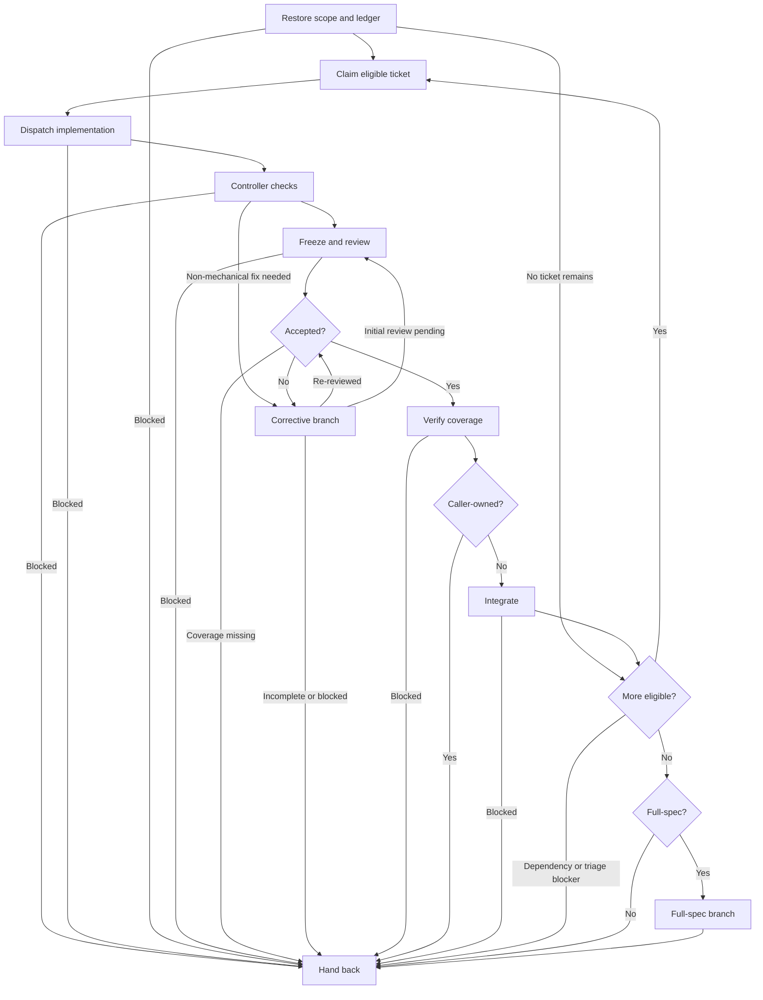

# Subagent-Driven Development

Controller for assigned tickets or dependency graphs; the brief governs. The controller owns scheduling, execution states, acceptance, snapshot freshness, integration, and hand-back. Workers own role workflows and report contracts; assignment templates carry inputs only.

**First action:** Confirm invocation access to `sdd-implementer` and `sdd-reviewer`. Files existing is not proof of access. If access is unavailable or unconfirmed, stop and identify the missing agents. Use the assigned agents, not substitutes.

Only when a concrete risk warrants a specialist, separately confirm the
selected agent is callable in the current harness before dispatch. Catalog
`canReview: true` means eligible, not available; the CLI deliberately does not
check harness access.

| Assignment                                             | Agent               | Required template                             |
| ------------------------------------------------------ | ------------------- | --------------------------------------------- |
| Implementation and batched fixes                       | `sdd-implementer`   | [implementer](./assets/implementer-prompt.md) |
| Initial, corrective, and aggregate Spec/Quality review | `sdd-reviewer`      | [reviewer](./assets/reviewer-prompt.md)       |
| Justified specialist code-review objective             | `sdd-code-reviewer` | The CLI-pinned specialist assignment          |

Read and populate the matching template for every dispatch, omitting sections whose stated condition does not apply. Load and follow the `int-verification-before-completion` skill. The TDD skill remains available when a user or task chooses test-first development, but SDD does not require that method. Use the existing checkout and preserve user changes and report history. Serialize implementation and fixes; freeze implementation edits until the reviewer returns. Only the controller changes execution states. Use the SDD ledger and workflow commands as the execution authority; Markdown remains the requirements, comments, and report record. Workflow commands persist intent and validate gates but never launch agents, execute checks, or mutate Git.

## Controller flow

Announce `Step <node path> - <label path> (ticket <ID>, when applicable)` before each node, including resumed nodes and loop re-entries. State decision results and selected branches. Disclosed sub-flowcharts extend the parent path with dot-separated IDs and `/`-separated labels; include corrective rounds when applicable.

### A. Restore scope and ledger

Read issues/comments, spec, instructions, glossary, and ADRs. Map every criterion to observable outcomes and confirm seams, permissions, baseline, tracker, and canonical `.scratch` destinations. Confirm an acyclic dependency graph. Use `sdd next --spec <path>` or `sdd status --spec <path>` to inspect permitted actions, pending assignments, and blockers without writing state. On resume, use `sdd resume --spec <path> --issue <id> --author <controller>` to restore the recorded gate and assignment; a changed controller must add `--confirm-handoff` only after confirming the prior worker stopped. Restore snapshot, checks, findings, rulings, attempts, and progress decisions without resetting completed work. Preserve earlier reports as history and judge usable coverage rather than discarding it. If no ticket remains, continue at K.

**Complete when:** scope and ownership are explicit, the ledger is current, and required inputs/baseline are available. Resume the recorded gate, or select B for new ticket work and K if no ticket remains; unresolved triage or missing inputs select Q.

### B. Claim eligible ticket

Confirm the issue is ready and all dependencies are integrated. Commit preparation documents, issue/triage updates, and every other checkout change before claiming. Run `sdd claim --spec <path> --issue <id> --author <controller>`; the command rejects staged, unstaged, and untracked changes, records the clean starting commit and controller only on success, and does not change Git state.

**Complete when:** the ledger records one clean-baseline claim with integrated dependencies; proceed to C. A failed claim leaves ownership and baseline unchanged.

### C. Dispatch implementation

Run `sdd implement --spec <path> --issue <id> --author <controller>`. It persists dispatch intent before returning the assignment's role `implementation` and durable absolute report destination. It does not launch an agent. Pass that exact path and the complete assignment inputs to `sdd-implementer`; preserve existing reports and never substitute another destination.

After the worker returns, save and submit its report with `sdd submit --spec <path> --issue <id> --role implementation --report <assigned-path> --author <controller>`. A missing report is not completion; record unavailable output explicitly with `--unavailable --details <reason>`, leaving the assignment pending. If dispatch was interrupted, `implement` or `resume` returns the same recorded assignment instead of allocating another one.

**Complete when:** the report is registered against the expected action and assigned path, allowing D. Missing, stale, failing, or unavailable required handoff evidence selects Q with a blocker.

### D. Controller checks

Apply formatting, then applicable lint, type, and ticket-wide regression checks. Record commands, results, and covered snapshot. Apply safe mechanical fixes only while no worker edits; route non-mechanical fixes through G. Repeat this gate after every fix, including final fixes. Reuse passing evidence that covers the current snapshot; rerun invalidated or explicitly scheduled checks.

**Complete when:** all required checks pass and cover the snapshot, selecting E. Non-mechanical fixes select G; other failed/unavailable checks select Q with a blocker.

### E. Freeze and review

Before preparing the feature review, read [review inputs](./references/review-inputs.md). Use one independent `sdd-reviewer` as the comprehensive default after all feature issues are closed. Add specialist reviewers only for a recorded, justified risk. Before the review snapshot is frozen, register a specialist with `sdd review require --spec <path> --scope delivery --type <agent-name> --details <objective> --author <controller>`. The catalog's `canReview: true` flag limits eligible agent names; the command does not check harness callability, so confirm actual access separately before dispatch.

Run `sdd review` to freeze the snapshot and get one distinct `review` assignment and report path per pinned reviewer. Preserve each assignment's ID, agent, objective, snapshot, inventory, and exact destination; pass those fields without substitution. Give the default reviewer the comprehensive review template and each specialist only its recorded objective plus its own assignment provenance. Submit each exact assignment ID and report path. Acceptance waits for the full recorded batch; a missing, pending, failed, unavailable, stale, or mismatched assignment blocks. The CLI has no default specialist batch or requirement-removal operation.

Wait for its report, reconcile stable finding IDs, and record controller rulings. A demonstrated defect proceeds to correction; missing context or unavailable required review evidence is a blocker, not a clean report.

**Complete when:** the comprehensive report covers Spec and Quality, every recorded specialist objective has distinct current evidence, and findings are ruled on the frozen snapshot, selecting F. Missing/inconsistent review context or unavailable review selects Q after the reviewer returns.

### F. Accepted?

Compare Spec/Quality verdicts, finding dispositions, and controller rulings with the current snapshot. Keep nonblocking recommendations separate from required fixes; park them only with reasons and follow-up. Set `Execution: accepted` only after sufficient current review/check evidence and no unresolved blocker.

**Complete when:** both verdicts `PASS` and no unresolved blocker select H; actionable blocking findings or non-mechanical failures select G with `Execution: changes-requested`. Missing required coverage or `UNVERIFIED` without an actionable fix selects Q. A confirmed finding is not a verified fix; scope changes require triage resolution and fresh affected review.

### G. Corrective branch

When findings or non-mechanical check failures require fixes, read [corrective rounds](./references/corrective-rounds.md) before dispatch. Batch compatible actionable blockers into one assignment; do not cycle through separate code, task, and slop reviews.

**Complete when:** the child exits with a checked snapshot requiring initial reviews (E), current scoped verdicts (F), or an incomplete/blocker result (Q). Announce `Step G - Corrective branch` as resumed, then take that exit without restarting child work.

### H. Verify coverage

Confirm required checks and reviews cover the accepted snapshot; freshness means coverage, not unconditional reruns. Missing, stale, failing, or unavailable required evidence blocks acceptance.

**Complete when:** required evidence is current and sufficient, selecting I; otherwise Q records the blocker.

### I. Caller-owned?

Use the ownership established in A.

**Complete when:** caller-owned tickets select Q; controller-owned delivery selects J.

### J. Integrate

Read [caller-owned integration](./references/integration.md). Run `sdd integrate`
to hand back the exact accepted inventory and pending delivery records. The
caller creates a commit containing only those accepted files, then runs
`sdd integrate --commit <sha>` to verify and record it. Commit the returned
delivery-record changes separately before another claim. The CLI never mutates
Git.

**Complete when:** confirmation records integration, resulting delivery
records are caller-committed, and the checkout is clean before continuing.
Then select K; unsafe pending files or a failed commit verification select Q
with a blocker.

### K. More eligible?

Evaluate the dependency graph and integrated ticket states.

**Complete when:** more eligible tickets select B; a finished graph selects L. Unfinished tickets with no eligible continuation select Q with their dependency or triage blockers.

### L. Full-spec?

Compare the completed delivery with the scope established in A.

**Complete when:** standalone full-spec delivery selects M; other scopes select Q.

### M. Full-spec branch

Read [full-spec delivery](./references/full-spec.md) only after ticket integration.

**Complete when:** the child supplies final evidence and retrospective or an explicit incomplete/blocker result. Announce `Step M - Full-spec branch` as resumed and return to Q without repeating child work.

### Q. Hand back

Return snapshot, criterion-to-evidence mapping, verdicts/rulings, check results, report paths, ticket states, applicable retrospective, and limitations. Preserve checkout and reports; publishing, closing tickets, or deleting user work requires authorization.

**Complete when:** the caller receives current evidence and every unresolved blocker or limitation.
