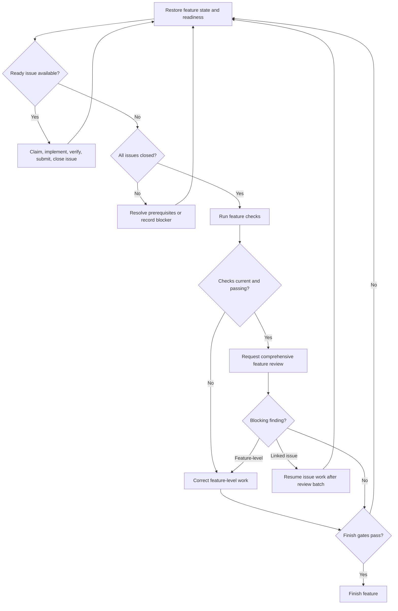

# Subagent-Driven Development

The controller coordinates a feature's issues, workers, checks, reviews, and completion. The feature workspace and `sdd.json` are the source of truth for structured issue and delivery state; each issue Markdown file holds its requirements, acceptance criteria, and discussion.

Use the existing checkout and preserve user changes and report history. TDD is optional; write appropriate tests and record verification evidence. Load and follow `int-verification-before-completion` before claiming work is complete. Serialize implementation and fixes, and keep implementation edits frozen while a review batch is running.

## Workflow map

Before acting on each chart node, announce `Step <node ID> - <node label>`, including initial entries, resumed steps, and loop re-entries. After each decision, state its result and selected branch before entering the target node.

## Issue workflow

1. Read the feature spec, issues, applicable instructions, glossary, and ADRs. Inspect `sdd status --spec <path>` and `sdd ready --spec <path>` to understand blockers, dependencies, and available work.
2. Create an issue for independently actionable work. Use `sdd issue update` for tracker status, explicit blockers, and dependencies; the supported lifecycle is `open`, `in-progress`, and `closed`. Readiness is derived from status, blockers, and dependencies rather than stored as a separate triage state.
3. Claim a ready issue with `sdd claim`. Dispatch implementation with `sdd implement`; pass the worker the exact assignment and report destination. Submit its report with `sdd submit --role implementation`.
4. Run relevant tests and checks and record their actual outcomes against the current snapshot. TDD is not required, but verification is.
5. Address implementation and verification gaps, then close the issue with `sdd issue update --status closed` once its acceptance criteria are met. Do not use per-issue accept or integrate steps.

If work is interrupted, inspect `sdd status` and use `sdd resume` to restore the recorded assignment. Preserve existing reports, findings, and evidence. Do not invent missing results or reset progress.

## Feature review and completion

After every issue is closed, establish current feature-level checks and request the comprehensive review with `sdd review --scope delivery --inventory <json-array>`. The `sdd-reviewer` is the default reviewer. Add specialists only for justified objectives with `sdd review require --scope delivery --type <agent-name>`; eligible names must be marked `canReview: true` in the Blueprint Catalog, and actual agent access must be confirmed before dispatch.

Submit every assigned review report against its exact assignment. Register findings from their report and snapshot. A blocking finding can name `--related-issue`; once the complete review batch is submitted, that issue is reopened so work can resume. Resolve blocking findings through issue work and repeat any invalidated checks and reviews.

For detailed review, findings, correction, and finish steps, read [feature delivery](./references/full-spec.md). For feature-level corrective work, follow [corrective rounds](./references/corrective-rounds.md). Feature completion requires all issues closed, current passing required checks and reviews, and no unresolved delivery blockers. Use the normal Git workflow; SDD does not stage, commit, or publish work and has no per-issue integration command.

## Reports and verification

Keep worker reports at their assigned absolute paths inside the feature's `reports/` directory. Preserve earlier reports as history and distinguish inspected evidence from checks actually run. Record failures, unavailable checks, and limitations explicitly. A passing test run is not a substitute for review or for the acceptance criteria.

See [verification evidence](./references/verification-evidence.md) for the worker handoff contract.
