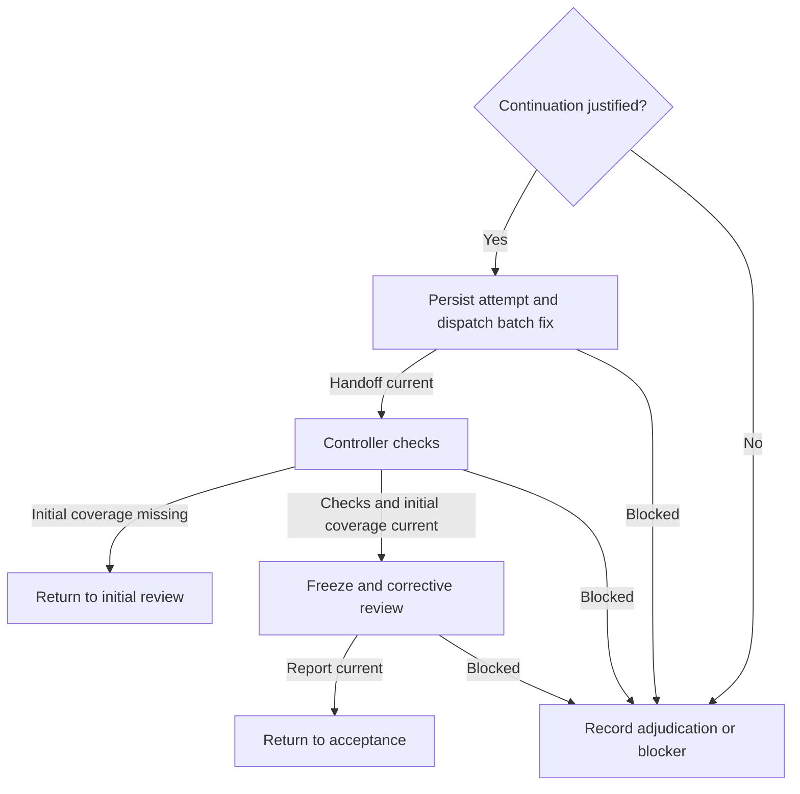

# Progress-based corrections

Parent: G - Corrective branch. Enter when review identifies actionable blockers or controller checks require a non-mechanical fix. Restore findings, attempts, rulings, and the recorded gate before acting. Attempt numbers identify history, not a fixed retry budget.

## Continuation decision

Apply this policy to ticket and delivery corrections. Issue 08 establishes the
issue-scoped correction lifecycle and evidence contracts. Issue 10 introduces
delivery-scoped operations and must reuse those contracts while keeping
delivery attempts, rulings, and evidence history independent from issue
history. Before dispatch, record the selected finding IDs or concrete check
failure, prior attempt outcome, demonstrated progress, and explicit controller
continuation decision. For a first fix, record the actionable correction
objective; for later fixes, cite verified blockers resolved or other concrete
progress supported by current checks/review.

Issue 08's current CLI implements `correct` with `--issue`. Delivery scope is
the follow-up in issue 10; its not-yet-implemented commands must not be
simulated by routing delivery findings through an arbitrary issue or reusing
issue attempts, adjudications, or evidence.

For issue scope, the first dispatch may use:

```sh
just spindle::run sdd correct --spec <absolute-spec-path> --issue I-0001 --findings F-0001 --details "<correction objective>" --author controller
```

Later attempts require `--decision continue --assessment "<demonstrated progress>" --assessment-result productive`. An explicit pause uses `--decision pause --reason <supported-reason> --details "<adjudication needed>"`. A check-driven fix uses `--check-failure "<exact recorded command>"` instead of `--findings`.

Repeated failed fixes, recurring blockers, no demonstrated progress, or disagreement about requirements pause for controller/user adjudication rather than another automatic dispatch. Record residual blockers and the specific decision needed. Requirement ambiguity returns to current triage (`needs-info` or `needs-triage`) while preserving the execution gate; technical inability uses the project's blocked state. An adjudication may authorize a materially revised plan, but cannot weaken acceptance or silently reset attempts.

Batch compatible confirmed blockers into one implementer assignment, including their required regression tests. Keep one checks gate and one comprehensive scoped review per checked fix. Reuse passing unaffected evidence; do not rerun all reviews or checks by default. A broadened contract or invalidated requirements/coverage needs expanded affected review, not an assertion that a narrow fix report covers everything.



Child IDs are local to this diagram: announce `Step G.<ID> - Corrective branch / <label>` before acting, for example `Step G.A - Corrective branch / Continuation justified?`. R returns to parent E, F to parent F, and X to parent Q. Before returning, announce `Step G - Corrective branch` as resumed, state the exit, and do not restart completed child work.

## A. Continuation justified?

Apply the continuation decision above. Do not use a five-round cap or permit blind retries.

**Complete when:** an explicit supported continuation selects G.B; stalled progress, requirements disagreement, or unavailable prerequisites selects G.X with the decision/blocker recorded.

## B. Persist attempt and dispatch batch fix

Persist the next attempt before dispatching `sdd-implementer` in corrective mode with the [implementer template](../assets/implementer-prompt.md). Supply all compatible selected blockers, prior attempts, rulings, and fresh scope/permissions using [corrective inputs](implementer-corrections.md). Assign a distinct round-specific review destination and append fix evidence to the implementation report. Set `Execution: implementing` and serialize edits.

**Complete when:** the handoff and required passing focused tests identify the fixed snapshot, selecting G.C; missing/failing required evidence selects G.X. Resume an interrupted assignment rather than allocating another attempt.

## C. Controller checks

Perform parent D once for the checked fix, rerunning invalidated or explicitly scheduled checks. Record the initial review coverage still applicable to the fixed snapshot.

**Complete when:** passing checks with missing initial coverage select G.R; passing checks with complete initial coverage select G.D; unresolved failures select G.X. Further non-mechanical fixes require a new recorded continuation decision, not an untracked edit loop.

## D. Freeze and corrective review

Freeze the fixed snapshot and set `Execution: in-review`. Read [review inputs](review-inputs.md) and populate the [reviewer template](../assets/reviewer-prompt.md) in `CORRECTIVE` mode with fix-only changes, prior/fixed identities, every selected finding verbatim, prior verdicts/rulings, initial coverage, and fresh covering checks. Dispatch `sdd-reviewer` once. Expand affected scope only when contracts or coverage changed; preserve justified unaffected evidence.

**Complete when:** the report accounts for each assigned finding and fix-induced regressions and records current scoped verdicts, selecting G.F; missing/unavailable review selects G.X. Unresolved actionable findings return through parent F for the next progress decision.

## R. Return to initial review

Record the checked snapshot and missing initial coverage. A check-driven correction before initial review must still receive a comprehensive initial review.

**Complete when:** missing coverage is explicit; resume parent G and return to E.

## F. Return to acceptance

Record finding dispositions, controller rulings, affected verdicts, and progress from the checked fix.

**Complete when:** current evidence and unaffected coverage are accounted for; resume parent G and return to F.

## X. Record adjudication or blocker

Preserve working changes, reports, attempt numbers, findings, and current gate. State the missing evidence, stalled correction, or requirement decision; do not dispatch another worker or reset history.

**Complete when:** the next required decision or blocker is explicit; resume parent G and return to Q.
