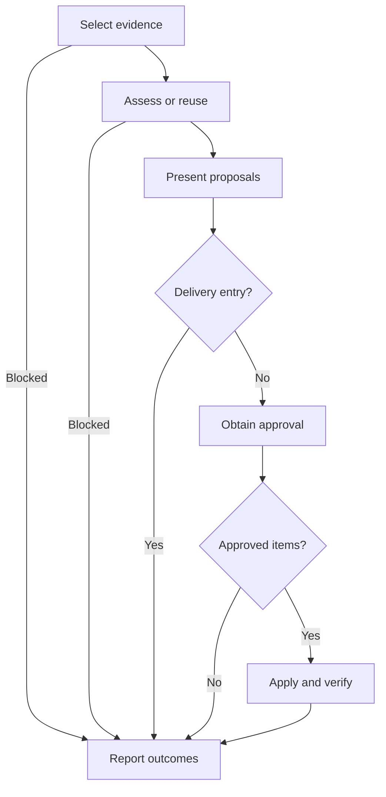

# Retrospective

Capture evidence-backed improvements to the agent environment and domain model. The controller coordinates; a fresh, read-only reader assesses.

## Arguments

Required value-taking flag `--entry` / `-E` selects `delivery` or `maintainer`, with identical behavior and no default. Optional trailing task text supplies the session selection, proposal-report pointer or delivery evidence context. With no task text, maintainer uses the current session; delivery still requires its evidence pointers.

- `delivery`: after final verification, once for the full spec or standalone ticket, never per ticket within a spec. Supply delivery evidence pointers. This path records proposals and applies nothing, even when asked to apply them.
- `maintainer`: optional session selection (defaults to the current session) and optional proposal-report pointer. This path obtains item-level approval before applying changes.

Parse only the leading option prefix. Recognize exact, case-sensitive `--entry` and `-E` tokens; consume the next token as the value. `--` ends option parsing and is removed. Otherwise the first non-option token starts task text: preserve everything after it unchanged, including later flag-like text, removing only separating whitespace.

Before workflow actions, explain invalid input and request correction: missing entry or value, a value other than `delivery` or `maintainer`, unknown leading flags, repeated options (including aliases or conflicting values), bundled aliases, or equals-form options such as `--entry=delivery`. Another option where a value is required is a missing-value error.

Calling skills supply arguments explicitly, for example `--entry maintainer`. Structured caller input `entry: maintainer` is equivalent; validate the same entry values and required presence without reconstructing a command string. Any supplied raw argument string follows the parsing rules above. Conversational mentions do not select an entry.

## Workflow

Before acting on each node, announce `Step <node ID> - <node label>`. Announce resumed steps and loop re-entries. After each decision, state its result and selected branch before entering the next node. Validate arguments before entering A.

### A. Select evidence

For delivery, list the spec or brief, every ticket and its `## Comments` log, starting and final revisions, and final review. For maintainer, locate primary sources for the selected session, including relevant local session logs. Start from a supplied report or the work's existing dated `retrospective.md` when available. Include applicable glossary, ADR and instruction pointers.

**Complete when:** the selected entry and accessible sources are explicit, selecting B; unavailable required sources select H with a blocker. Session sources need not contain delivery artifacts; state genuine evidence gaps.

### B. Assess or reuse

Reuse an existing report only after checking its cited evidence still covers the selected work and its proposals satisfy the [report contract](./assets/retrospective-prompt.md#required-report). Otherwise fill the [reader contract](./assets/retrospective-prompt.md) for one fresh read-only subagent that did not participate in the assessed work. Include Required Reader Skills unchanged. Both entries use the same assessment prompts and proposal contract.

**Complete when:** an evidence-current, contract-compliant report is available, selecting C; required reader skills were confirmed for fresh assessment. Missing prerequisites select H with a blocker, not a completed assessment.

### C. Present proposals

Rank by impact and show stable IDs with their evidence and verification criteria. Delivery writes `.scratch/YYYY-MM-DD-<feature-slug>/retrospective.md` in the work's existing dated directory. Maintainer presents the report; reuse that destination when one exists, otherwise present in chat.

**Complete when:** proposals (or "None") and assessment limitations are visible, selecting D; delivery's report exists and no environment or domain files have changed.

### D. Delivery entry?

Evaluate the validated entry.

**Complete when:** `delivery` selects Yes and H; `maintainer` selects No and E. Delivery never enters approval or application.

### E. Obtain approval

Ask for approval by proposal ID, recording approved, declined and pending items. A blanket "just apply it" is a request to review: list proposals for item-level approval and wait in E. On the response, resume E. Resolve approved domain proposals with the maintainer through `int-domain-modeling`; unresolved decisions remain pending.

**Complete when:** the item-level response is recorded and approved IDs, targets and any domain decisions are explicit, selecting F. An empty proposal list proceeds to F without an approval request.

### F. Approved items?

Check for individually approved items whose targets and required domain decisions are settled.

**Complete when:** at least one actionable approved item selects Yes and G; none selects No and H. Unresolved items remain pending.

### G. Apply and verify

Change only approved targets. Load `int-writing-for-agents` for agent-facing writing, `int-writing-instruction` for workspace instructions, `int-writing-skills` for skills, and `int-testing-agent-guidance` for behavior-shaping guidance validation. Instruction briefs are not validated files. Use existing repository tooling for checks and test each proposal against its recorded criterion.

**Complete when:** each actionable approved item has an applied change and passing evidence, or an explicit blocker/unverified result, selecting H.

### H. Report outcomes

Delivery hands the report path and pending proposals to the maintainer and stops without applying changes. Maintainer reports applied, declined and pending IDs, verification evidence and limitations; update an existing proposal report without overwriting its evidence. A blocked assessment reports missing prerequisites instead of claiming completion. Commit or publish only when requested.

**Complete when:** the caller has the report or explicit blocker, proposal statuses and applicable verification results; stop.
