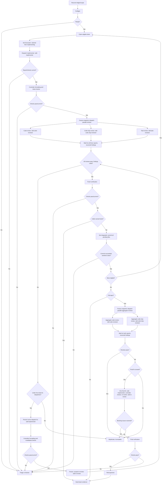

# Subagent-Driven Development

**First action:** Check the available subagent definitions and invocation tools for access to all five required subagents: `sdd-implementer`, `sdd-code-reviewer`, `sdd-code-slop-reviewer`, `sdd-task-reviewer`, and `sdd-re-review`. Their files existing is not proof that they are callable. If any access is unavailable or cannot be confirmed, stop and tell the user exactly which required agents are unavailable or unconfirmed; do not start the controller flow, substitute other agents, or perform their work yourself. Continue only when invocation access to all five is confirmed.

Controller for assigned tickets or dependency graphs; the brief governs. The controller owns dispatch, state, review, integration, and hand-back.

**Every subagent dispatch MUST use its matching assignment template:** read it, fill every field, and send the populated template. Agent definitions own workflows and report contracts; templates carry assignment inputs only.

| Assignment                                          | Required agent                                                         | Template                                         |
| --------------------------------------------------- | ---------------------------------------------------------------------- | ------------------------------------------------ |
| Implementation and all fixes, including final fixes | [sdd-implementer](../../agents/sdd-implementer.agent.md)               | [implementer](implementer-prompt.md)             |
| Initial and final aggregate code review             | [sdd-code-reviewer](../../agents/sdd-code-reviewer.agent.md)           | [code-review](code-reviewer-prompt.md)           |
| Initial and final aggregate code-slop review        | [sdd-code-slop-reviewer](../../agents/sdd-code-slop-reviewer.agent.md) | [code-slop-review](code-slop-reviewer-prompt.md) |
| Task-scoped Spec and Quality review                 | [sdd-task-reviewer](../../agents/sdd-task-reviewer.agent.md)           | [task-review](task-reviewer-prompt.md)           |
| Scoped corrective-round re-review                   | [sdd-re-review](../../agents/sdd-re-review.agent.md)                   | [re-review](re-review-prompt.md)                 |

**Required skills:** `int-test-driven-development`, `int-verification-before-completion`, and `int-retrospective` for standalone full-spec delivery.

## Operating rules

- Use the existing checkout; preserve user changes. Serialize implementation and fixes; dispatch independent reviews in parallel. Coordinate shared-file ownership and freeze implementation edits until every reviewer has returned.
- The controller alone changes execution states and decides acceptance. Workers edit only assigned files and preserve report history.
- On resume, restore the ledger, snapshot, dependencies, checks, findings, rulings, and round counters. Resume at that gate; never reset budgets.

## Controller flow

On entering each flowchart node, announce the current step to the user before acting: `Step <node ID> — <node label> (ticket <ID>, when applicable)`. Announce resumed steps and loop re-entries too; include the corrective round when applicable. For decision nodes, state the result and selected branch once evaluated, before moving to the next node. For example: `Step H — Freeze; code review (ticket 03)`.



Dispatch code review, code-slop review, and task review in parallel against the same frozen snapshot and verification evidence using the assigned agents above. Give each reviewer a distinct report path and the prior findings and rulings available at dispatch. For same-batch review reports that do not yet exist, explicitly state `NONE — parallel review pending`; no reviewer waits for another reviewer's output. Wait for all three reports, reconcile findings and controller rulings, and only then evaluate acceptance or dispatch fixes. A failed or unavailable review blocks the gate; it does not permit edits while other reviewers are still running. For full-spec delivery, run aggregate code and code-slop reviews in parallel with the same snapshot, separate reports, and wait-for-all barrier.

Preflight: read tickets/comments, spec, instructions, glossary, and ADRs; map criteria to observable outcomes and confirm seams; ensure the graph is acyclic and dependencies integrated; preserve checkout; confirm baseline, permissions, tracker, and dated `.scratch` reports.

## Resolve report destinations

Resolve each worker's durable report destinations directly through Spindle:

```sh
spindle sdd workspace --workspace /absolute/checkout \
  --reports-dir .scratch/YYYY-MM-DD-feature/reports --ticket 03
```

Add `--round <R>` for a corrective review. The JSON result provides the checkout, reports directory, and absolute and checkout-relative destinations for implementation, code review, task review, optional scoped review, final review, and final fix review. This command is read-only: it does not create directories or reports, overwrite existing report contents, or change Git state. Preserve report history and coordinate shared-file edits when writing to the resolved paths.

Spindle workflow commands are invoked directly, not through Just wrappers.

Missing or stale checks block acceptance. Integrate only when verification and review match the snapshot. Cap corrective dispatches at five per ticket across reviews; persist each round and never dispatch round six. Full-spec delivery allows one final-fix dispatch and scoped re-review.

The controller owns the mechanical gate: after implementer handoff, apply project formatting, then run applicable lint, type, and ticket-wide regression checks before freezing the snapshot for review. Record commands, results, and the checked snapshot. Apply safe mechanical fixes directly while no worker is editing; dispatch non-mechanical corrections through the existing fix budget. Complete this gate after every fix, including final fixes, before re-review. Failed or unavailable required checks block review and acceptance. Reuse passing evidence that covers the current snapshot; rerun only invalidated checks or those explicitly required by the check plan. Final verification confirms this coverage, not an unconditional rerun.

Before starting the next ticket, the controller must stage and commit all pending files, including tracked and untracked files and formatting or linting changes outside the completed ticket's scope. Preserve existing file contents when staging; scope alone is not a reason to defer a file. Proceed only after the commit succeeds and the worktree is clean; if already clean, no empty commit is needed. If any pending file cannot safely be committed or the commit fails, stop and report the blocker instead of starting the next ticket. Workers follow assigned commit permissions.

## Hand-back

Hand back snapshot, evidence mapping, verdicts/rulings, check results, report paths, ticket states, retrospective, and limitations. Keep blockers explicit; do not publish, close tickets, or delete user work without authorization.
