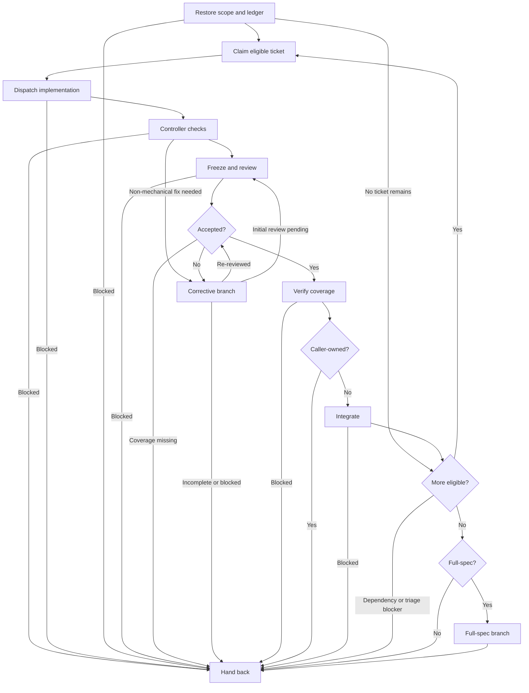

# Subagent-Driven Development

Controller for assigned tickets or dependency graphs; the brief governs. The controller owns scheduling, execution states, acceptance, snapshot freshness, integration, and hand-back. Workers own role workflows and report contracts; assignment templates carry inputs only.

**First action:** Confirm invocation access to all five agents below. Files existing is not proof of access. If any access is unavailable or unconfirmed, stop and identify those agents; continue only when all five are callable. Use the assigned agents, not substitutes.

| Assignment                   | Agent                    | Required template                                |
| ---------------------------- | ------------------------ | ------------------------------------------------ |
| Implementation and fixes     | `sdd-implementer`        | [implementer](assets/implementer-prompt.md)      |
| Code review                  | `sdd-code-reviewer`      | [code-review](assets/code-reviewer-prompt.md)    |
| Code-slop review             | `sdd-code-slop-reviewer` | [code-slop](assets/code-slop-reviewer-prompt.md) |
| Task Spec and Quality review | `sdd-task-reviewer`      | [task-review](assets/task-reviewer-prompt.md)    |
| Scoped re-review             | `sdd-re-review`          | [re-review](assets/re-review-prompt.md)          |

Read and populate the matching template for every dispatch, omitting sections whose stated condition does not apply. Load and follow the `int-test-driven-development` skill and the `int-verification-before-completion` skill. Use the existing checkout and preserve user changes and report history. Serialize implementation and fixes; freeze implementation edits until every dispatched reviewer returns. Only the controller changes execution states.

## Controller flow

Announce `Step <node path> - <label path> (ticket <ID>, when applicable)` before each node, including resumed nodes and loop re-entries. State decision results and selected branches. Disclosed sub-flowcharts extend the parent path with dot-separated IDs and `/`-separated labels; include corrective rounds when applicable.

### A. Restore scope and ledger

Read tickets/comments, spec, instructions, glossary, and ADRs. Map every criterion to observable outcomes and confirm seams, permissions, baseline, tracker, and dated `.scratch` destinations. Confirm an acyclic dependency graph. Restore snapshot, checks, findings, rulings, counters, and recorded gate on resume; continue there rather than restarting completed work. If no ticket remains, continue at K.

**Complete when:** scope and ownership are explicit, the ledger is current, and required inputs/baseline are available. Resume the recorded gate, or select B for new ticket work and K if no ticket remains; unresolved triage or missing inputs select Q.

### B. Claim eligible ticket

Claim only a ticket whose dependencies are integrated. Set `Execution: claimed`.

**Complete when:** one eligible ticket is claimed and its dependencies are integrated; proceed to C.

### C. Dispatch implementation

Set `Execution: implementing`. Resolve report destinations with `spindle sdd workspace --workspace <absolute-checkout> --reports-dir <dated-reports-dir> --ticket <ID>`. This read-only command returns absolute and checkout-relative paths; it does not create reports. Spindle workflow commands are invoked directly, not through Just wrappers.

Populate the implementer assignment in initial mode and dispatch `sdd-implementer`. Wait for its report.

**Complete when:** the implementation report identifies the assigned changes and current focused-test evidence, allowing D. Missing, stale, failing, or unavailable required handoff evidence selects Q with a blocker.

### D. Controller checks

Apply formatting, then applicable lint, type, and ticket-wide regression checks. Record commands, results, and covered snapshot. Apply safe mechanical fixes only while no worker edits; route non-mechanical fixes through G. Repeat this gate after every fix, including final fixes. Reuse passing evidence that covers the current snapshot; rerun invalidated or explicitly scheduled checks.

**Complete when:** all required checks pass and cover the snapshot, selecting E. Non-mechanical fixes select G; other failed/unavailable checks select Q with a blocker.

### E. Freeze and review

Before preparing review assignments, read [review inputs](references/review-inputs.md). Supply the same frozen change and verification evidence to `sdd-code-reviewer`, `sdd-code-slop-reviewer`, and `sdd-task-reviewer` **in parallel**, with distinct report paths. Existing durable inputs may be referenced rather than copied. For unavailable same-batch reports use `NONE - parallel review pending`; reviewers do not wait for peers.

Wait for all three reports before reconciling findings and controller rulings. Failed/unavailable reviews block this gate while implementation remains frozen.

**Complete when:** every required review has returned for the frozen snapshot and every finding is ruled, selecting F. Failed/unavailable reviews select Q with a blocker only after all dispatched reviewers return.

### F. Accepted?

Compare all required verdicts, findings, and controller rulings with the current snapshot.

**Complete when:** passing reviews and no unresolved blocker select H; remaining findings select G. Missing required review coverage remains blocked rather than accepted.

### G. Corrective branch

When findings or non-mechanical check failures require fixes, read [corrective rounds](references/corrective-rounds.md) before dispatch.

**Complete when:** the child exits with a checked snapshot requiring initial reviews (E), current scoped verdicts (F), or an incomplete/blocker result (Q). Announce `Step G - Corrective branch` as resumed, then take that exit without restarting child work.

### H. Verify coverage

Confirm required checks and reviews cover the accepted snapshot; freshness means coverage, not unconditional reruns. Missing, stale, failing, or unavailable required evidence blocks acceptance.

**Complete when:** required evidence is current and sufficient, selecting I; otherwise Q records the blocker.

### I. Caller-owned?

Use the ownership established in A.

**Complete when:** caller-owned tickets select Q; controller-owned delivery selects J.

### J. Integrate

Read [integration](references/integration.md) before changing integration state or committing.

**Complete when:** integration succeeds with a clean worktree, selecting K; unsafe pending files or failed commits select Q with a blocker.

### K. More eligible?

Evaluate the dependency graph and integrated ticket states.

**Complete when:** more eligible tickets select B; a finished graph selects L. Unfinished tickets with no eligible continuation select Q with their dependency or triage blockers.

### L. Full-spec?

Compare the completed delivery with the scope established in A.

**Complete when:** standalone full-spec delivery selects M; other scopes select Q.

### M. Full-spec branch

Read [full-spec delivery](references/full-spec.md) only after ticket integration.

**Complete when:** the child supplies final evidence and retrospective or an explicit incomplete/blocker result. Announce `Step M - Full-spec branch` as resumed and return to Q without repeating child work.

### Q. Hand back

Return snapshot, criterion-to-evidence mapping, verdicts/rulings, check results, report paths, ticket states, applicable retrospective, and limitations. Preserve checkout and reports; publishing, closing tickets, or deleting user work requires authorization.

**Complete when:** the caller receives current evidence and every unresolved blocker or limitation.
