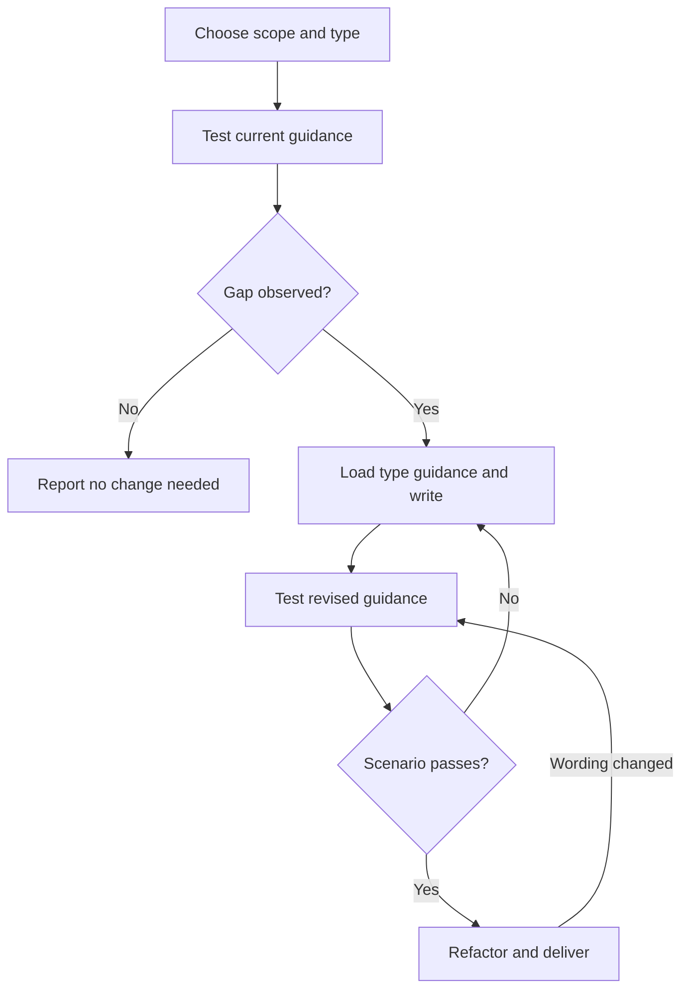

# Writing Skills

Author reusable guidance by testing the current behavior, addressing the observed gap, and retesting. This is an Interactive skill.

**REQUIRED:** Use `int-writing-for-agents` for agent-facing writing and `int-testing-agent-guidance` for test execution. Read the former's `SKILL-MECHANICS.md` when choosing invocation or designing a router.

## Authoring flow

On entering each node, announce `Step <node ID> - <node label>` before acting. Announce resumed steps and loop re-entries; state each decision result and selected branch. For nested flowcharts, use the [hierarchical announcement protocol](./references/interactive-skills.md#flowchart-protocol).



Complete each phase before continuing; track its applicable completion criteria as todos.

### A. Choose scope and type

A skill teaches a reusable capability. Put project conventions in instructions, one-off solutions in the task, and mechanically enforceable rules in tooling.

Choose the primary type:

- **Interactive:** ordered actions with completion criteria and progressively disclosed supporting material. Human input is required only where requested.
- **Reference:** knowledge consulted and applied as needed, organized for lookup. Examples and short procedures may support it.

Mixed content chooses its primary purpose, not a third type. Type is independent of visibility and invocation.

**Internal visibility:** name internal skills with `int-` and use exactly this description, instead of discovery triggers:

```text
This is an internal skill do not load it unless explicitly required by the user or another skill.
```

An internal skill is like a private method or class: a primary skill pulls it in at an explicit disclosure point. It may be Interactive or Reference and may have only one caller. Keep invocation by another skill available; `user-invocable: false` hides the slash command without disabling that route.

For non-internal, model-discoverable skills, start descriptions with "Use when..." and name concrete triggers, not workflow. Human-only skills use `disable-model-invocation: true` and a human-facing description. Follow the [Agent Skills specification](https://agentskills.io/specification): use a lowercase, hyphenated name matching its directory, a description of at most 1,024 characters, and repository version metadata.

Apply **DRY**: keep each meaning authoritative in one place; reuse existing guidance through explicit pointers. Apply **YAGNI**: include only what the requested capability needs. Internal skills enable disclosure, not speculative abstractions.

**Complete when:** reusable scope, primary type, visibility, invocation, and relevant prior art are explicit.

### B. Test current guidance

Before drafting or editing, read [Testing skills](./references/testing-skills.md) and run the baseline. **No skill without a failing test first.** If drafted before RED, discard the draft and restart from the baseline.

**Complete when:** a frozen scenario, observable criterion, and baseline result are recorded.

### C. Gap observed?

Compare the recorded behavior with the criterion. A specific failure selects Yes and D; a passing baseline selects No and H.

**Complete when:** the result and selected branch are explicit.

### D. Load type guidance and write

Load only the selected branch:

- **Interactive:** read [Interactive skills](./references/interactive-skills.md).
- **Reference:** read [Reference skills](./references/reference-skills.md).

Use the matching template named there for every new skill. For existing skills, adopt its structure only where relevant to the requested edit. Address the observed gap using the guidance form selected during testing.

Store skills at `.github/skills/<skill-name>/SKILL.md`, keeping the skill directory flat. Use bundled resources deliberately:

```text
skill-name/
├── SKILL.md
├── references/    - documentation loaded when needed
└── assets/        - templates and other files used in output
```

Keep the common path inline; disclose branch-specific material through conditional pointers. Internal skills are another disclosure boundary when explicitly invoked guidance is appropriate.

**Complete when:** the selected structure is filled, references resolve, each retained section has a distinct purpose, and no placeholder remains.

### E. Test revised guidance

Rerun the same frozen scenario in a fresh context using the `int-testing-agent-guidance` skill and the selected criteria in [Testing skills](./references/testing-skills.md).

**Complete when:** revised behavior and any remaining failures are recorded.

### F. Scenario passes?

Compare observed behavior with the unchanged criterion. An unresolved failure selects No and D for a targeted correction; a passing scenario selects Yes and G.

**Complete when:** evidence supports the stated result and selected branch.

### G. Refactor and deliver

Prune duplication, stale material, and speculative rules. Retest after wording changes. Verify frontmatter, relative links, resource packaging, and any required version bump. Run expanded testing only when requested, including `--test`.

**Complete when:** final validation passes or limitations are explicit, and the change is ready for authorized delivery. Commit, push, or open a PR only when requested.

### H. Report no change needed

Leave passing behavior unchanged. Report the scenario and evidence without inventing a gap.

**Complete when:** the user has the baseline result and reason no revision is needed.
